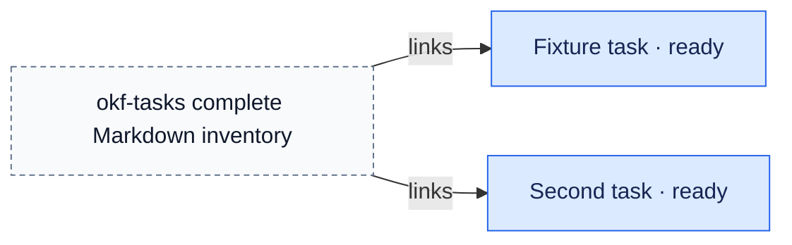
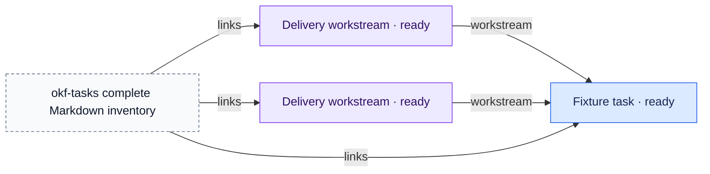
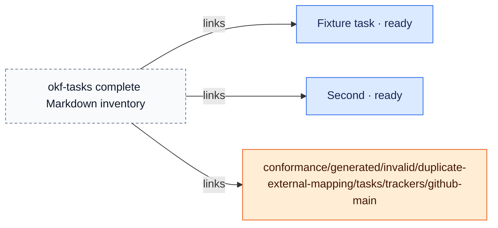

# okf-tasks

> Generated from repository-local OKF records. The Markdown/YAML bundle remains canonical.

Source: `.`

The report separates the connected repository map from detailed component and key-concept views so large bundles remain reviewable.

## Connected-area overview

```mermaid
flowchart LR
    a0["conformance/generated/exports/file-uri/repo · 1 concepts"]
    a1["conformance/generated/exports/github-relative/repo · 1 concepts"]
    a2["conformance/generated/exports/gitlab-relative/repo · 1 concepts"]
    a3["conformance/generated/exports/home-path/repo · 1 concepts"]
    a4["conformance/generated/exports/insecure-http/repo · 1 concepts"]
    a5["conformance/generated/exports/missing-link/repo · 1 concepts"]
    a6["conformance/generated/exports/outside-link/repo · 1 concepts"]
    a7["conformance/generated/exports/posix-path/repo · 1 concepts"]
    a8["conformance/generated/exports/remote-image/repo · 1 concepts"]
    a9["conformance/generated/exports/secret-link/repo · 1 concepts"]
    a10["conformance/generated/exports/secret/repo · 1 concepts"]
    a11["conformance/generated/exports/untrusted-instructions/repo · 1 concepts"]
    a12["conformance/generated/exports/windows-path/repo · 1 concepts"]
    a13["conformance/generated/invalid/closed-missing-effort · 1 concepts"]
    a14["conformance/generated/invalid/disconnected-durable-links · 2 concepts"]
    a15["conformance/generated/invalid/done-active-workstream · 2 concepts"]
    a16["conformance/generated/invalid/done-running-time · 1 concepts"]
    a17["conformance/generated/invalid/duplicate-active-branch · 3 concepts"]
    a18["conformance/generated/invalid/duplicate-external-mapping · 3 concepts"]
    a19["conformance/generated/invalid/duplicate-running-combination · 1 concepts"]
    a20["conformance/generated/invalid/external-missing-fields · 1 concepts"]
    a21["conformance/generated/invalid/incomplete-status-map · 2 concepts"]
    a22["conformance/generated/invalid/invalid-completion-history · 1 concepts"]
    a23["conformance/generated/invalid/invalid-estimate · 1 concepts"]
    a24["conformance/generated/invalid/invalid-frontmatter-formatting · 1 concepts"]
    a25["conformance/generated/invalid/invalid-navigation-role · 1 concepts"]
    a26["conformance/generated/invalid/invalid-points · 1 concepts"]
    a27["conformance/generated/invalid/invalid-portable-field · 1 concepts"]
    a28["conformance/generated/invalid/invalid-task-level-sync · 1 concepts"]
    a29["conformance/generated/invalid/invalid-task-slug · 1 concepts"]
    a30["conformance/generated/invalid/invalid-task-timestamp · 1 concepts"]
    a31["conformance/generated/invalid/lossy-tracker-authority · 2 concepts"]
    a32["conformance/generated/invalid/missing-index · 1 concepts"]
    a33["conformance/generated/invalid/missing-task-field · 1 concepts"]
    a34["conformance/generated/invalid/missing-task-heading · 1 concepts"]
    a35["conformance/generated/invalid/missing-time-activity · 1 concepts"]
    a36["conformance/generated/invalid/missing-tracker-profile · 1 concepts"]
    a37["conformance/generated/invalid/multiple-default-trackers · 3 concepts"]
    a38["conformance/generated/invalid/running-with-closed-fields · 1 concepts"]
    a39["conformance/generated/invalid/stale-index · 1 concepts"]
    a40["conformance/generated/invalid/unknown-task-status · 1 concepts"]
    a41["conformance/generated/invalid/unknown-time-activity · 1 concepts"]
    a42["conformance/generated/invalid/unknown-time-method · 1 concepts"]
    a43["conformance/generated/invalid/workstream-missing-created · 2 concepts"]
    a44["conformance/generated/invalid/workstream-parent-mismatch · 2 concepts"]
    a45["conformance/generated/valid/broken-relationships-warning · 1 concepts"]
    a46["conformance/generated/valid/docs-placement/docs · 1 concepts"]
    a47["conformance/generated/valid/excluded-volatile-concepts · 2 concepts"]
    a48["conformance/generated/valid/full-task · 2 concepts"]
    a49["conformance/generated/valid/reopened-history · 1 concepts"]
    a50["conformance/generated/valid/time-methods · 1 concepts"]
    a51["conformance/generated/valid/unedited-skeleton-warning · 1 concepts"]
    a52["conformance/generated/valid/unique-external-mappings · 4 concepts"]
    a53["conformance/generated/valid/unknown-concept · 2 concepts"]
    a54["conformance/generated/valid/workstream · 2 concepts"]
    a55["conformance/invalid/bad-time-rollup · 1 concepts"]
    a56["conformance/valid/minimal · 1 concepts"]
    a57["docs · 8 concepts"]
    a58["examples · 122 concepts"]
    a59["examples/architecture-knowledge-base · 6 concepts"]
    a60["examples/combined-delivery-architecture · 51 concepts"]
    a61["examples/complex-task-portfolio · 45 concepts"]
    a62["examples/knowledge-linked · 1 concepts"]
    a63["examples/many-to-many-clickup · 2 concepts"]
    a64["examples/project-docs/docs · 1 concepts"]
    a65["examples/standalone · 1 concepts"]
    a66["examples/tracker-synchronised · 2 concepts"]
    a67["examples/visualization · 5 concepts"]
    a68["repository root · 4 concepts"]
    a69["tasks · 1 concepts"]
    a57 -->|links| a0
    a57 -->|links| a1
    a57 -->|links| a2
    a57 -->|links| a3
    a57 -->|links| a4
    a57 -->|links| a5
    a57 -->|links| a6
    a57 -->|links| a7
    a57 -->|links| a8
    a57 -->|links| a9
    a57 -->|links| a10
    a57 -->|links| a11
    a57 -->|links| a12
    a57 -->|links| a13
    a57 -->|links| a14
    a57 -->|links| a15
    a57 -->|links| a16
    a57 -->|links| a17
    a57 -->|links| a18
    a57 -->|links| a19
    a57 -->|links| a20
    a57 -->|links| a21
    a57 -->|links| a22
    a57 -->|links| a23
    a57 -->|links| a24
    a57 -->|links| a25
    a57 -->|links| a26
    a57 -->|links| a27
    a57 -->|links| a28
    a57 -->|links| a29
    a57 -->|links| a30
    a57 -->|links| a31
    a57 -->|links| a32
    a57 -->|links| a33
    a57 -->|links| a34
    a57 -->|links| a35
    a57 -->|links| a36
    a57 -->|links| a37
    a57 -->|links| a38
    a57 -->|links| a39
    a57 -->|links| a40
    a57 -->|links| a41
    a57 -->|links| a42
    a57 -->|links| a43
    a57 -->|links| a44
    a57 -->|links| a45
    a57 -->|links| a46
    a57 -->|links| a47
    a57 -->|links| a48
    a57 -->|links| a49
    a57 -->|links| a50
    a57 -->|links| a51
    a57 -->|links| a52
    a57 -->|links| a53
    a57 -->|links| a54
    a57 -->|links| a55
    a57 -->|links| a56
    a57 -->|links| a58
    a57 -->|links| a59
    a57 -->|links| a60
    a57 -->|links| a61
    a57 -->|links| a62
    a57 -->|links| a64
    a57 -->|links| a65
    a57 -->|links| a66
    a57 -->|links| a67
    a57 -->|links| a68
    a57 -->|links| a69
    a58 -->|links| a59
    a58 -->|links| a60
    a58 -->|links| a61
    a58 -->|links| a62
    a58 -->|links| a63
    a58 -->|links| a64
    a58 -->|links| a65
    a58 -->|links| a66
    a58 -->|links| a67
    a59 -->|links| a58
    a60 -->|links| a58
    a61 -->|links| a58
    a63 -->|links| a58
    a68 -->|links| a57
    a68 -->|links| a58
    a69 -->|links| a57
    classDef default fill:#eef2ff,stroke:#4f46e5,color:#1e1b4b
```



## Connected component 1

### conformance/generated/exports/file-uri/repo


### conformance/generated/exports/github-relative/repo


### conformance/generated/exports/gitlab-relative/repo


### conformance/generated/exports/home-path/repo


### conformance/generated/exports/insecure-http/repo


### conformance/generated/exports/missing-link/repo


### conformance/generated/exports/outside-link/repo


### conformance/generated/exports/posix-path/repo


### conformance/generated/exports/remote-image/repo


### conformance/generated/exports/secret-link/repo


### conformance/generated/exports/secret/repo


### conformance/generated/exports/untrusted-instructions/repo


### conformance/generated/exports/windows-path/repo


### conformance/generated/invalid/closed-missing-effort


### conformance/generated/invalid/disconnected-durable-links



### conformance/generated/invalid/done-active-workstream


### conformance/generated/invalid/done-running-time


### conformance/generated/invalid/duplicate-active-branch



### conformance/generated/invalid/duplicate-external-mapping



### conformance/generated/invalid/duplicate-running-combination

```mermaid
flowchart LR
    n0["Fixture task · ready"]:::task
    n1["okf-tasks complete Markdown inventory"]:::boundary
    n1 -->|links| n0
    classDef task fill:#dbeafe,stroke:#2563eb,color:#172554
    classDef workstream fill:#ede9fe,stroke:#7c3aed,color:#2e1065
    classDef tracker fill:#ffedd5,stroke:#ea580c,color:#431407
    classDef knowledge fill:#dcfce7,stroke:#16a34a,color:#052e16
    classDef boundary fill:#f8fafc,stroke:#64748b,color:#0f172a,stroke-dasharray:4 3
```

### conformance/generated/invalid/external-missing-fields

```mermaid
flowchart LR
    n0["Fixture task · ready"]:::task
    n1["okf-tasks complete Markdown inventory"]:::boundary
    n1 -->|links| n0
    classDef task fill:#dbeafe,stroke:#2563eb,color:#172554
    classDef workstream fill:#ede9fe,stroke:#7c3aed,color:#2e1065
    classDef tracker fill:#ffedd5,stroke:#ea580c,color:#431407
    classDef knowledge fill:#dcfce7,stroke:#16a34a,color:#052e16
    classDef boundary fill:#f8fafc,stroke:#64748b,color:#0f172a,stroke-dasharray:4 3
```

### conformance/generated/invalid/incomplete-status-map

```mermaid
flowchart LR
    n0["Fixture task · ready"]:::task
    n1["conformance/generated/invalid/incomplete-status-map/tasks/trackers/github-main"]:::tracker
    n2["okf-tasks complete Markdown inventory"]:::boundary
    n2 -->|links| n0
    n2 -->|links| n1
    classDef task fill:#dbeafe,stroke:#2563eb,color:#172554
    classDef workstream fill:#ede9fe,stroke:#7c3aed,color:#2e1065
    classDef tracker fill:#ffedd5,stroke:#ea580c,color:#431407
    classDef knowledge fill:#dcfce7,stroke:#16a34a,color:#052e16
    classDef boundary fill:#f8fafc,stroke:#64748b,color:#0f172a,stroke-dasharray:4 3
```

### conformance/generated/invalid/invalid-completion-history

```mermaid
flowchart LR
    n0["Fixture task · ready"]:::task
    n1["okf-tasks complete Markdown inventory"]:::boundary
    n1 -->|links| n0
    classDef task fill:#dbeafe,stroke:#2563eb,color:#172554
    classDef workstream fill:#ede9fe,stroke:#7c3aed,color:#2e1065
    classDef tracker fill:#ffedd5,stroke:#ea580c,color:#431407
    classDef knowledge fill:#dcfce7,stroke:#16a34a,color:#052e16
    classDef boundary fill:#f8fafc,stroke:#64748b,color:#0f172a,stroke-dasharray:4 3
```

### conformance/generated/invalid/invalid-estimate

```mermaid
flowchart LR
    n0["Fixture task · ready"]:::task
    n1["okf-tasks complete Markdown inventory"]:::boundary
    n1 -->|links| n0
    classDef task fill:#dbeafe,stroke:#2563eb,color:#172554
    classDef workstream fill:#ede9fe,stroke:#7c3aed,color:#2e1065
    classDef tracker fill:#ffedd5,stroke:#ea580c,color:#431407
    classDef knowledge fill:#dcfce7,stroke:#16a34a,color:#052e16
    classDef boundary fill:#f8fafc,stroke:#64748b,color:#0f172a,stroke-dasharray:4 3
```

### conformance/generated/invalid/invalid-frontmatter-formatting

```mermaid
flowchart LR
    n0["**Formatted task** · ready"]:::task
    n1["okf-tasks complete Markdown inventory"]:::boundary
    n1 -->|links| n0
    classDef task fill:#dbeafe,stroke:#2563eb,color:#172554
    classDef workstream fill:#ede9fe,stroke:#7c3aed,color:#2e1065
    classDef tracker fill:#ffedd5,stroke:#ea580c,color:#431407
    classDef knowledge fill:#dcfce7,stroke:#16a34a,color:#052e16
    classDef boundary fill:#f8fafc,stroke:#64748b,color:#0f172a,stroke-dasharray:4 3
```

### conformance/generated/invalid/invalid-navigation-role

```mermaid
flowchart LR
    n0["Fixture task · ready"]:::task
    n1["okf-tasks complete Markdown inventory"]:::boundary
    n1 -->|links| n0
    classDef task fill:#dbeafe,stroke:#2563eb,color:#172554
    classDef workstream fill:#ede9fe,stroke:#7c3aed,color:#2e1065
    classDef tracker fill:#ffedd5,stroke:#ea580c,color:#431407
    classDef knowledge fill:#dcfce7,stroke:#16a34a,color:#052e16
    classDef boundary fill:#f8fafc,stroke:#64748b,color:#0f172a,stroke-dasharray:4 3
```

### conformance/generated/invalid/invalid-points

```mermaid
flowchart LR
    n0["Fixture task · ready"]:::task
    n1["okf-tasks complete Markdown inventory"]:::boundary
    n1 -->|links| n0
    classDef task fill:#dbeafe,stroke:#2563eb,color:#172554
    classDef workstream fill:#ede9fe,stroke:#7c3aed,color:#2e1065
    classDef tracker fill:#ffedd5,stroke:#ea580c,color:#431407
    classDef knowledge fill:#dcfce7,stroke:#16a34a,color:#052e16
    classDef boundary fill:#f8fafc,stroke:#64748b,color:#0f172a,stroke-dasharray:4 3
```

### conformance/generated/invalid/invalid-portable-field

```mermaid
flowchart LR
    n0["Fixture task · ready"]:::task
    n1["okf-tasks complete Markdown inventory"]:::boundary
    n1 -->|links| n0
    classDef task fill:#dbeafe,stroke:#2563eb,color:#172554
    classDef workstream fill:#ede9fe,stroke:#7c3aed,color:#2e1065
    classDef tracker fill:#ffedd5,stroke:#ea580c,color:#431407
    classDef knowledge fill:#dcfce7,stroke:#16a34a,color:#052e16
    classDef boundary fill:#f8fafc,stroke:#64748b,color:#0f172a,stroke-dasharray:4 3
```

### conformance/generated/invalid/invalid-task-level-sync

```mermaid
flowchart LR
    n0["Fixture task · ready"]:::task
    n1["okf-tasks complete Markdown inventory"]:::boundary
    n1 -->|links| n0
    classDef task fill:#dbeafe,stroke:#2563eb,color:#172554
    classDef workstream fill:#ede9fe,stroke:#7c3aed,color:#2e1065
    classDef tracker fill:#ffedd5,stroke:#ea580c,color:#431407
    classDef knowledge fill:#dcfce7,stroke:#16a34a,color:#052e16
    classDef boundary fill:#f8fafc,stroke:#64748b,color:#0f172a,stroke-dasharray:4 3
```

### conformance/generated/invalid/invalid-task-slug

```mermaid
flowchart LR
    n0["Fixture task · ready"]:::task
    n1["okf-tasks complete Markdown inventory"]:::boundary
    n1 -->|links| n0
    classDef task fill:#dbeafe,stroke:#2563eb,color:#172554
    classDef workstream fill:#ede9fe,stroke:#7c3aed,color:#2e1065
    classDef tracker fill:#ffedd5,stroke:#ea580c,color:#431407
    classDef knowledge fill:#dcfce7,stroke:#16a34a,color:#052e16
    classDef boundary fill:#f8fafc,stroke:#64748b,color:#0f172a,stroke-dasharray:4 3
```

### conformance/generated/invalid/invalid-task-timestamp

```mermaid
flowchart LR
    n0["Fixture task · ready"]:::task
    n1["okf-tasks complete Markdown inventory"]:::boundary
    n1 -->|links| n0
    classDef task fill:#dbeafe,stroke:#2563eb,color:#172554
    classDef workstream fill:#ede9fe,stroke:#7c3aed,color:#2e1065
    classDef tracker fill:#ffedd5,stroke:#ea580c,color:#431407
    classDef knowledge fill:#dcfce7,stroke:#16a34a,color:#052e16
    classDef boundary fill:#f8fafc,stroke:#64748b,color:#0f172a,stroke-dasharray:4 3
```

### conformance/generated/invalid/lossy-tracker-authority

```mermaid
flowchart LR
    n0["Fixture task · ready"]:::task
    n1["conformance/generated/invalid/lossy-tracker-authority/tasks/trackers/github-main"]:::tracker
    n2["okf-tasks complete Markdown inventory"]:::boundary
    n2 -->|links| n0
    n2 -->|links| n1
    classDef task fill:#dbeafe,stroke:#2563eb,color:#172554
    classDef workstream fill:#ede9fe,stroke:#7c3aed,color:#2e1065
    classDef tracker fill:#ffedd5,stroke:#ea580c,color:#431407
    classDef knowledge fill:#dcfce7,stroke:#16a34a,color:#052e16
    classDef boundary fill:#f8fafc,stroke:#64748b,color:#0f172a,stroke-dasharray:4 3
```

### conformance/generated/invalid/missing-index

```mermaid
flowchart LR
    n0["Fixture task · ready"]:::task
    n1["okf-tasks complete Markdown inventory"]:::boundary
    n1 -->|links| n0
    classDef task fill:#dbeafe,stroke:#2563eb,color:#172554
    classDef workstream fill:#ede9fe,stroke:#7c3aed,color:#2e1065
    classDef tracker fill:#ffedd5,stroke:#ea580c,color:#431407
    classDef knowledge fill:#dcfce7,stroke:#16a34a,color:#052e16
    classDef boundary fill:#f8fafc,stroke:#64748b,color:#0f172a,stroke-dasharray:4 3
```

### conformance/generated/invalid/missing-task-field

```mermaid
flowchart LR
    n0["Fixture task · ready"]:::task
    n1["okf-tasks complete Markdown inventory"]:::boundary
    n1 -->|links| n0
    classDef task fill:#dbeafe,stroke:#2563eb,color:#172554
    classDef workstream fill:#ede9fe,stroke:#7c3aed,color:#2e1065
    classDef tracker fill:#ffedd5,stroke:#ea580c,color:#431407
    classDef knowledge fill:#dcfce7,stroke:#16a34a,color:#052e16
    classDef boundary fill:#f8fafc,stroke:#64748b,color:#0f172a,stroke-dasharray:4 3
```

### conformance/generated/invalid/missing-task-heading

```mermaid
flowchart LR
    n0["Fixture task · ready"]:::task
    n1["okf-tasks complete Markdown inventory"]:::boundary
    n1 -->|links| n0
    classDef task fill:#dbeafe,stroke:#2563eb,color:#172554
    classDef workstream fill:#ede9fe,stroke:#7c3aed,color:#2e1065
    classDef tracker fill:#ffedd5,stroke:#ea580c,color:#431407
    classDef knowledge fill:#dcfce7,stroke:#16a34a,color:#052e16
    classDef boundary fill:#f8fafc,stroke:#64748b,color:#0f172a,stroke-dasharray:4 3
```

### conformance/generated/invalid/missing-time-activity

```mermaid
flowchart LR
    n0["Fixture task · ready"]:::task
    n1["okf-tasks complete Markdown inventory"]:::boundary
    n1 -->|links| n0
    classDef task fill:#dbeafe,stroke:#2563eb,color:#172554
    classDef workstream fill:#ede9fe,stroke:#7c3aed,color:#2e1065
    classDef tracker fill:#ffedd5,stroke:#ea580c,color:#431407
    classDef knowledge fill:#dcfce7,stroke:#16a34a,color:#052e16
    classDef boundary fill:#f8fafc,stroke:#64748b,color:#0f172a,stroke-dasharray:4 3
```

### conformance/generated/invalid/missing-tracker-profile

```mermaid
flowchart LR
    n0["Fixture task · ready"]:::task
    n1["okf-tasks complete Markdown inventory"]:::boundary
    n1 -->|links| n0
    classDef task fill:#dbeafe,stroke:#2563eb,color:#172554
    classDef workstream fill:#ede9fe,stroke:#7c3aed,color:#2e1065
    classDef tracker fill:#ffedd5,stroke:#ea580c,color:#431407
    classDef knowledge fill:#dcfce7,stroke:#16a34a,color:#052e16
    classDef boundary fill:#f8fafc,stroke:#64748b,color:#0f172a,stroke-dasharray:4 3
```

### conformance/generated/invalid/multiple-default-trackers

```mermaid
flowchart LR
    n0["Fixture task · ready"]:::task
    n1["conformance/generated/invalid/multiple-default-trackers/tasks/trackers/github-main"]:::tracker
    n2["conformance/generated/invalid/multiple-default-trackers/tasks/trackers/linear-default"]:::tracker
    n3["okf-tasks complete Markdown inventory"]:::boundary
    n3 -->|links| n0
    n3 -->|links| n1
    n3 -->|links| n2
    classDef task fill:#dbeafe,stroke:#2563eb,color:#172554
    classDef workstream fill:#ede9fe,stroke:#7c3aed,color:#2e1065
    classDef tracker fill:#ffedd5,stroke:#ea580c,color:#431407
    classDef knowledge fill:#dcfce7,stroke:#16a34a,color:#052e16
    classDef boundary fill:#f8fafc,stroke:#64748b,color:#0f172a,stroke-dasharray:4 3
```

### conformance/generated/invalid/running-with-closed-fields

```mermaid
flowchart LR
    n0["Fixture task · ready"]:::task
    n1["okf-tasks complete Markdown inventory"]:::boundary
    n1 -->|links| n0
    classDef task fill:#dbeafe,stroke:#2563eb,color:#172554
    classDef workstream fill:#ede9fe,stroke:#7c3aed,color:#2e1065
    classDef tracker fill:#ffedd5,stroke:#ea580c,color:#431407
    classDef knowledge fill:#dcfce7,stroke:#16a34a,color:#052e16
    classDef boundary fill:#f8fafc,stroke:#64748b,color:#0f172a,stroke-dasharray:4 3
```

### conformance/generated/invalid/stale-index

```mermaid
flowchart LR
    n0["Fixture task · ready"]:::task
    n1["okf-tasks complete Markdown inventory"]:::boundary
    n1 -->|links| n0
    classDef task fill:#dbeafe,stroke:#2563eb,color:#172554
    classDef workstream fill:#ede9fe,stroke:#7c3aed,color:#2e1065
    classDef tracker fill:#ffedd5,stroke:#ea580c,color:#431407
    classDef knowledge fill:#dcfce7,stroke:#16a34a,color:#052e16
    classDef boundary fill:#f8fafc,stroke:#64748b,color:#0f172a,stroke-dasharray:4 3
```

### conformance/generated/invalid/unknown-task-status

```mermaid
flowchart LR
    n0["Fixture task · qa"]:::task
    n1["okf-tasks complete Markdown inventory"]:::boundary
    n1 -->|links| n0
    classDef task fill:#dbeafe,stroke:#2563eb,color:#172554
    classDef workstream fill:#ede9fe,stroke:#7c3aed,color:#2e1065
    classDef tracker fill:#ffedd5,stroke:#ea580c,color:#431407
    classDef knowledge fill:#dcfce7,stroke:#16a34a,color:#052e16
    classDef boundary fill:#f8fafc,stroke:#64748b,color:#0f172a,stroke-dasharray:4 3
```

### conformance/generated/invalid/unknown-time-activity

```mermaid
flowchart LR
    n0["Fixture task · ready"]:::task
    n1["okf-tasks complete Markdown inventory"]:::boundary
    n1 -->|links| n0
    classDef task fill:#dbeafe,stroke:#2563eb,color:#172554
    classDef workstream fill:#ede9fe,stroke:#7c3aed,color:#2e1065
    classDef tracker fill:#ffedd5,stroke:#ea580c,color:#431407
    classDef knowledge fill:#dcfce7,stroke:#16a34a,color:#052e16
    classDef boundary fill:#f8fafc,stroke:#64748b,color:#0f172a,stroke-dasharray:4 3
```

### conformance/generated/invalid/unknown-time-method

```mermaid
flowchart LR
    n0["Fixture task · ready"]:::task
    n1["okf-tasks complete Markdown inventory"]:::boundary
    n1 -->|links| n0
    classDef task fill:#dbeafe,stroke:#2563eb,color:#172554
    classDef workstream fill:#ede9fe,stroke:#7c3aed,color:#2e1065
    classDef tracker fill:#ffedd5,stroke:#ea580c,color:#431407
    classDef knowledge fill:#dcfce7,stroke:#16a34a,color:#052e16
    classDef boundary fill:#f8fafc,stroke:#64748b,color:#0f172a,stroke-dasharray:4 3
```

### conformance/generated/invalid/workstream-missing-created

```mermaid
flowchart LR
    n0["Fixture task · ready"]:::task
    n1["Delivery workstream · ready"]:::workstream
    n2["okf-tasks complete Markdown inventory"]:::boundary
    n1 -->|workstream| n0
    n2 -->|links| n0
    n2 -->|links| n1
    classDef task fill:#dbeafe,stroke:#2563eb,color:#172554
    classDef workstream fill:#ede9fe,stroke:#7c3aed,color:#2e1065
    classDef tracker fill:#ffedd5,stroke:#ea580c,color:#431407
    classDef knowledge fill:#dcfce7,stroke:#16a34a,color:#052e16
    classDef boundary fill:#f8fafc,stroke:#64748b,color:#0f172a,stroke-dasharray:4 3
```

### conformance/generated/invalid/workstream-parent-mismatch

```mermaid
flowchart LR
    n0["Fixture task · ready"]:::task
    n1["Delivery workstream · ready"]:::workstream
    n2["okf-tasks complete Markdown inventory"]:::boundary
    n2 -->|links| n0
    n2 -->|links| n1
    classDef task fill:#dbeafe,stroke:#2563eb,color:#172554
    classDef workstream fill:#ede9fe,stroke:#7c3aed,color:#2e1065
    classDef tracker fill:#ffedd5,stroke:#ea580c,color:#431407
    classDef knowledge fill:#dcfce7,stroke:#16a34a,color:#052e16
    classDef boundary fill:#f8fafc,stroke:#64748b,color:#0f172a,stroke-dasharray:4 3
```

### conformance/generated/valid/broken-relationships-warning

```mermaid
flowchart LR
    n0["Fixture task · ready"]:::task
    n1["okf-tasks complete Markdown inventory"]:::boundary
    n1 -->|links| n0
    classDef task fill:#dbeafe,stroke:#2563eb,color:#172554
    classDef workstream fill:#ede9fe,stroke:#7c3aed,color:#2e1065
    classDef tracker fill:#ffedd5,stroke:#ea580c,color:#431407
    classDef knowledge fill:#dcfce7,stroke:#16a34a,color:#052e16
    classDef boundary fill:#f8fafc,stroke:#64748b,color:#0f172a,stroke-dasharray:4 3
```

### conformance/generated/valid/docs-placement/docs

```mermaid
flowchart LR
    n0["Deliver project · ready"]:::task
    n1["okf-tasks complete Markdown inventory"]:::boundary
    n1 -->|links| n0
    classDef task fill:#dbeafe,stroke:#2563eb,color:#172554
    classDef workstream fill:#ede9fe,stroke:#7c3aed,color:#2e1065
    classDef tracker fill:#ffedd5,stroke:#ea580c,color:#431407
    classDef knowledge fill:#dcfce7,stroke:#16a34a,color:#052e16
    classDef boundary fill:#f8fafc,stroke:#64748b,color:#0f172a,stroke-dasharray:4 3
```

### conformance/generated/valid/excluded-volatile-concepts

```mermaid
flowchart LR
    n0["Fixture task · ready"]:::task
    n1["conformance/generated/valid/excluded-volatile-concepts/tasks/runbooks/operator"]:::knowledge
    n2["okf-tasks complete Markdown inventory"]:::boundary
    n2 -->|links| n0
    n2 -->|links| n1
    classDef task fill:#dbeafe,stroke:#2563eb,color:#172554
    classDef workstream fill:#ede9fe,stroke:#7c3aed,color:#2e1065
    classDef tracker fill:#ffedd5,stroke:#ea580c,color:#431407
    classDef knowledge fill:#dcfce7,stroke:#16a34a,color:#052e16
    classDef boundary fill:#f8fafc,stroke:#64748b,color:#0f172a,stroke-dasharray:4 3
```

### conformance/generated/valid/full-task

```mermaid
flowchart LR
    n0["Fixture task · ready"]:::task
    n1["conformance/generated/valid/full-task/tasks/trackers/github-main"]:::tracker
    n2["okf-tasks complete Markdown inventory"]:::boundary
    n2 -->|links| n0
    n2 -->|links| n1
    classDef task fill:#dbeafe,stroke:#2563eb,color:#172554
    classDef workstream fill:#ede9fe,stroke:#7c3aed,color:#2e1065
    classDef tracker fill:#ffedd5,stroke:#ea580c,color:#431407
    classDef knowledge fill:#dcfce7,stroke:#16a34a,color:#052e16
    classDef boundary fill:#f8fafc,stroke:#64748b,color:#0f172a,stroke-dasharray:4 3
```

### conformance/generated/valid/reopened-history

```mermaid
flowchart LR
    n0["Fixture task · in-progress"]:::task
    n1["okf-tasks complete Markdown inventory"]:::boundary
    n1 -->|links| n0
    classDef task fill:#dbeafe,stroke:#2563eb,color:#172554
    classDef workstream fill:#ede9fe,stroke:#7c3aed,color:#2e1065
    classDef tracker fill:#ffedd5,stroke:#ea580c,color:#431407
    classDef knowledge fill:#dcfce7,stroke:#16a34a,color:#052e16
    classDef boundary fill:#f8fafc,stroke:#64748b,color:#0f172a,stroke-dasharray:4 3
```

### conformance/generated/valid/time-methods

```mermaid
flowchart LR
    n0["Fixture task · ready"]:::task
    n1["okf-tasks complete Markdown inventory"]:::boundary
    n1 -->|links| n0
    classDef task fill:#dbeafe,stroke:#2563eb,color:#172554
    classDef workstream fill:#ede9fe,stroke:#7c3aed,color:#2e1065
    classDef tracker fill:#ffedd5,stroke:#ea580c,color:#431407
    classDef knowledge fill:#dcfce7,stroke:#16a34a,color:#052e16
    classDef boundary fill:#f8fafc,stroke:#64748b,color:#0f172a,stroke-dasharray:4 3
```

### conformance/generated/valid/unedited-skeleton-warning

```mermaid
flowchart LR
    n0["Fixture task · ready"]:::task
    n1["okf-tasks complete Markdown inventory"]:::boundary
    n1 -->|links| n0
    classDef task fill:#dbeafe,stroke:#2563eb,color:#172554
    classDef workstream fill:#ede9fe,stroke:#7c3aed,color:#2e1065
    classDef tracker fill:#ffedd5,stroke:#ea580c,color:#431407
    classDef knowledge fill:#dcfce7,stroke:#16a34a,color:#052e16
    classDef boundary fill:#f8fafc,stroke:#64748b,color:#0f172a,stroke-dasharray:4 3
```

### conformance/generated/valid/unique-external-mappings

```mermaid
flowchart LR
    n0["Fixture task · ready"]:::task
    n1["Second task · ready"]:::task
    n2["conformance/generated/valid/unique-external-mappings/tasks/trackers/github-main"]:::tracker
    n3["conformance/generated/valid/unique-external-mappings/tasks/trackers/github-other"]:::tracker
    n4["okf-tasks complete Markdown inventory"]:::boundary
    n4 -->|links| n0
    n4 -->|links| n1
    n4 -->|links| n2
    n4 -->|links| n3
    classDef task fill:#dbeafe,stroke:#2563eb,color:#172554
    classDef workstream fill:#ede9fe,stroke:#7c3aed,color:#2e1065
    classDef tracker fill:#ffedd5,stroke:#ea580c,color:#431407
    classDef knowledge fill:#dcfce7,stroke:#16a34a,color:#052e16
    classDef boundary fill:#f8fafc,stroke:#64748b,color:#0f172a,stroke-dasharray:4 3
```

### conformance/generated/valid/unknown-concept

```mermaid
flowchart LR
    n0["conformance/generated/valid/unknown-concept/tasks/fixture-task/coordination"]:::knowledge
    n1["Fixture task · ready"]:::task
    n2["okf-tasks complete Markdown inventory"]:::boundary
    n0 -->|links| n1
    n2 -->|links| n0
    n2 -->|links| n1
    classDef task fill:#dbeafe,stroke:#2563eb,color:#172554
    classDef workstream fill:#ede9fe,stroke:#7c3aed,color:#2e1065
    classDef tracker fill:#ffedd5,stroke:#ea580c,color:#431407
    classDef knowledge fill:#dcfce7,stroke:#16a34a,color:#052e16
    classDef boundary fill:#f8fafc,stroke:#64748b,color:#0f172a,stroke-dasharray:4 3
```

### conformance/generated/valid/workstream

```mermaid
flowchart LR
    n0["Fixture task · ready"]:::task
    n1["Delivery workstream · ready"]:::workstream
    n2["okf-tasks complete Markdown inventory"]:::boundary
    n1 -->|workstream| n0
    n2 -->|links| n0
    n2 -->|links| n1
    classDef task fill:#dbeafe,stroke:#2563eb,color:#172554
    classDef workstream fill:#ede9fe,stroke:#7c3aed,color:#2e1065
    classDef tracker fill:#ffedd5,stroke:#ea580c,color:#431407
    classDef knowledge fill:#dcfce7,stroke:#16a34a,color:#052e16
    classDef boundary fill:#f8fafc,stroke:#64748b,color:#0f172a,stroke-dasharray:4 3
```

### conformance/invalid/bad-time-rollup

```mermaid
flowchart LR
    n0["Bad time rollup · in-progress"]:::task
    n1["okf-tasks complete Markdown inventory"]:::boundary
    n1 -->|links| n0
    classDef task fill:#dbeafe,stroke:#2563eb,color:#172554
    classDef workstream fill:#ede9fe,stroke:#7c3aed,color:#2e1065
    classDef tracker fill:#ffedd5,stroke:#ea580c,color:#431407
    classDef knowledge fill:#dcfce7,stroke:#16a34a,color:#052e16
    classDef boundary fill:#f8fafc,stroke:#64748b,color:#0f172a,stroke-dasharray:4 3
```

### conformance/valid/minimal

```mermaid
flowchart LR
    n0["First task · proposed"]:::task
    n1["okf-tasks complete Markdown inventory"]:::boundary
    n1 -->|links| n0
    classDef task fill:#dbeafe,stroke:#2563eb,color:#172554
    classDef workstream fill:#ede9fe,stroke:#7c3aed,color:#2e1065
    classDef tracker fill:#ffedd5,stroke:#ea580c,color:#431407
    classDef knowledge fill:#dcfce7,stroke:#16a34a,color:#052e16
    classDef boundary fill:#f8fafc,stroke:#64748b,color:#0f172a,stroke-dasharray:4 3
```

### docs

```mermaid
flowchart LR
    n0["Changelog"]:::boundary
    n1["Fixture task · ready"]:::boundary
    n2["Fixture task · ready"]:::boundary
    n3["Fixture task · ready"]:::boundary
    n4["Fixture task · ready"]:::boundary
    n5["Fixture task · ready"]:::boundary
    n6["Fixture task · ready"]:::boundary
    n7["Fixture task · ready"]:::boundary
    n8["Fixture task · ready"]:::boundary
    n9["Fixture task · ready"]:::boundary
    n10["Fixture task · ready"]:::boundary
    n11["Fixture task · ready"]:::boundary
    n12["Fixture task · ready"]:::boundary
    n13["Fixture task · ready"]:::boundary
    n14["Fixture task · ready"]:::boundary
    n15["Fixture task · ready"]:::boundary
    n16["Second task · ready"]:::boundary
    n17["Fixture task · done"]:::boundary
    n18["Delivery workstream · ready"]:::boundary
    n19["Fixture task · done"]:::boundary
    n20["Fixture task · ready"]:::boundary
    n21["Delivery workstream · ready"]:::boundary
    n22["Delivery workstream · ready"]:::boundary
    n23["Fixture task · ready"]:::boundary
    n24["Second · ready"]:::boundary
    n25["conformance/generated/invalid/duplicate-external-mapping/tasks/trackers/github-main"]:::boundary
    n26["Fixture task · ready"]:::boundary
    n27["Fixture task · ready"]:::boundary
    n28["Fixture task · ready"]:::boundary
    n29["conformance/generated/invalid/incomplete-status-map/tasks/trackers/github-main"]:::boundary
    n30["Fixture task · ready"]:::boundary
    n31["Fixture task · ready"]:::boundary
    n32["**Formatted task** · ready"]:::boundary
    n33["Fixture task · ready"]:::boundary
    n34["Fixture task · ready"]:::boundary
    n35["Fixture task · ready"]:::boundary
    n36["Fixture task · ready"]:::boundary
    n37["Fixture task · ready"]:::boundary
    n38["Fixture task · ready"]:::boundary
    n39["Fixture task · ready"]:::boundary
    n40["conformance/generated/invalid/lossy-tracker-authority/tasks/trackers/github-main"]:::boundary
    n41["Fixture task · ready"]:::boundary
    n42["Fixture task · ready"]:::boundary
    n43["Fixture task · ready"]:::boundary
    n44["Fixture task · ready"]:::boundary
    n45["Fixture task · ready"]:::boundary
    n46["Fixture task · ready"]:::boundary
    n47["conformance/generated/invalid/multiple-default-trackers/tasks/trackers/github-main"]:::boundary
    n48["conformance/generated/invalid/multiple-default-trackers/tasks/trackers/linear-default"]:::boundary
    n49["Fixture task · ready"]:::boundary
    n50["Fixture task · ready"]:::boundary
    n51["Fixture task · qa"]:::boundary
    n52["Fixture task · ready"]:::boundary
    n53["Fixture task · ready"]:::boundary
    n54["Fixture task · ready"]:::boundary
    n55["Delivery workstream · ready"]:::boundary
    n56["Fixture task · ready"]:::boundary
    n57["Delivery workstream · ready"]:::boundary
    n58["Fixture task · ready"]:::boundary
    n59["Deliver project · ready"]:::boundary
    n60["Fixture task · ready"]:::boundary
    n61["conformance/generated/valid/excluded-volatile-concepts/tasks/runbooks/operator"]:::boundary
    n62["Fixture task · ready"]:::boundary
    n63["conformance/generated/valid/full-task/tasks/trackers/github-main"]:::boundary
    n64["Fixture task · in-progress"]:::boundary
    n65["Fixture task · ready"]:::boundary
    n66["Fixture task · ready"]:::boundary
    n67["Fixture task · ready"]:::boundary
    n68["Second task · ready"]:::boundary
    n69["conformance/generated/valid/unique-external-mappings/tasks/trackers/github-main"]:::boundary
    n70["conformance/generated/valid/unique-external-mappings/tasks/trackers/github-other"]:::boundary
    n71["conformance/generated/valid/unknown-concept/tasks/fixture-task/coordination"]:::boundary
    n72["Fixture task · ready"]:::boundary
    n73["Fixture task · ready"]:::boundary
    n74["Delivery workstream · ready"]:::boundary
    n75["Bad time rollup · in-progress"]:::boundary
    n76["First task · proposed"]:::boundary
    n77["CLI setup"]:::knowledge
    n78["OKF combined delivery and architecture workspace"]:::knowledge
    n79["okf-tasks complete Markdown inventory"]:::knowledge
    n80["okf-tasks documentation map"]:::knowledge
    n81["okf-tasks repository OKF visualization"]:::knowledge
    n82["Tracker integration setup and live evidence"]:::knowledge
    n83["OKF Tasks visualisation example"]:::knowledge
    n84["Interactive visualisation guide"]:::knowledge
    n85["Container Topology · current"]:::boundary
    n86["Data Platform · current"]:::boundary
    n87["Deployment Topology · current"]:::boundary
    n88["Event Backbone · current"]:::boundary
    n89["Identity Boundary · current"]:::boundary
    n90["Migration Architecture · current"]:::boundary
    n91["Observability Model · current"]:::boundary
    n92["Request Lifecycle · current"]:::boundary
    n93["Resilience Model · current"]:::boundary
    n94["Security Architecture · current"]:::boundary
    n95["System Context · current"]:::boundary
    n96["Tenant Isolation · current"]:::boundary
    n97["Adr 001: Modular Service Boundaries · accepted"]:::boundary
    n98["Adr 002: Versioned Event Envelope · accepted"]:::boundary
    n99["Adr 003: Oidc Workload Identity · accepted"]:::boundary
    n100["Adr 004: Tenant Key Partitioning · accepted"]:::boundary
    n101["Adr 005: Transactional Outbox · accepted"]:::boundary
    n102["Adr 006: Idempotent Command Handling · accepted"]:::boundary
    n103["Adr 007: Schema Registry Compatibility · accepted"]:::boundary
    n104["Adr 008: Zero Downtime Database Change · accepted"]:::boundary
    n105["Adr 009: Regional Active Passive · accepted"]:::boundary
    n106["Adr 010: Central Policy Evaluation · accepted"]:::boundary
    n107["Adr 011: Short Lived Access Tokens · accepted"]:::boundary
    n108["Adr 012: Immutable Deployment Artefacts · accepted"]:::boundary
    n109["Adr 013: Progressive Delivery · accepted"]:::boundary
    n110["Adr 014: Open Telemetry Signals · accepted"]:::boundary
    n111["Adr 015: Error Budget Release Gates · accepted"]:::boundary
    n112["Adr 016: Encrypted Event Payloads · accepted"]:::boundary
    n113["Adr 017: Customer Managed Retention · accepted"]:::boundary
    n114["Adr 018: Migration Dual Read Window · proposed"]:::boundary
    n115["Adr 019: Bounded Retry Policies · proposed"]:::boundary
    n116["Adr 020: Architecture Evidence Records · proposed"]:::boundary
    n117["Audit Event Contract · current"]:::boundary
    n118["Customer Events · current"]:::boundary
    n119["Identity Events · current"]:::boundary
    n120["Migration Control Api · current"]:::boundary
    n121["Public Api · current"]:::boundary
    n122["Reporting Query Api · current"]:::boundary
    n123["Availability · current"]:::boundary
    n124["Operability · current"]:::boundary
    n125["Performance · current"]:::boundary
    n126["Recoverability · current"]:::boundary
    n127["Security · current"]:::boundary
    n128["Audit Service · current"]:::boundary
    n129["Customer Service · current"]:::boundary
    n130["Identity Service · current"]:::boundary
    n131["Migration Service · current"]:::boundary
    n132["Notification Service · current"]:::boundary
    n133["Reporting Service · current"]:::boundary
    n134["Tenant Service · current"]:::boundary
    n135["Workflow Service · current"]:::boundary
    n136["Architecture knowledge graph example"]:::boundary
    n137["Approve architecture readiness · blocked"]:::boundary
    n138["Benchmark critical request paths · ready"]:::boundary
    n139["Exercise tenant isolation · in-progress"]:::boundary
    n140["Prototype the event backbone · validation"]:::boundary
    n141["Rehearse regional recovery · proposed"]:::boundary
    n142["Validate architecture decision coverage · done"]:::boundary
    n143["Container Topology · current"]:::boundary
    n144["Data Platform · current"]:::boundary
    n145["Deployment Topology · current"]:::boundary
    n146["Event Backbone · current"]:::boundary
    n147["Identity Boundary · current"]:::boundary
    n148["Migration Architecture · current"]:::boundary
    n149["Observability Model · current"]:::boundary
    n150["Request Lifecycle · current"]:::boundary
    n151["Resilience Model · current"]:::boundary
    n152["Security Architecture · current"]:::boundary
    n153["System Context · current"]:::boundary
    n154["Tenant Isolation · current"]:::boundary
    n155["Customer Experience delivery plan · current"]:::boundary
    n156["Data Migration delivery plan · current"]:::boundary
    n157["Adr 001: Modular Service Boundaries · accepted"]:::boundary
    n158["Adr 002: Versioned Event Envelope · accepted"]:::boundary
    n159["Adr 003: Oidc Workload Identity · accepted"]:::boundary
    n160["Adr 004: Tenant Key Partitioning · accepted"]:::boundary
    n161["Adr 005: Transactional Outbox · accepted"]:::boundary
    n162["Adr 006: Idempotent Command Handling · accepted"]:::boundary
    n163["Adr 007: Schema Registry Compatibility · accepted"]:::boundary
    n164["Adr 008: Zero Downtime Database Change · accepted"]:::boundary
    n165["Adr 009: Regional Active Passive · accepted"]:::boundary
    n166["Adr 010: Central Policy Evaluation · accepted"]:::boundary
    n167["Adr 011: Short Lived Access Tokens · accepted"]:::boundary
    n168["Adr 012: Immutable Deployment Artefacts · accepted"]:::boundary
    n169["Adr 013: Progressive Delivery · accepted"]:::boundary
    n170["Adr 014: Open Telemetry Signals · accepted"]:::boundary
    n171["Adr 015: Error Budget Release Gates · accepted"]:::boundary
    n172["Adr 016: Encrypted Event Payloads · accepted"]:::boundary
    n173["Adr 017: Customer Managed Retention · accepted"]:::boundary
    n174["Adr 018: Migration Dual Read Window · proposed"]:::boundary
    n175["Adr 019: Bounded Retry Policies · proposed"]:::boundary
    n176["Adr 020: Architecture Evidence Records · proposed"]:::boundary
    n177["Identity Security delivery plan · current"]:::boundary
    n178["Audit Event Contract · current"]:::boundary
    n179["Customer Events · current"]:::boundary
    n180["Identity Events · current"]:::boundary
    n181["Migration Control Api · current"]:::boundary
    n182["Public Api · current"]:::boundary
    n183["Reporting Query Api · current"]:::boundary
    n184["Observability Release delivery plan · current"]:::boundary
    n185["Platform Foundations delivery plan · current"]:::boundary
    n186["Programme Delivery And Architecture Map · current"]:::boundary
    n187["Availability · current"]:::boundary
    n188["Operability · current"]:::boundary
    n189["Performance · current"]:::boundary
    n190["Recoverability · current"]:::boundary
    n191["Security · current"]:::boundary
    n192["Audit Service · current"]:::boundary
    n193["Customer Service · current"]:::boundary
    n194["Identity Service · current"]:::boundary
    n195["Migration Service · current"]:::boundary
    n196["Notification Service · current"]:::boundary
    n197["Reporting Service · current"]:::boundary
    n198["Tenant Service · current"]:::boundary
    n199["Workflow Service · current"]:::boundary
    n200["Combined delivery and architecture workspace"]:::boundary
    n201["Add migration progress centre · in-progress"]:::boundary
    n202["Customer Experience coordination · in-progress"]:::boundary
    n203["Add privileged access reviews · validation"]:::boundary
    n204["Add release health checks · in-progress"]:::boundary
    n205["Observability Release coordination · in-progress"]:::boundary
    n206["Approve architecture readiness · blocked"]:::boundary
    n207["Approve general availability · ready"]:::boundary
    n208["Approve production cutover data · ready"]:::boundary
    n209["Automate dependency updates · blocked"]:::boundary
    n210["Benchmark critical request paths · ready"]:::boundary
    n211["Build account creation flow · done"]:::boundary
    n212["Build change data capture pipeline · validation"]:::boundary
    n213["Build operational dashboards · validation"]:::boundary
    n214["Build shared authentication middleware · ready"]:::boundary
    n215["Complete guided onboarding trials · blocked"]:::boundary
    n216["Complete release rehearsal · blocked"]:::boundary
    n217["Complete threat model review · blocked"]:::boundary
    n218["Create cross-service trace model · done"]:::boundary
    n219["Create reconciliation reports · in-progress"]:::boundary
    n220["Data Migration coordination · in-progress"]:::boundary
    n221["Define canonical customer schema · done"]:::boundary
    n222["Define service level objectives · done"]:::boundary
    n223["Define service ownership · done"]:::boundary
    n224["Design recoverable form states · ready"]:::boundary
    n225["Enforce workload identity · in-progress"]:::boundary
    n226["Identity Security coordination · in-progress"]:::boundary
    n227["Establish repository boundaries · done"]:::boundary
    n228["Exercise rollback automation · ready"]:::boundary
    n229["Exercise tenant isolation · in-progress"]:::boundary
    n230["Harden session management · ready"]:::boundary
    n231["Implement organisation switching · validation"]:::boundary
    n232["Implement token rotation · done"]:::boundary
    n233["Instrument authentication failures · proposed"]:::boundary
    n234["Introduce feature flagging · proposed"]:::boundary
    n235["Inventory legacy data sources · done"]:::boundary
    n236["Map onboarding journey · done"]:::boundary
    n237["Meet accessibility acceptance · proposed"]:::boundary
    n238["Migrate reference data · ready"]:::boundary
    n239["Model tenant isolation · done"]:::boundary
    n240["Prototype the event backbone · validation"]:::boundary
    n241["Provision development environments · validation"]:::boundary
    n242["Publish customer experience readiness · ready"]:::boundary
    n243["Publish platform readiness evidence · ready"]:::boundary
    n244["Rehearse regional recovery · proposed"]:::boundary
    n245["Resolve migration exceptions · blocked"]:::boundary
    n246["Run customer migration rehearsal · proposed"]:::boundary
    n247["Run failure injection scenarios · proposed"]:::boundary
    n248["Standardise configuration loading · in-progress"]:::boundary
    n249["Platform Foundations coordination · in-progress"]:::boundary
    n250["Validate architecture decision coverage · done"]:::boundary
    n251["Validate security launch controls · ready"]:::boundary
    n252["Customer Experience delivery plan · current"]:::boundary
    n253["Data Migration delivery plan · current"]:::boundary
    n254["Identity Security delivery plan · current"]:::boundary
    n255["Observability Release delivery plan · current"]:::boundary
    n256["Platform Foundations delivery plan · current"]:::boundary
    n257["Complex task portfolio example"]:::boundary
    n258["Add migration progress centre · in-progress"]:::boundary
    n259["Customer Experience coordination · in-progress"]:::boundary
    n260["Add privileged access reviews · validation"]:::boundary
    n261["Add release health checks · in-progress"]:::boundary
    n262["Observability Release coordination · in-progress"]:::boundary
    n263["Approve general availability · ready"]:::boundary
    n264["Approve production cutover data · ready"]:::boundary
    n265["Automate dependency updates · blocked"]:::boundary
    n266["Build account creation flow · done"]:::boundary
    n267["Build change data capture pipeline · validation"]:::boundary
    n268["Build operational dashboards · validation"]:::boundary
    n269["Build shared authentication middleware · ready"]:::boundary
    n270["Complete guided onboarding trials · blocked"]:::boundary
    n271["Complete release rehearsal · blocked"]:::boundary
    n272["Complete threat model review · blocked"]:::boundary
    n273["Create cross-service trace model · done"]:::boundary
    n274["Create reconciliation reports · in-progress"]:::boundary
    n275["Data Migration coordination · in-progress"]:::boundary
    n276["Define canonical customer schema · done"]:::boundary
    n277["Define service level objectives · done"]:::boundary
    n278["Define service ownership · done"]:::boundary
    n279["Design recoverable form states · ready"]:::boundary
    n280["Enforce workload identity · in-progress"]:::boundary
    n281["Identity Security coordination · in-progress"]:::boundary
    n282["Establish repository boundaries · done"]:::boundary
    n283["Exercise rollback automation · ready"]:::boundary
    n284["Harden session management · ready"]:::boundary
    n285["Implement organisation switching · validation"]:::boundary
    n286["Implement token rotation · done"]:::boundary
    n287["Instrument authentication failures · proposed"]:::boundary
    n288["Introduce feature flagging · proposed"]:::boundary
    n289["Inventory legacy data sources · done"]:::boundary
    n290["Map onboarding journey · done"]:::boundary
    n291["Meet accessibility acceptance · proposed"]:::boundary
    n292["Migrate reference data · ready"]:::boundary
    n293["Model tenant isolation · done"]:::boundary
    n294["Provision development environments · validation"]:::boundary
    n295["Publish customer experience readiness · ready"]:::boundary
    n296["Publish platform readiness evidence · ready"]:::boundary
    n297["Resolve migration exceptions · blocked"]:::boundary
    n298["Run customer migration rehearsal · proposed"]:::boundary
    n299["Run failure injection scenarios · proposed"]:::boundary
    n300["Standardise configuration loading · in-progress"]:::boundary
    n301["Platform Foundations coordination · in-progress"]:::boundary
    n302["Validate security launch controls · ready"]:::boundary
    n303["Knowledge-linked bundle"]:::boundary
    n304["Document the session rotation policy · validation"]:::boundary
    n305["Migrate checkout traffic · ready"]:::boundary
    n306["Project documentation placement"]:::boundary
    n307["Standalone bundle"]:::boundary
    n308["Implement token rotation · ready"]:::boundary
    n309["Tracker-synchronised bundle"]:::boundary
    n310["Add authentication audit events · in-progress"]:::boundary
    n311["examples/tracker-synchronised/tasks/trackers/linear-security"]:::boundary
    n312["Visualisation example"]:::boundary
    n313["Publish the visualisation guide · proposed"]:::boundary
    n314["Release OKF Tasks · in-progress"]:::boundary
    n315["Specification and conformance · validation"]:::boundary
    n316["Visualisation consumer · in-progress"]:::boundary
    n317["examples/visualization/tasks/trackers/github-main"]:::boundary
    n318["Governance"]:::boundary
    n319["OKF Tasks"]:::boundary
    n320["OKF Tasks Profile"]:::boundary
    n321["Adopt RKE OKF knowledge format · done"]:::boundary
    n0 -->|links| n80
    n18 -->|workstream| n17
    n21 -->|workstream| n20
    n22 -->|workstream| n20
    n55 -->|workstream| n54
    n71 -->|links| n72
    n74 -->|workstream| n73
    n77 -->|links| n80
    n79 -->|links| n0
    n79 -->|links| n1
    n79 -->|links| n2
    n79 -->|links| n3
    n79 -->|links| n4
    n79 -->|links| n5
    n79 -->|links| n6
    n79 -->|links| n7
    n79 -->|links| n8
    n79 -->|links| n9
    n79 -->|links| n11
    n79 -->|links| n10
    n79 -->|links| n12
    n79 -->|links| n13
    n79 -->|links| n14
    n79 -->|links| n15
    n79 -->|links| n16
    n79 -->|links| n17
    n79 -->|links| n18
    n79 -->|links| n19
    n79 -->|links| n20
    n79 -->|links| n21
    n79 -->|links| n22
    n79 -->|links| n23
    n79 -->|links| n24
    n79 -->|links| n25
    n79 -->|links| n26
    n79 -->|links| n27
    n79 -->|links| n28
    n79 -->|links| n29
    n79 -->|links| n30
    n79 -->|links| n31
    n79 -->|links| n32
    n79 -->|links| n33
    n79 -->|links| n34
    n79 -->|links| n35
    n79 -->|links| n36
    n79 -->|links| n37
    n79 -->|links| n38
    n79 -->|links| n39
    n79 -->|links| n40
    n79 -->|links| n41
    n79 -->|links| n42
    n79 -->|links| n43
    n79 -->|links| n44
    n79 -->|links| n45
    n79 -->|links| n46
    n79 -->|links| n47
    n79 -->|links| n48
    n79 -->|links| n49
    n79 -->|links| n50
    n79 -->|links| n51
    n79 -->|links| n52
    n79 -->|links| n53
    n79 -->|links| n54
    n79 -->|links| n55
    n79 -->|links| n56
    n79 -->|links| n57
    n79 -->|links| n58
    n79 -->|links| n59
    n79 -->|links| n60
    n79 -->|links| n61
    n79 -->|links| n62
    n79 -->|links| n63
    n79 -->|links| n64
    n79 -->|links| n65
    n79 -->|links| n66
    n79 -->|links| n67
    n79 -->|links| n68
    n79 -->|links| n69
    n79 -->|links| n70
    n79 -->|links| n71
    n79 -->|links| n72
    n79 -->|links| n73
    n79 -->|links| n74
    n79 -->|links| n75
    n79 -->|links| n76
    n79 -->|links| n77
    n79 -->|links| n78
    n79 -->|links| n80
    n79 -->|links| n81
    n79 -->|links| n82
    n79 -->|links| n83
    n79 -->|links| n84
    n79 -->|links| n85
    n79 -->|links| n86
    n79 -->|links| n87
    n79 -->|links| n88
    n79 -->|links| n89
    n79 -->|links| n90
    n79 -->|links| n91
    n79 -->|links| n92
    n79 -->|links| n93
    n79 -->|links| n94
    n79 -->|links| n95
    n79 -->|links| n96
    n79 -->|links| n97
    n79 -->|links| n98
    n79 -->|links| n99
    n79 -->|links| n100
    n79 -->|links| n101
    n79 -->|links| n102
    n79 -->|links| n103
    n79 -->|links| n104
    n79 -->|links| n105
    n79 -->|links| n106
    n79 -->|links| n107
    n79 -->|links| n108
    n79 -->|links| n109
    n79 -->|links| n110
    n79 -->|links| n111
    n79 -->|links| n112
    n79 -->|links| n113
    n79 -->|links| n114
    n79 -->|links| n115
    n79 -->|links| n116
    n79 -->|links| n117
    n79 -->|links| n118
    n79 -->|links| n119
    n79 -->|links| n120
    n79 -->|links| n121
    n79 -->|links| n122
    n79 -->|links| n123
    n79 -->|links| n124
    n79 -->|links| n125
    n79 -->|links| n126
    n79 -->|links| n127
    n79 -->|links| n128
    n79 -->|links| n129
    n79 -->|links| n130
    n79 -->|links| n131
    n79 -->|links| n132
    n79 -->|links| n133
    n79 -->|links| n134
    n79 -->|links| n135
    n79 -->|links| n136
    n79 -->|links| n137
    n79 -->|links| n138
    n79 -->|links| n139
    n79 -->|links| n140
    n79 -->|links| n141
    n79 -->|links| n142
    n79 -->|links| n143
    n79 -->|links| n144
    n79 -->|links| n145
    n79 -->|links| n146
    n79 -->|links| n147
    n79 -->|links| n148
    n79 -->|links| n149
    n79 -->|links| n150
    n79 -->|links| n151
    n79 -->|links| n152
    n79 -->|links| n153
    n79 -->|links| n154
    n79 -->|links| n155
    n79 -->|links| n156
    n79 -->|links| n157
    n79 -->|links| n158
    n79 -->|links| n159
    n79 -->|links| n160
    n79 -->|links| n161
    n79 -->|links| n162
    n79 -->|links| n163
    n79 -->|links| n164
    n79 -->|links| n165
    n79 -->|links| n166
    n79 -->|links| n167
    n79 -->|links| n168
    n79 -->|links| n169
    n79 -->|links| n170
    n79 -->|links| n171
    n79 -->|links| n172
    n79 -->|links| n173
    n79 -->|links| n174
    n79 -->|links| n175
    n79 -->|links| n176
    n79 -->|links| n177
    n79 -->|links| n178
    n79 -->|links| n179
    n79 -->|links| n180
    n79 -->|links| n181
    n79 -->|links| n182
    n79 -->|links| n183
    n79 -->|links| n184
    n79 -->|links| n185
    n79 -->|links| n186
    n79 -->|links| n187
    n79 -->|links| n188
    n79 -->|links| n189
    n79 -->|links| n190
    n79 -->|links| n191
    n79 -->|links| n192
    n79 -->|links| n193
    n79 -->|links| n194
    n79 -->|links| n195
    n79 -->|links| n196
    n79 -->|links| n197
    n79 -->|links| n198
    n79 -->|links| n199
    n79 -->|links| n200
    n79 -->|links| n201
    n79 -->|links| n202
    n79 -->|links| n203
    n79 -->|links| n204
    n79 -->|links| n205
    n79 -->|links| n206
    n79 -->|links| n207
    n79 -->|links| n208
    n79 -->|links| n209
    n79 -->|links| n210
    n79 -->|links| n211
    n79 -->|links| n212
    n79 -->|links| n213
    n79 -->|links| n214
    n79 -->|links| n215
    n79 -->|links| n216
    n79 -->|links| n217
    n79 -->|links| n218
    n79 -->|links| n219
    n79 -->|links| n220
    n79 -->|links| n221
    n79 -->|links| n222
    n79 -->|links| n223
    n79 -->|links| n224
    n79 -->|links| n225
    n79 -->|links| n226
    n79 -->|links| n227
    n79 -->|links| n228
    n79 -->|links| n229
    n79 -->|links| n230
    n79 -->|links| n231
    n79 -->|links| n232
    n79 -->|links| n233
    n79 -->|links| n234
    n79 -->|links| n235
    n79 -->|links| n236
    n79 -->|links| n237
    n79 -->|links| n238
    n79 -->|links| n239
    n79 -->|links| n240
    n79 -->|links| n241
    n79 -->|links| n242
    n79 -->|links| n243
    n79 -->|links| n244
    n79 -->|links| n245
    n79 -->|links| n246
    n79 -->|links| n247
    n79 -->|links| n248
    n79 -->|links| n249
    n79 -->|links| n250
    n79 -->|links| n251
    n79 -->|links| n252
    n79 -->|links| n253
    n79 -->|links| n254
    n79 -->|links| n255
    n79 -->|links| n256
    n79 -->|links| n257
    n79 -->|links| n258
    n79 -->|links| n259
    n79 -->|links| n260
    n79 -->|links| n261
    n79 -->|links| n262
    n79 -->|links| n263
    n79 -->|links| n264
    n79 -->|links| n265
    n79 -->|links| n266
    n79 -->|links| n267
    n79 -->|links| n268
    n79 -->|links| n269
    n79 -->|links| n270
    n79 -->|links| n271
    n79 -->|links| n272
    n79 -->|links| n273
    n79 -->|links| n274
    n79 -->|links| n275
    n79 -->|links| n276
    n79 -->|links| n277
    n79 -->|links| n278
    n79 -->|links| n279
    n79 -->|links| n280
    n79 -->|links| n281
    n79 -->|links| n282
    n79 -->|links| n283
    n79 -->|links| n284
    n79 -->|links| n285
    n79 -->|links| n286
    n79 -->|links| n287
    n79 -->|links| n288
    n79 -->|links| n289
    n79 -->|links| n290
    n79 -->|links| n291
    n79 -->|links| n292
    n79 -->|links| n293
    n79 -->|links| n294
    n79 -->|links| n295
    n79 -->|links| n296
    n79 -->|links| n297
    n79 -->|links| n298
    n79 -->|links| n299
    n79 -->|links| n300
    n79 -->|links| n301
    n79 -->|links| n302
    n79 -->|links| n303
    n79 -->|links| n304
    n79 -->|links| n305
    n79 -->|links| n306
    n79 -->|links| n307
    n79 -->|links| n308
    n79 -->|links| n309
    n79 -->|links| n310
    n79 -->|links| n311
    n79 -->|links| n312
    n79 -->|links| n313
    n79 -->|links| n314
    n79 -->|links| n315
    n79 -->|links| n316
    n79 -->|links| n317
    n79 -->|links| n318
    n79 -->|links| n319
    n79 -->|links| n320
    n79 -->|links| n321
    n80 -->|links| n319
    n80 -->|links| n79
    n80 -->|links| n318
    n80 -->|links| n0
    n80 -->|links| n77
    n80 -->|links| n78
    n80 -->|links| n82
    n80 -->|links| n83
    n80 -->|links| n84
    n80 -->|links| n320
    n80 -->|links| n321
    n80 -->|links| n81
    n81 -->|links| n80
    n81 -->|links| n79
    n81 -->|links| n321
    n82 -->|links| n80
    n84 -->|links| n78
    n84 -->|links| n80
    n85 -->|links| n98
    n85 -->|links| n105
    n85 -->|links| n134
    n85 -->|links| n135
    n86 -->|links| n102
    n86 -->|links| n109
    n86 -->|links| n132
    n86 -->|links| n130
    n87 -->|links| n104
    n87 -->|links| n111
    n87 -->|links| n133
    n87 -->|links| n129
    n88 -->|links| n103
    n88 -->|links| n110
    n88 -->|links| n128
    n88 -->|links| n134
    n89 -->|links| n100
    n89 -->|links| n107
    n89 -->|links| n131
    n89 -->|links| n128
    n90 -->|links| n108
    n90 -->|links| n115
    n90 -->|links| n131
    n90 -->|links| n128
    n91 -->|links| n106
    n91 -->|links| n113
    n91 -->|links| n134
    n91 -->|links| n135
    n92 -->|links| n99
    n92 -->|links| n106
    n92 -->|links| n129
    n92 -->|links| n132
    n93 -->|links| n105
    n93 -->|links| n112
    n93 -->|links| n130
    n93 -->|links| n131
    n94 -->|links| n107
    n94 -->|links| n114
    n94 -->|links| n129
    n94 -->|links| n132
    n95 -->|links| n97
    n95 -->|links| n104
    n95 -->|links| n130
    n95 -->|links| n131
    n96 -->|links| n101
    n96 -->|links| n108
    n96 -->|links| n135
    n96 -->|links| n133
    n97 -->|links| n95
    n98 -->|links| n85
    n98 -->|links| n97
    n99 -->|links| n92
    n99 -->|links| n98
    n100 -->|links| n89
    n100 -->|links| n99
    n101 -->|links| n96
    n101 -->|links| n100
    n102 -->|links| n86
    n102 -->|links| n101
    n103 -->|links| n88
    n103 -->|links| n102
    n104 -->|links| n87
    n104 -->|links| n103
    n105 -->|links| n93
    n105 -->|links| n104
    n106 -->|links| n91
    n106 -->|links| n105
    n107 -->|links| n94
    n107 -->|links| n106
    n108 -->|links| n90
    n108 -->|links| n107
    n109 -->|links| n95
    n109 -->|links| n108
    n110 -->|links| n85
    n110 -->|links| n109
    n111 -->|links| n92
    n111 -->|links| n110
    n112 -->|links| n89
    n112 -->|links| n111
    n113 -->|links| n96
    n113 -->|links| n112
    n114 -->|links| n86
    n114 -->|links| n113
    n115 -->|links| n88
    n115 -->|links| n114
    n116 -->|links| n87
    n116 -->|links| n115
    n117 -->|links| n135
    n117 -->|links| n128
    n117 -->|links| n110
    n118 -->|links| n129
    n118 -->|links| n135
    n118 -->|links| n104
    n119 -->|links| n134
    n119 -->|links| n131
    n119 -->|links| n101
    n120 -->|links| n131
    n120 -->|links| n132
    n120 -->|links| n107
    n121 -->|links| n130
    n121 -->|links| n129
    n121 -->|links| n98
    n122 -->|links| n132
    n122 -->|links| n133
    n122 -->|links| n113
    n123 -->|links| n96
    n123 -->|links| n99
    n124 -->|links| n93
    n124 -->|links| n115
    n125 -->|links| n88
    n125 -->|links| n107
    n126 -->|links| n87
    n126 -->|links| n111
    n127 -->|links| n86
    n127 -->|links| n103
    n128 -->|links| n95
    n128 -->|links| n121
    n129 -->|links| n96
    n129 -->|links| n118
    n130 -->|links| n95
    n130 -->|links| n121
    n131 -->|links| n88
    n131 -->|links| n120
    n132 -->|links| n94
    n132 -->|links| n122
    n133 -->|links| n92
    n133 -->|links| n119
    n134 -->|links| n92
    n134 -->|links| n119
    n135 -->|links| n93
    n135 -->|links| n117
    n136 -->|links| n95
    n136 -->|links| n97
    n136 -->|links| n142
    n137 -->|links| n141
    n137 -->|links| n94
    n137 -->|links| n112
    n138 -->|links| n139
    n138 -->|links| n88
    n138 -->|links| n106
    n139 -->|links| n140
    n139 -->|links| n96
    n139 -->|links| n103
    n140 -->|links| n142
    n140 -->|links| n92
    n140 -->|links| n100
    n141 -->|links| n138
    n141 -->|links| n93
    n141 -->|links| n109
    n142 -->|links| n95
    n142 -->|links| n97
    n143 -->|links| n158
    n143 -->|links| n165
    n143 -->|links| n198
    n143 -->|links| n199
    n144 -->|links| n162
    n144 -->|links| n169
    n144 -->|links| n196
    n144 -->|links| n194
    n145 -->|links| n164
    n145 -->|links| n171
    n145 -->|links| n197
    n145 -->|links| n193
    n146 -->|links| n163
    n146 -->|links| n170
    n146 -->|links| n192
    n146 -->|links| n198
    n147 -->|links| n160
    n147 -->|links| n167
    n147 -->|links| n195
    n147 -->|links| n192
    n148 -->|links| n168
    n148 -->|links| n175
    n148 -->|links| n195
    n148 -->|links| n192
    n149 -->|links| n166
    n149 -->|links| n173
    n149 -->|links| n198
    n149 -->|links| n199
    n150 -->|links| n159
    n150 -->|links| n166
    n150 -->|links| n193
    n150 -->|links| n196
    n151 -->|links| n165
    n151 -->|links| n172
    n151 -->|links| n194
    n151 -->|links| n195
    n152 -->|links| n167
    n152 -->|links| n174
    n152 -->|links| n193
    n152 -->|links| n196
    n153 -->|links| n157
    n153 -->|links| n164
    n153 -->|links| n194
    n153 -->|links| n195
    n154 -->|links| n161
    n154 -->|links| n168
    n154 -->|links| n199
    n154 -->|links| n197
    n155 -->|links| n236
    n155 -->|links| n211
    n155 -->|links| n231
    n155 -->|links| n201
    n155 -->|links| n224
    n155 -->|links| n237
    n155 -->|links| n215
    n155 -->|links| n242
    n156 -->|links| n235
    n156 -->|links| n221
    n156 -->|links| n212
    n156 -->|links| n219
    n156 -->|links| n238
    n156 -->|links| n246
    n156 -->|links| n245
    n156 -->|links| n208
    n157 -->|links| n153
    n158 -->|links| n143
    n158 -->|links| n157
    n159 -->|links| n150
    n159 -->|links| n158
    n160 -->|links| n147
    n160 -->|links| n159
    n161 -->|links| n154
    n161 -->|links| n160
    n162 -->|links| n144
    n162 -->|links| n161
    n163 -->|links| n146
    n163 -->|links| n162
    n164 -->|links| n145
    n164 -->|links| n163
    n165 -->|links| n151
    n165 -->|links| n164
    n166 -->|links| n149
    n166 -->|links| n165
    n167 -->|links| n152
    n167 -->|links| n166
    n168 -->|links| n148
    n168 -->|links| n167
    n169 -->|links| n153
    n169 -->|links| n168
    n170 -->|links| n143
    n170 -->|links| n169
    n171 -->|links| n150
    n171 -->|links| n170
    n172 -->|links| n147
    n172 -->|links| n171
    n173 -->|links| n154
    n173 -->|links| n172
    n174 -->|links| n144
    n174 -->|links| n173
    n175 -->|links| n146
    n175 -->|links| n174
    n176 -->|links| n145
    n176 -->|links| n175
    n177 -->|links| n239
    n177 -->|links| n232
    n177 -->|links| n203
    n177 -->|links| n225
    n177 -->|links| n230
    n177 -->|links| n233
    n177 -->|links| n217
    n177 -->|links| n251
    n178 -->|links| n199
    n178 -->|links| n192
    n178 -->|links| n170
    n179 -->|links| n193
    n179 -->|links| n199
    n179 -->|links| n164
    n180 -->|links| n198
    n180 -->|links| n195
    n180 -->|links| n161
    n181 -->|links| n195
    n181 -->|links| n196
    n181 -->|links| n167
    n182 -->|links| n194
    n182 -->|links| n193
    n182 -->|links| n158
    n183 -->|links| n196
    n183 -->|links| n197
    n183 -->|links| n173
    n184 -->|links| n222
    n184 -->|links| n218
    n184 -->|links| n213
    n184 -->|links| n204
    n184 -->|links| n228
    n184 -->|links| n247
    n184 -->|links| n216
    n184 -->|links| n207
    n185 -->|links| n227
    n185 -->|links| n223
    n185 -->|links| n241
    n185 -->|links| n248
    n185 -->|links| n214
    n185 -->|links| n234
    n185 -->|links| n209
    n185 -->|links| n243
    n186 -->|links| n153
    n186 -->|links| n157
    n186 -->|links| n185
    n186 -->|links| n227
    n186 -->|links| n250
    n187 -->|links| n154
    n187 -->|links| n159
    n188 -->|links| n151
    n188 -->|links| n175
    n189 -->|links| n146
    n189 -->|links| n167
    n190 -->|links| n145
    n190 -->|links| n171
    n191 -->|links| n144
    n191 -->|links| n163
    n192 -->|links| n153
    n192 -->|links| n182
    n193 -->|links| n154
    n193 -->|links| n179
    n194 -->|links| n153
    n194 -->|links| n182
    n195 -->|links| n146
    n195 -->|links| n181
    n196 -->|links| n152
    n196 -->|links| n183
    n197 -->|links| n150
    n197 -->|links| n180
    n198 -->|links| n150
    n198 -->|links| n180
    n199 -->|links| n151
    n199 -->|links| n178
    n200 -->|links| n186
    n200 -->|links| n153
    n200 -->|links| n185
    n201 -->|links| n231
    n201 -->|links| n236
    n201 -->|links| n155
    n202 -->|links| n211
    n202 -->|links| n231
    n202 -->|links| n224
    n202 -->|links| n237
    n202 -->|links| n215
    n202 -->|workstream| n201
    n203 -->|links| n232
    n203 -->|links| n177
    n204 -->|links| n213
    n204 -->|links| n222
    n204 -->|links| n184
    n205 -->|links| n218
    n205 -->|links| n213
    n205 -->|links| n228
    n205 -->|links| n247
    n205 -->|links| n216
    n205 -->|workstream| n204
    n206 -->|links| n244
    n206 -->|links| n152
    n206 -->|links| n172
    n207 -->|links| n216
    n207 -->|links| n228
    n207 -->|links| n184
    n208 -->|links| n245
    n208 -->|links| n238
    n208 -->|links| n156
    n209 -->|links| n234
    n209 -->|links| n248
    n209 -->|links| n185
    n210 -->|links| n229
    n210 -->|links| n146
    n210 -->|links| n166
    n211 -->|links| n236
    n211 -->|links| n155
    n212 -->|links| n221
    n212 -->|links| n156
    n213 -->|links| n218
    n213 -->|links| n184
    n214 -->|links| n248
    n214 -->|links| n223
    n214 -->|links| n185
    n215 -->|links| n237
    n215 -->|links| n201
    n215 -->|links| n155
    n216 -->|links| n247
    n216 -->|links| n204
    n216 -->|links| n184
    n217 -->|links| n233
    n217 -->|links| n225
    n217 -->|links| n177
    n218 -->|links| n222
    n218 -->|links| n184
    n219 -->|links| n212
    n219 -->|links| n235
    n219 -->|links| n156
    n220 -->|links| n221
    n220 -->|links| n212
    n220 -->|links| n238
    n220 -->|links| n246
    n220 -->|links| n245
    n220 -->|workstream| n219
    n221 -->|links| n235
    n221 -->|links| n156
    n222 -->|links| n242
    n222 -->|links| n184
    n223 -->|links| n227
    n223 -->|links| n185
    n224 -->|links| n201
    n224 -->|links| n211
    n224 -->|links| n155
    n225 -->|links| n203
    n225 -->|links| n239
    n225 -->|links| n177
    n226 -->|links| n232
    n226 -->|links| n203
    n226 -->|links| n230
    n226 -->|links| n233
    n226 -->|links| n217
    n226 -->|workstream| n225
    n227 -->|links| n185
    n228 -->|links| n204
    n228 -->|links| n218
    n228 -->|links| n184
    n229 -->|links| n240
    n229 -->|links| n154
    n229 -->|links| n163
    n230 -->|links| n225
    n230 -->|links| n232
    n230 -->|links| n177
    n231 -->|links| n211
    n231 -->|links| n155
    n232 -->|links| n239
    n232 -->|links| n177
    n233 -->|links| n230
    n233 -->|links| n203
    n233 -->|links| n177
    n234 -->|links| n214
    n234 -->|links| n241
    n234 -->|links| n185
    n235 -->|links| n251
    n235 -->|links| n156
    n236 -->|links| n208
    n236 -->|links| n155
    n237 -->|links| n224
    n237 -->|links| n231
    n237 -->|links| n155
    n238 -->|links| n219
    n238 -->|links| n221
    n238 -->|links| n156
    n239 -->|links| n243
    n239 -->|links| n177
    n240 -->|links| n250
    n240 -->|links| n150
    n240 -->|links| n160
    n241 -->|links| n223
    n241 -->|links| n185
    n242 -->|links| n215
    n242 -->|links| n224
    n242 -->|links| n155
    n243 -->|links| n209
    n243 -->|links| n214
    n243 -->|links| n185
    n244 -->|links| n210
    n244 -->|links| n151
    n244 -->|links| n169
    n245 -->|links| n246
    n245 -->|links| n219
    n245 -->|links| n156
    n246 -->|links| n238
    n246 -->|links| n212
    n246 -->|links| n156
    n247 -->|links| n228
    n247 -->|links| n213
    n247 -->|links| n184
    n248 -->|links| n241
    n248 -->|links| n227
    n248 -->|links| n185
    n249 -->|links| n223
    n249 -->|links| n241
    n249 -->|links| n214
    n249 -->|links| n234
    n249 -->|links| n209
    n249 -->|workstream| n248
    n250 -->|links| n153
    n250 -->|links| n157
    n251 -->|links| n217
    n251 -->|links| n230
    n251 -->|links| n177
    n252 -->|links| n290
    n252 -->|links| n266
    n252 -->|links| n285
    n252 -->|links| n258
    n252 -->|links| n279
    n252 -->|links| n291
    n252 -->|links| n270
    n252 -->|links| n295
    n253 -->|links| n289
    n253 -->|links| n276
    n253 -->|links| n267
    n253 -->|links| n274
    n253 -->|links| n292
    n253 -->|links| n298
    n253 -->|links| n297
    n253 -->|links| n264
    n254 -->|links| n293
    n254 -->|links| n286
    n254 -->|links| n260
    n254 -->|links| n280
    n254 -->|links| n284
    n254 -->|links| n287
    n254 -->|links| n272
    n254 -->|links| n302
    n255 -->|links| n277
    n255 -->|links| n273
    n255 -->|links| n268
    n255 -->|links| n261
    n255 -->|links| n283
    n255 -->|links| n299
    n255 -->|links| n271
    n255 -->|links| n263
    n256 -->|links| n282
    n256 -->|links| n278
    n256 -->|links| n294
    n256 -->|links| n300
    n256 -->|links| n269
    n256 -->|links| n288
    n256 -->|links| n265
    n256 -->|links| n296
    n257 -->|links| n256
    n257 -->|links| n282
    n257 -->|links| n263
    n258 -->|links| n285
    n258 -->|links| n290
    n258 -->|links| n252
    n259 -->|links| n266
    n259 -->|links| n285
    n259 -->|links| n279
    n259 -->|links| n291
    n259 -->|links| n270
    n259 -->|workstream| n258
    n260 -->|links| n286
    n260 -->|links| n254
    n261 -->|links| n268
    n261 -->|links| n277
    n261 -->|links| n255
    n262 -->|links| n273
    n262 -->|links| n268
    n262 -->|links| n283
    n262 -->|links| n299
    n262 -->|links| n271
    n262 -->|workstream| n261
    n263 -->|links| n271
    n263 -->|links| n283
    n263 -->|links| n255
    n264 -->|links| n297
    n264 -->|links| n292
    n264 -->|links| n253
    n265 -->|links| n288
    n265 -->|links| n300
    n265 -->|links| n256
    n266 -->|links| n290
    n266 -->|links| n252
    n267 -->|links| n276
    n267 -->|links| n253
    n268 -->|links| n273
    n268 -->|links| n255
    n269 -->|links| n300
    n269 -->|links| n278
    n269 -->|links| n256
    n270 -->|links| n291
    n270 -->|links| n258
    n270 -->|links| n252
    n271 -->|links| n299
    n271 -->|links| n261
    n271 -->|links| n255
    n272 -->|links| n287
    n272 -->|links| n280
    n272 -->|links| n254
    n273 -->|links| n277
    n273 -->|links| n255
    n274 -->|links| n267
    n274 -->|links| n289
    n274 -->|links| n253
    n275 -->|links| n276
    n275 -->|links| n267
    n275 -->|links| n292
    n275 -->|links| n298
    n275 -->|links| n297
    n275 -->|workstream| n274
    n276 -->|links| n289
    n276 -->|links| n253
    n277 -->|links| n295
    n277 -->|links| n255
    n278 -->|links| n282
    n278 -->|links| n256
    n279 -->|links| n258
    n279 -->|links| n266
    n279 -->|links| n252
    n280 -->|links| n260
    n280 -->|links| n293
    n280 -->|links| n254
    n281 -->|links| n286
    n281 -->|links| n260
    n281 -->|links| n284
    n281 -->|links| n287
    n281 -->|links| n272
    n281 -->|workstream| n280
    n282 -->|links| n256
    n283 -->|links| n261
    n283 -->|links| n273
    n283 -->|links| n255
    n284 -->|links| n280
    n284 -->|links| n286
    n284 -->|links| n254
    n285 -->|links| n266
    n285 -->|links| n252
    n286 -->|links| n293
    n286 -->|links| n254
    n287 -->|links| n284
    n287 -->|links| n260
    n287 -->|links| n254
    n288 -->|links| n269
    n288 -->|links| n294
    n288 -->|links| n256
    n289 -->|links| n302
    n289 -->|links| n253
    n290 -->|links| n264
    n290 -->|links| n252
    n291 -->|links| n279
    n291 -->|links| n285
    n291 -->|links| n252
    n292 -->|links| n274
    n292 -->|links| n276
    n292 -->|links| n253
    n293 -->|links| n296
    n293 -->|links| n254
    n294 -->|links| n278
    n294 -->|links| n256
    n295 -->|links| n270
    n295 -->|links| n279
    n295 -->|links| n252
    n296 -->|links| n265
    n296 -->|links| n269
    n296 -->|links| n256
    n297 -->|links| n298
    n297 -->|links| n274
    n297 -->|links| n253
    n298 -->|links| n292
    n298 -->|links| n267
    n298 -->|links| n253
    n299 -->|links| n283
    n299 -->|links| n268
    n299 -->|links| n255
    n300 -->|links| n294
    n300 -->|links| n282
    n300 -->|links| n256
    n301 -->|links| n278
    n301 -->|links| n294
    n301 -->|links| n269
    n301 -->|links| n288
    n301 -->|links| n265
    n301 -->|workstream| n300
    n302 -->|links| n272
    n302 -->|links| n284
    n302 -->|links| n254
    n303 -->|links| n304
    n304 -->|time:20260717t100000z-james-manual| n304
    n306 -->|links| n305
    n307 -->|links| n308
    n308 -->|time:20260717t090000z-agent-tracked| n308
    n309 -->|links| n310
    n310 -->|time:20260717t074500z-agent-commit-review| n310
    n312 -->|links| n314
    n312 -->|links| n313
    n313 -->|links| n314
    n314 -->|time:visualization-session| n314
    n315 -->|workstream| n314
    n316 -->|workstream| n314
    n318 -->|links| n80
    n319 -->|links| n320
    n319 -->|links| n83
    n319 -->|links| n84
    n319 -->|links| n82
    n319 -->|links| n77
    n319 -->|links| n257
    n319 -->|links| n136
    n319 -->|links| n200
    n319 -->|links| n78
    n319 -->|links| n318
    n319 -->|links| n80
    n320 -->|links| n80
    n321 -->|links| n80
    n321 -->|links| n81
    classDef task fill:#dbeafe,stroke:#2563eb,color:#172554
    classDef workstream fill:#ede9fe,stroke:#7c3aed,color:#2e1065
    classDef tracker fill:#ffedd5,stroke:#ea580c,color:#431407
    classDef knowledge fill:#dcfce7,stroke:#16a34a,color:#052e16
    classDef boundary fill:#f8fafc,stroke:#64748b,color:#0f172a,stroke-dasharray:4 3
```

### examples

```mermaid
flowchart LR
    n0["okf-tasks complete Markdown inventory"]:::boundary
    n1["Container Topology · current"]:::knowledge
    n2["Data Platform · current"]:::knowledge
    n3["Deployment Topology · current"]:::knowledge
    n4["Event Backbone · current"]:::knowledge
    n5["Identity Boundary · current"]:::knowledge
    n6["Migration Architecture · current"]:::knowledge
    n7["Observability Model · current"]:::knowledge
    n8["Request Lifecycle · current"]:::knowledge
    n9["Resilience Model · current"]:::knowledge
    n10["Security Architecture · current"]:::knowledge
    n11["System Context · current"]:::knowledge
    n12["Tenant Isolation · current"]:::knowledge
    n13["Adr 001: Modular Service Boundaries · accepted"]:::knowledge
    n14["Adr 002: Versioned Event Envelope · accepted"]:::knowledge
    n15["Adr 003: Oidc Workload Identity · accepted"]:::knowledge
    n16["Adr 004: Tenant Key Partitioning · accepted"]:::knowledge
    n17["Adr 005: Transactional Outbox · accepted"]:::knowledge
    n18["Adr 006: Idempotent Command Handling · accepted"]:::knowledge
    n19["Adr 007: Schema Registry Compatibility · accepted"]:::knowledge
    n20["Adr 008: Zero Downtime Database Change · accepted"]:::knowledge
    n21["Adr 009: Regional Active Passive · accepted"]:::knowledge
    n22["Adr 010: Central Policy Evaluation · accepted"]:::knowledge
    n23["Adr 011: Short Lived Access Tokens · accepted"]:::knowledge
    n24["Adr 012: Immutable Deployment Artefacts · accepted"]:::knowledge
    n25["Adr 013: Progressive Delivery · accepted"]:::knowledge
    n26["Adr 014: Open Telemetry Signals · accepted"]:::knowledge
    n27["Adr 015: Error Budget Release Gates · accepted"]:::knowledge
    n28["Adr 016: Encrypted Event Payloads · accepted"]:::knowledge
    n29["Adr 017: Customer Managed Retention · accepted"]:::knowledge
    n30["Adr 018: Migration Dual Read Window · proposed"]:::knowledge
    n31["Adr 019: Bounded Retry Policies · proposed"]:::knowledge
    n32["Adr 020: Architecture Evidence Records · proposed"]:::knowledge
    n33["Audit Event Contract · current"]:::knowledge
    n34["Customer Events · current"]:::knowledge
    n35["Identity Events · current"]:::knowledge
    n36["Migration Control Api · current"]:::knowledge
    n37["Public Api · current"]:::knowledge
    n38["Reporting Query Api · current"]:::knowledge
    n39["Availability · current"]:::knowledge
    n40["Operability · current"]:::knowledge
    n41["Performance · current"]:::knowledge
    n42["Recoverability · current"]:::knowledge
    n43["Security · current"]:::knowledge
    n44["Audit Service · current"]:::knowledge
    n45["Customer Service · current"]:::knowledge
    n46["Identity Service · current"]:::knowledge
    n47["Migration Service · current"]:::knowledge
    n48["Notification Service · current"]:::knowledge
    n49["Reporting Service · current"]:::knowledge
    n50["Tenant Service · current"]:::knowledge
    n51["Workflow Service · current"]:::knowledge
    n52["Architecture knowledge graph example"]:::knowledge
    n53["Approve architecture readiness · blocked"]:::boundary
    n54["Benchmark critical request paths · ready"]:::boundary
    n55["Exercise tenant isolation · in-progress"]:::boundary
    n56["Prototype the event backbone · validation"]:::boundary
    n57["Rehearse regional recovery · proposed"]:::boundary
    n58["Validate architecture decision coverage · done"]:::boundary
    n59["Container Topology · current"]:::knowledge
    n60["Data Platform · current"]:::knowledge
    n61["Deployment Topology · current"]:::knowledge
    n62["Event Backbone · current"]:::knowledge
    n63["Identity Boundary · current"]:::knowledge
    n64["Migration Architecture · current"]:::knowledge
    n65["Observability Model · current"]:::knowledge
    n66["Request Lifecycle · current"]:::knowledge
    n67["Resilience Model · current"]:::knowledge
    n68["Security Architecture · current"]:::knowledge
    n69["System Context · current"]:::knowledge
    n70["Tenant Isolation · current"]:::knowledge
    n71["Customer Experience delivery plan · current"]:::knowledge
    n72["Data Migration delivery plan · current"]:::knowledge
    n73["Adr 001: Modular Service Boundaries · accepted"]:::knowledge
    n74["Adr 002: Versioned Event Envelope · accepted"]:::knowledge
    n75["Adr 003: Oidc Workload Identity · accepted"]:::knowledge
    n76["Adr 004: Tenant Key Partitioning · accepted"]:::knowledge
    n77["Adr 005: Transactional Outbox · accepted"]:::knowledge
    n78["Adr 006: Idempotent Command Handling · accepted"]:::knowledge
    n79["Adr 007: Schema Registry Compatibility · accepted"]:::knowledge
    n80["Adr 008: Zero Downtime Database Change · accepted"]:::knowledge
    n81["Adr 009: Regional Active Passive · accepted"]:::knowledge
    n82["Adr 010: Central Policy Evaluation · accepted"]:::knowledge
    n83["Adr 011: Short Lived Access Tokens · accepted"]:::knowledge
    n84["Adr 012: Immutable Deployment Artefacts · accepted"]:::knowledge
    n85["Adr 013: Progressive Delivery · accepted"]:::knowledge
    n86["Adr 014: Open Telemetry Signals · accepted"]:::knowledge
    n87["Adr 015: Error Budget Release Gates · accepted"]:::knowledge
    n88["Adr 016: Encrypted Event Payloads · accepted"]:::knowledge
    n89["Adr 017: Customer Managed Retention · accepted"]:::knowledge
    n90["Adr 018: Migration Dual Read Window · proposed"]:::knowledge
    n91["Adr 019: Bounded Retry Policies · proposed"]:::knowledge
    n92["Adr 020: Architecture Evidence Records · proposed"]:::knowledge
    n93["Identity Security delivery plan · current"]:::knowledge
    n94["Audit Event Contract · current"]:::knowledge
    n95["Customer Events · current"]:::knowledge
    n96["Identity Events · current"]:::knowledge
    n97["Migration Control Api · current"]:::knowledge
    n98["Public Api · current"]:::knowledge
    n99["Reporting Query Api · current"]:::knowledge
    n100["Observability Release delivery plan · current"]:::knowledge
    n101["Platform Foundations delivery plan · current"]:::knowledge
    n102["Programme Delivery And Architecture Map · current"]:::knowledge
    n103["Availability · current"]:::knowledge
    n104["Operability · current"]:::knowledge
    n105["Performance · current"]:::knowledge
    n106["Recoverability · current"]:::knowledge
    n107["Security · current"]:::knowledge
    n108["Audit Service · current"]:::knowledge
    n109["Customer Service · current"]:::knowledge
    n110["Identity Service · current"]:::knowledge
    n111["Migration Service · current"]:::knowledge
    n112["Notification Service · current"]:::knowledge
    n113["Reporting Service · current"]:::knowledge
    n114["Tenant Service · current"]:::knowledge
    n115["Workflow Service · current"]:::knowledge
    n116["Combined delivery and architecture workspace"]:::knowledge
    n117["Add migration progress centre · in-progress"]:::boundary
    n118["Add privileged access reviews · validation"]:::boundary
    n119["Add release health checks · in-progress"]:::boundary
    n120["Approve architecture readiness · blocked"]:::boundary
    n121["Approve general availability · ready"]:::boundary
    n122["Approve production cutover data · ready"]:::boundary
    n123["Automate dependency updates · blocked"]:::boundary
    n124["Benchmark critical request paths · ready"]:::boundary
    n125["Build account creation flow · done"]:::boundary
    n126["Build change data capture pipeline · validation"]:::boundary
    n127["Build operational dashboards · validation"]:::boundary
    n128["Build shared authentication middleware · ready"]:::boundary
    n129["Complete guided onboarding trials · blocked"]:::boundary
    n130["Complete release rehearsal · blocked"]:::boundary
    n131["Complete threat model review · blocked"]:::boundary
    n132["Create cross-service trace model · done"]:::boundary
    n133["Create reconciliation reports · in-progress"]:::boundary
    n134["Define canonical customer schema · done"]:::boundary
    n135["Define service level objectives · done"]:::boundary
    n136["Define service ownership · done"]:::boundary
    n137["Design recoverable form states · ready"]:::boundary
    n138["Enforce workload identity · in-progress"]:::boundary
    n139["Establish repository boundaries · done"]:::boundary
    n140["Exercise rollback automation · ready"]:::boundary
    n141["Exercise tenant isolation · in-progress"]:::boundary
    n142["Harden session management · ready"]:::boundary
    n143["Implement organisation switching · validation"]:::boundary
    n144["Implement token rotation · done"]:::boundary
    n145["Instrument authentication failures · proposed"]:::boundary
    n146["Introduce feature flagging · proposed"]:::boundary
    n147["Inventory legacy data sources · done"]:::boundary
    n148["Map onboarding journey · done"]:::boundary
    n149["Meet accessibility acceptance · proposed"]:::boundary
    n150["Migrate reference data · ready"]:::boundary
    n151["Model tenant isolation · done"]:::boundary
    n152["Prototype the event backbone · validation"]:::boundary
    n153["Provision development environments · validation"]:::boundary
    n154["Publish customer experience readiness · ready"]:::boundary
    n155["Publish platform readiness evidence · ready"]:::boundary
    n156["Rehearse regional recovery · proposed"]:::boundary
    n157["Resolve migration exceptions · blocked"]:::boundary
    n158["Run customer migration rehearsal · proposed"]:::boundary
    n159["Run failure injection scenarios · proposed"]:::boundary
    n160["Standardise configuration loading · in-progress"]:::boundary
    n161["Validate architecture decision coverage · done"]:::boundary
    n162["Validate security launch controls · ready"]:::boundary
    n163["Customer Experience delivery plan · current"]:::knowledge
    n164["Data Migration delivery plan · current"]:::knowledge
    n165["Identity Security delivery plan · current"]:::knowledge
    n166["Observability Release delivery plan · current"]:::knowledge
    n167["Platform Foundations delivery plan · current"]:::knowledge
    n168["Complex task portfolio example"]:::knowledge
    n169["Add migration progress centre · in-progress"]:::boundary
    n170["Add privileged access reviews · validation"]:::boundary
    n171["Add release health checks · in-progress"]:::boundary
    n172["Approve general availability · ready"]:::boundary
    n173["Approve production cutover data · ready"]:::boundary
    n174["Automate dependency updates · blocked"]:::boundary
    n175["Build account creation flow · done"]:::boundary
    n176["Build change data capture pipeline · validation"]:::boundary
    n177["Build operational dashboards · validation"]:::boundary
    n178["Build shared authentication middleware · ready"]:::boundary
    n179["Complete guided onboarding trials · blocked"]:::boundary
    n180["Complete release rehearsal · blocked"]:::boundary
    n181["Complete threat model review · blocked"]:::boundary
    n182["Create cross-service trace model · done"]:::boundary
    n183["Create reconciliation reports · in-progress"]:::boundary
    n184["Define canonical customer schema · done"]:::boundary
    n185["Define service level objectives · done"]:::boundary
    n186["Define service ownership · done"]:::boundary
    n187["Design recoverable form states · ready"]:::boundary
    n188["Enforce workload identity · in-progress"]:::boundary
    n189["Establish repository boundaries · done"]:::boundary
    n190["Exercise rollback automation · ready"]:::boundary
    n191["Harden session management · ready"]:::boundary
    n192["Implement organisation switching · validation"]:::boundary
    n193["Implement token rotation · done"]:::boundary
    n194["Instrument authentication failures · proposed"]:::boundary
    n195["Introduce feature flagging · proposed"]:::boundary
    n196["Inventory legacy data sources · done"]:::boundary
    n197["Map onboarding journey · done"]:::boundary
    n198["Meet accessibility acceptance · proposed"]:::boundary
    n199["Migrate reference data · ready"]:::boundary
    n200["Model tenant isolation · done"]:::boundary
    n201["Provision development environments · validation"]:::boundary
    n202["Publish customer experience readiness · ready"]:::boundary
    n203["Publish platform readiness evidence · ready"]:::boundary
    n204["Resolve migration exceptions · blocked"]:::boundary
    n205["Run customer migration rehearsal · proposed"]:::boundary
    n206["Run failure injection scenarios · proposed"]:::boundary
    n207["Standardise configuration loading · in-progress"]:::boundary
    n208["Validate security launch controls · ready"]:::boundary
    n209["Knowledge-linked bundle"]:::knowledge
    n210["Document the session rotation policy · validation"]:::boundary
    n211["Many-to-many ClickUp contributions"]:::knowledge
    n212["Implement API · ready"]:::boundary
    n213["Test API · proposed"]:::boundary
    n214["Migrate checkout traffic · ready"]:::boundary
    n215["Project documentation placement"]:::knowledge
    n216["Standalone bundle"]:::knowledge
    n217["Implement token rotation · ready"]:::boundary
    n218["Tracker-synchronised bundle"]:::knowledge
    n219["Add authentication audit events · in-progress"]:::boundary
    n220["Visualisation example"]:::knowledge
    n221["Publish the visualisation guide · proposed"]:::boundary
    n222["Release OKF Tasks · in-progress"]:::boundary
    n223["OKF Tasks"]:::boundary
    n0 -->|links| n1
    n0 -->|links| n2
    n0 -->|links| n3
    n0 -->|links| n4
    n0 -->|links| n5
    n0 -->|links| n6
    n0 -->|links| n7
    n0 -->|links| n8
    n0 -->|links| n9
    n0 -->|links| n10
    n0 -->|links| n11
    n0 -->|links| n12
    n0 -->|links| n13
    n0 -->|links| n14
    n0 -->|links| n15
    n0 -->|links| n16
    n0 -->|links| n17
    n0 -->|links| n18
    n0 -->|links| n19
    n0 -->|links| n20
    n0 -->|links| n21
    n0 -->|links| n22
    n0 -->|links| n23
    n0 -->|links| n24
    n0 -->|links| n25
    n0 -->|links| n26
    n0 -->|links| n27
    n0 -->|links| n28
    n0 -->|links| n29
    n0 -->|links| n30
    n0 -->|links| n31
    n0 -->|links| n32
    n0 -->|links| n33
    n0 -->|links| n34
    n0 -->|links| n35
    n0 -->|links| n36
    n0 -->|links| n37
    n0 -->|links| n38
    n0 -->|links| n39
    n0 -->|links| n40
    n0 -->|links| n41
    n0 -->|links| n42
    n0 -->|links| n43
    n0 -->|links| n44
    n0 -->|links| n45
    n0 -->|links| n46
    n0 -->|links| n47
    n0 -->|links| n48
    n0 -->|links| n49
    n0 -->|links| n50
    n0 -->|links| n51
    n0 -->|links| n52
    n0 -->|links| n53
    n0 -->|links| n54
    n0 -->|links| n55
    n0 -->|links| n56
    n0 -->|links| n57
    n0 -->|links| n58
    n0 -->|links| n59
    n0 -->|links| n60
    n0 -->|links| n61
    n0 -->|links| n62
    n0 -->|links| n63
    n0 -->|links| n64
    n0 -->|links| n65
    n0 -->|links| n66
    n0 -->|links| n67
    n0 -->|links| n68
    n0 -->|links| n69
    n0 -->|links| n70
    n0 -->|links| n71
    n0 -->|links| n72
    n0 -->|links| n73
    n0 -->|links| n74
    n0 -->|links| n75
    n0 -->|links| n76
    n0 -->|links| n77
    n0 -->|links| n78
    n0 -->|links| n79
    n0 -->|links| n80
    n0 -->|links| n81
    n0 -->|links| n82
    n0 -->|links| n83
    n0 -->|links| n84
    n0 -->|links| n85
    n0 -->|links| n86
    n0 -->|links| n87
    n0 -->|links| n88
    n0 -->|links| n89
    n0 -->|links| n90
    n0 -->|links| n91
    n0 -->|links| n92
    n0 -->|links| n93
    n0 -->|links| n94
    n0 -->|links| n95
    n0 -->|links| n96
    n0 -->|links| n97
    n0 -->|links| n98
    n0 -->|links| n99
    n0 -->|links| n100
    n0 -->|links| n101
    n0 -->|links| n102
    n0 -->|links| n103
    n0 -->|links| n104
    n0 -->|links| n105
    n0 -->|links| n106
    n0 -->|links| n107
    n0 -->|links| n108
    n0 -->|links| n109
    n0 -->|links| n110
    n0 -->|links| n111
    n0 -->|links| n112
    n0 -->|links| n113
    n0 -->|links| n114
    n0 -->|links| n115
    n0 -->|links| n116
    n0 -->|links| n117
    n0 -->|links| n118
    n0 -->|links| n119
    n0 -->|links| n120
    n0 -->|links| n121
    n0 -->|links| n122
    n0 -->|links| n123
    n0 -->|links| n124
    n0 -->|links| n125
    n0 -->|links| n126
    n0 -->|links| n127
    n0 -->|links| n128
    n0 -->|links| n129
    n0 -->|links| n130
    n0 -->|links| n131
    n0 -->|links| n132
    n0 -->|links| n133
    n0 -->|links| n134
    n0 -->|links| n135
    n0 -->|links| n136
    n0 -->|links| n137
    n0 -->|links| n138
    n0 -->|links| n139
    n0 -->|links| n140
    n0 -->|links| n141
    n0 -->|links| n142
    n0 -->|links| n143
    n0 -->|links| n144
    n0 -->|links| n145
    n0 -->|links| n146
    n0 -->|links| n147
    n0 -->|links| n148
    n0 -->|links| n149
    n0 -->|links| n150
    n0 -->|links| n151
    n0 -->|links| n152
    n0 -->|links| n153
    n0 -->|links| n154
    n0 -->|links| n155
    n0 -->|links| n156
    n0 -->|links| n157
    n0 -->|links| n158
    n0 -->|links| n159
    n0 -->|links| n160
    n0 -->|links| n161
    n0 -->|links| n162
    n0 -->|links| n163
    n0 -->|links| n164
    n0 -->|links| n165
    n0 -->|links| n166
    n0 -->|links| n167
    n0 -->|links| n168
    n0 -->|links| n169
    n0 -->|links| n170
    n0 -->|links| n171
    n0 -->|links| n172
    n0 -->|links| n173
    n0 -->|links| n174
    n0 -->|links| n175
    n0 -->|links| n176
    n0 -->|links| n177
    n0 -->|links| n178
    n0 -->|links| n179
    n0 -->|links| n180
    n0 -->|links| n181
    n0 -->|links| n182
    n0 -->|links| n183
    n0 -->|links| n184
    n0 -->|links| n185
    n0 -->|links| n186
    n0 -->|links| n187
    n0 -->|links| n188
    n0 -->|links| n189
    n0 -->|links| n190
    n0 -->|links| n191
    n0 -->|links| n192
    n0 -->|links| n193
    n0 -->|links| n194
    n0 -->|links| n195
    n0 -->|links| n196
    n0 -->|links| n197
    n0 -->|links| n198
    n0 -->|links| n199
    n0 -->|links| n200
    n0 -->|links| n201
    n0 -->|links| n202
    n0 -->|links| n203
    n0 -->|links| n204
    n0 -->|links| n205
    n0 -->|links| n206
    n0 -->|links| n207
    n0 -->|links| n208
    n0 -->|links| n209
    n0 -->|links| n210
    n0 -->|links| n214
    n0 -->|links| n215
    n0 -->|links| n216
    n0 -->|links| n217
    n0 -->|links| n218
    n0 -->|links| n219
    n0 -->|links| n220
    n0 -->|links| n221
    n0 -->|links| n222
    n0 -->|links| n223
    n1 -->|links| n14
    n1 -->|links| n21
    n1 -->|links| n50
    n1 -->|links| n51
    n2 -->|links| n18
    n2 -->|links| n25
    n2 -->|links| n48
    n2 -->|links| n46
    n3 -->|links| n20
    n3 -->|links| n27
    n3 -->|links| n49
    n3 -->|links| n45
    n4 -->|links| n19
    n4 -->|links| n26
    n4 -->|links| n44
    n4 -->|links| n50
    n5 -->|links| n16
    n5 -->|links| n23
    n5 -->|links| n47
    n5 -->|links| n44
    n6 -->|links| n24
    n6 -->|links| n31
    n6 -->|links| n47
    n6 -->|links| n44
    n7 -->|links| n22
    n7 -->|links| n29
    n7 -->|links| n50
    n7 -->|links| n51
    n8 -->|links| n15
    n8 -->|links| n22
    n8 -->|links| n45
    n8 -->|links| n48
    n9 -->|links| n21
    n9 -->|links| n28
    n9 -->|links| n46
    n9 -->|links| n47
    n10 -->|links| n23
    n10 -->|links| n30
    n10 -->|links| n45
    n10 -->|links| n48
    n11 -->|links| n13
    n11 -->|links| n20
    n11 -->|links| n46
    n11 -->|links| n47
    n12 -->|links| n17
    n12 -->|links| n24
    n12 -->|links| n51
    n12 -->|links| n49
    n13 -->|links| n11
    n14 -->|links| n1
    n14 -->|links| n13
    n15 -->|links| n8
    n15 -->|links| n14
    n16 -->|links| n5
    n16 -->|links| n15
    n17 -->|links| n12
    n17 -->|links| n16
    n18 -->|links| n2
    n18 -->|links| n17
    n19 -->|links| n4
    n19 -->|links| n18
    n20 -->|links| n3
    n20 -->|links| n19
    n21 -->|links| n9
    n21 -->|links| n20
    n22 -->|links| n7
    n22 -->|links| n21
    n23 -->|links| n10
    n23 -->|links| n22
    n24 -->|links| n6
    n24 -->|links| n23
    n25 -->|links| n11
    n25 -->|links| n24
    n26 -->|links| n1
    n26 -->|links| n25
    n27 -->|links| n8
    n27 -->|links| n26
    n28 -->|links| n5
    n28 -->|links| n27
    n29 -->|links| n12
    n29 -->|links| n28
    n30 -->|links| n2
    n30 -->|links| n29
    n31 -->|links| n4
    n31 -->|links| n30
    n32 -->|links| n3
    n32 -->|links| n31
    n33 -->|links| n51
    n33 -->|links| n44
    n33 -->|links| n26
    n34 -->|links| n45
    n34 -->|links| n51
    n34 -->|links| n20
    n35 -->|links| n50
    n35 -->|links| n47
    n35 -->|links| n17
    n36 -->|links| n47
    n36 -->|links| n48
    n36 -->|links| n23
    n37 -->|links| n46
    n37 -->|links| n45
    n37 -->|links| n14
    n38 -->|links| n48
    n38 -->|links| n49
    n38 -->|links| n29
    n39 -->|links| n12
    n39 -->|links| n15
    n40 -->|links| n9
    n40 -->|links| n31
    n41 -->|links| n4
    n41 -->|links| n23
    n42 -->|links| n3
    n42 -->|links| n27
    n43 -->|links| n2
    n43 -->|links| n19
    n44 -->|links| n11
    n44 -->|links| n37
    n45 -->|links| n12
    n45 -->|links| n34
    n46 -->|links| n11
    n46 -->|links| n37
    n47 -->|links| n4
    n47 -->|links| n36
    n48 -->|links| n10
    n48 -->|links| n38
    n49 -->|links| n8
    n49 -->|links| n35
    n50 -->|links| n8
    n50 -->|links| n35
    n51 -->|links| n9
    n51 -->|links| n33
    n52 -->|links| n11
    n52 -->|links| n13
    n52 -->|links| n58
    n53 -->|links| n57
    n53 -->|links| n10
    n53 -->|links| n28
    n54 -->|links| n55
    n54 -->|links| n4
    n54 -->|links| n22
    n55 -->|links| n56
    n55 -->|links| n12
    n55 -->|links| n19
    n56 -->|links| n58
    n56 -->|links| n8
    n56 -->|links| n16
    n57 -->|links| n54
    n57 -->|links| n9
    n57 -->|links| n25
    n58 -->|links| n11
    n58 -->|links| n13
    n59 -->|links| n74
    n59 -->|links| n81
    n59 -->|links| n114
    n59 -->|links| n115
    n60 -->|links| n78
    n60 -->|links| n85
    n60 -->|links| n112
    n60 -->|links| n110
    n61 -->|links| n80
    n61 -->|links| n87
    n61 -->|links| n113
    n61 -->|links| n109
    n62 -->|links| n79
    n62 -->|links| n86
    n62 -->|links| n108
    n62 -->|links| n114
    n63 -->|links| n76
    n63 -->|links| n83
    n63 -->|links| n111
    n63 -->|links| n108
    n64 -->|links| n84
    n64 -->|links| n91
    n64 -->|links| n111
    n64 -->|links| n108
    n65 -->|links| n82
    n65 -->|links| n89
    n65 -->|links| n114
    n65 -->|links| n115
    n66 -->|links| n75
    n66 -->|links| n82
    n66 -->|links| n109
    n66 -->|links| n112
    n67 -->|links| n81
    n67 -->|links| n88
    n67 -->|links| n110
    n67 -->|links| n111
    n68 -->|links| n83
    n68 -->|links| n90
    n68 -->|links| n109
    n68 -->|links| n112
    n69 -->|links| n73
    n69 -->|links| n80
    n69 -->|links| n110
    n69 -->|links| n111
    n70 -->|links| n77
    n70 -->|links| n84
    n70 -->|links| n115
    n70 -->|links| n113
    n71 -->|links| n148
    n71 -->|links| n125
    n71 -->|links| n143
    n71 -->|links| n117
    n71 -->|links| n137
    n71 -->|links| n149
    n71 -->|links| n129
    n71 -->|links| n154
    n72 -->|links| n147
    n72 -->|links| n134
    n72 -->|links| n126
    n72 -->|links| n133
    n72 -->|links| n150
    n72 -->|links| n158
    n72 -->|links| n157
    n72 -->|links| n122
    n73 -->|links| n69
    n74 -->|links| n59
    n74 -->|links| n73
    n75 -->|links| n66
    n75 -->|links| n74
    n76 -->|links| n63
    n76 -->|links| n75
    n77 -->|links| n70
    n77 -->|links| n76
    n78 -->|links| n60
    n78 -->|links| n77
    n79 -->|links| n62
    n79 -->|links| n78
    n80 -->|links| n61
    n80 -->|links| n79
    n81 -->|links| n67
    n81 -->|links| n80
    n82 -->|links| n65
    n82 -->|links| n81
    n83 -->|links| n68
    n83 -->|links| n82
    n84 -->|links| n64
    n84 -->|links| n83
    n85 -->|links| n69
    n85 -->|links| n84
    n86 -->|links| n59
    n86 -->|links| n85
    n87 -->|links| n66
    n87 -->|links| n86
    n88 -->|links| n63
    n88 -->|links| n87
    n89 -->|links| n70
    n89 -->|links| n88
    n90 -->|links| n60
    n90 -->|links| n89
    n91 -->|links| n62
    n91 -->|links| n90
    n92 -->|links| n61
    n92 -->|links| n91
    n93 -->|links| n151
    n93 -->|links| n144
    n93 -->|links| n118
    n93 -->|links| n138
    n93 -->|links| n142
    n93 -->|links| n145
    n93 -->|links| n131
    n93 -->|links| n162
    n94 -->|links| n115
    n94 -->|links| n108
    n94 -->|links| n86
    n95 -->|links| n109
    n95 -->|links| n115
    n95 -->|links| n80
    n96 -->|links| n114
    n96 -->|links| n111
    n96 -->|links| n77
    n97 -->|links| n111
    n97 -->|links| n112
    n97 -->|links| n83
    n98 -->|links| n110
    n98 -->|links| n109
    n98 -->|links| n74
    n99 -->|links| n112
    n99 -->|links| n113
    n99 -->|links| n89
    n100 -->|links| n135
    n100 -->|links| n132
    n100 -->|links| n127
    n100 -->|links| n119
    n100 -->|links| n140
    n100 -->|links| n159
    n100 -->|links| n130
    n100 -->|links| n121
    n101 -->|links| n139
    n101 -->|links| n136
    n101 -->|links| n153
    n101 -->|links| n160
    n101 -->|links| n128
    n101 -->|links| n146
    n101 -->|links| n123
    n101 -->|links| n155
    n102 -->|links| n69
    n102 -->|links| n73
    n102 -->|links| n101
    n102 -->|links| n139
    n102 -->|links| n161
    n103 -->|links| n70
    n103 -->|links| n75
    n104 -->|links| n67
    n104 -->|links| n91
    n105 -->|links| n62
    n105 -->|links| n83
    n106 -->|links| n61
    n106 -->|links| n87
    n107 -->|links| n60
    n107 -->|links| n79
    n108 -->|links| n69
    n108 -->|links| n98
    n109 -->|links| n70
    n109 -->|links| n95
    n110 -->|links| n69
    n110 -->|links| n98
    n111 -->|links| n62
    n111 -->|links| n97
    n112 -->|links| n68
    n112 -->|links| n99
    n113 -->|links| n66
    n113 -->|links| n96
    n114 -->|links| n66
    n114 -->|links| n96
    n115 -->|links| n67
    n115 -->|links| n94
    n116 -->|links| n102
    n116 -->|links| n69
    n116 -->|links| n101
    n117 -->|links| n143
    n117 -->|links| n148
    n117 -->|links| n71
    n118 -->|links| n144
    n118 -->|links| n93
    n119 -->|links| n127
    n119 -->|links| n135
    n119 -->|links| n100
    n120 -->|links| n156
    n120 -->|links| n68
    n120 -->|links| n88
    n121 -->|links| n130
    n121 -->|links| n140
    n121 -->|links| n100
    n122 -->|links| n157
    n122 -->|links| n150
    n122 -->|links| n72
    n123 -->|links| n146
    n123 -->|links| n160
    n123 -->|links| n101
    n124 -->|links| n141
    n124 -->|links| n62
    n124 -->|links| n82
    n125 -->|links| n148
    n125 -->|links| n71
    n126 -->|links| n134
    n126 -->|links| n72
    n127 -->|links| n132
    n127 -->|links| n100
    n128 -->|links| n160
    n128 -->|links| n136
    n128 -->|links| n101
    n129 -->|links| n149
    n129 -->|links| n117
    n129 -->|links| n71
    n130 -->|links| n159
    n130 -->|links| n119
    n130 -->|links| n100
    n131 -->|links| n145
    n131 -->|links| n138
    n131 -->|links| n93
    n132 -->|links| n135
    n132 -->|links| n100
    n133 -->|links| n126
    n133 -->|links| n147
    n133 -->|links| n72
    n134 -->|links| n147
    n134 -->|links| n72
    n135 -->|links| n154
    n135 -->|links| n100
    n136 -->|links| n139
    n136 -->|links| n101
    n137 -->|links| n117
    n137 -->|links| n125
    n137 -->|links| n71
    n138 -->|links| n118
    n138 -->|links| n151
    n138 -->|links| n93
    n139 -->|links| n101
    n140 -->|links| n119
    n140 -->|links| n132
    n140 -->|links| n100
    n141 -->|links| n152
    n141 -->|links| n70
    n141 -->|links| n79
    n142 -->|links| n138
    n142 -->|links| n144
    n142 -->|links| n93
    n143 -->|links| n125
    n143 -->|links| n71
    n144 -->|links| n151
    n144 -->|links| n93
    n145 -->|links| n142
    n145 -->|links| n118
    n145 -->|links| n93
    n146 -->|links| n128
    n146 -->|links| n153
    n146 -->|links| n101
    n147 -->|links| n162
    n147 -->|links| n72
    n148 -->|links| n122
    n148 -->|links| n71
    n149 -->|links| n137
    n149 -->|links| n143
    n149 -->|links| n71
    n150 -->|links| n133
    n150 -->|links| n134
    n150 -->|links| n72
    n151 -->|links| n155
    n151 -->|links| n93
    n152 -->|links| n161
    n152 -->|links| n66
    n152 -->|links| n76
    n153 -->|links| n136
    n153 -->|links| n101
    n154 -->|links| n129
    n154 -->|links| n137
    n154 -->|links| n71
    n155 -->|links| n123
    n155 -->|links| n128
    n155 -->|links| n101
    n156 -->|links| n124
    n156 -->|links| n67
    n156 -->|links| n85
    n157 -->|links| n158
    n157 -->|links| n133
    n157 -->|links| n72
    n158 -->|links| n150
    n158 -->|links| n126
    n158 -->|links| n72
    n159 -->|links| n140
    n159 -->|links| n127
    n159 -->|links| n100
    n160 -->|links| n153
    n160 -->|links| n139
    n160 -->|links| n101
    n161 -->|links| n69
    n161 -->|links| n73
    n162 -->|links| n131
    n162 -->|links| n142
    n162 -->|links| n93
    n163 -->|links| n197
    n163 -->|links| n175
    n163 -->|links| n192
    n163 -->|links| n169
    n163 -->|links| n187
    n163 -->|links| n198
    n163 -->|links| n179
    n163 -->|links| n202
    n164 -->|links| n196
    n164 -->|links| n184
    n164 -->|links| n176
    n164 -->|links| n183
    n164 -->|links| n199
    n164 -->|links| n205
    n164 -->|links| n204
    n164 -->|links| n173
    n165 -->|links| n200
    n165 -->|links| n193
    n165 -->|links| n170
    n165 -->|links| n188
    n165 -->|links| n191
    n165 -->|links| n194
    n165 -->|links| n181
    n165 -->|links| n208
    n166 -->|links| n185
    n166 -->|links| n182
    n166 -->|links| n177
    n166 -->|links| n171
    n166 -->|links| n190
    n166 -->|links| n206
    n166 -->|links| n180
    n166 -->|links| n172
    n167 -->|links| n189
    n167 -->|links| n186
    n167 -->|links| n201
    n167 -->|links| n207
    n167 -->|links| n178
    n167 -->|links| n195
    n167 -->|links| n174
    n167 -->|links| n203
    n168 -->|links| n167
    n168 -->|links| n189
    n168 -->|links| n172
    n169 -->|links| n192
    n169 -->|links| n197
    n169 -->|links| n163
    n170 -->|links| n193
    n170 -->|links| n165
    n171 -->|links| n177
    n171 -->|links| n185
    n171 -->|links| n166
    n172 -->|links| n180
    n172 -->|links| n190
    n172 -->|links| n166
    n173 -->|links| n204
    n173 -->|links| n199
    n173 -->|links| n164
    n174 -->|links| n195
    n174 -->|links| n207
    n174 -->|links| n167
    n175 -->|links| n197
    n175 -->|links| n163
    n176 -->|links| n184
    n176 -->|links| n164
    n177 -->|links| n182
    n177 -->|links| n166
    n178 -->|links| n207
    n178 -->|links| n186
    n178 -->|links| n167
    n179 -->|links| n198
    n179 -->|links| n169
    n179 -->|links| n163
    n180 -->|links| n206
    n180 -->|links| n171
    n180 -->|links| n166
    n181 -->|links| n194
    n181 -->|links| n188
    n181 -->|links| n165
    n182 -->|links| n185
    n182 -->|links| n166
    n183 -->|links| n176
    n183 -->|links| n196
    n183 -->|links| n164
    n184 -->|links| n196
    n184 -->|links| n164
    n185 -->|links| n202
    n185 -->|links| n166
    n186 -->|links| n189
    n186 -->|links| n167
    n187 -->|links| n169
    n187 -->|links| n175
    n187 -->|links| n163
    n188 -->|links| n170
    n188 -->|links| n200
    n188 -->|links| n165
    n189 -->|links| n167
    n190 -->|links| n171
    n190 -->|links| n182
    n190 -->|links| n166
    n191 -->|links| n188
    n191 -->|links| n193
    n191 -->|links| n165
    n192 -->|links| n175
    n192 -->|links| n163
    n193 -->|links| n200
    n193 -->|links| n165
    n194 -->|links| n191
    n194 -->|links| n170
    n194 -->|links| n165
    n195 -->|links| n178
    n195 -->|links| n201
    n195 -->|links| n167
    n196 -->|links| n208
    n196 -->|links| n164
    n197 -->|links| n173
    n197 -->|links| n163
    n198 -->|links| n187
    n198 -->|links| n192
    n198 -->|links| n163
    n199 -->|links| n183
    n199 -->|links| n184
    n199 -->|links| n164
    n200 -->|links| n203
    n200 -->|links| n165
    n201 -->|links| n186
    n201 -->|links| n167
    n202 -->|links| n179
    n202 -->|links| n187
    n202 -->|links| n163
    n203 -->|links| n174
    n203 -->|links| n178
    n203 -->|links| n167
    n204 -->|links| n205
    n204 -->|links| n183
    n204 -->|links| n164
    n205 -->|links| n199
    n205 -->|links| n176
    n205 -->|links| n164
    n206 -->|links| n190
    n206 -->|links| n177
    n206 -->|links| n166
    n207 -->|links| n201
    n207 -->|links| n189
    n207 -->|links| n167
    n208 -->|links| n181
    n208 -->|links| n191
    n208 -->|links| n165
    n209 -->|links| n210
    n210 -->|time:20260717t100000z-james-manual| n210
    n211 -->|links| n212
    n211 -->|links| n213
    n212 -->|links| n211
    n213 -->|links| n211
    n215 -->|links| n214
    n216 -->|links| n217
    n217 -->|time:20260717t090000z-agent-tracked| n217
    n218 -->|links| n219
    n219 -->|time:20260717t074500z-agent-commit-review| n219
    n220 -->|links| n222
    n220 -->|links| n221
    n221 -->|links| n222
    n222 -->|time:visualization-session| n222
    n223 -->|links| n211
    n223 -->|links| n168
    n223 -->|links| n52
    n223 -->|links| n116
    classDef task fill:#dbeafe,stroke:#2563eb,color:#172554
    classDef workstream fill:#ede9fe,stroke:#7c3aed,color:#2e1065
    classDef tracker fill:#ffedd5,stroke:#ea580c,color:#431407
    classDef knowledge fill:#dcfce7,stroke:#16a34a,color:#052e16
    classDef boundary fill:#f8fafc,stroke:#64748b,color:#0f172a,stroke-dasharray:4 3
```

### examples/architecture-knowledge-base

```mermaid
flowchart LR
    n0["okf-tasks complete Markdown inventory"]:::boundary
    n1["Event Backbone · current"]:::boundary
    n2["Request Lifecycle · current"]:::boundary
    n3["Resilience Model · current"]:::boundary
    n4["Security Architecture · current"]:::boundary
    n5["System Context · current"]:::boundary
    n6["Tenant Isolation · current"]:::boundary
    n7["Adr 001: Modular Service Boundaries · accepted"]:::boundary
    n8["Adr 004: Tenant Key Partitioning · accepted"]:::boundary
    n9["Adr 007: Schema Registry Compatibility · accepted"]:::boundary
    n10["Adr 010: Central Policy Evaluation · accepted"]:::boundary
    n11["Adr 013: Progressive Delivery · accepted"]:::boundary
    n12["Adr 016: Encrypted Event Payloads · accepted"]:::boundary
    n13["Architecture knowledge graph example"]:::boundary
    n14["Approve architecture readiness · blocked"]:::task
    n15["Benchmark critical request paths · ready"]:::task
    n16["Exercise tenant isolation · in-progress"]:::task
    n17["Prototype the event backbone · validation"]:::task
    n18["Rehearse regional recovery · proposed"]:::task
    n19["Validate architecture decision coverage · done"]:::task
    n0 -->|links| n1
    n0 -->|links| n2
    n0 -->|links| n3
    n0 -->|links| n4
    n0 -->|links| n5
    n0 -->|links| n6
    n0 -->|links| n7
    n0 -->|links| n8
    n0 -->|links| n9
    n0 -->|links| n10
    n0 -->|links| n11
    n0 -->|links| n12
    n0 -->|links| n13
    n0 -->|links| n14
    n0 -->|links| n15
    n0 -->|links| n16
    n0 -->|links| n17
    n0 -->|links| n18
    n0 -->|links| n19
    n1 -->|links| n9
    n2 -->|links| n10
    n3 -->|links| n12
    n5 -->|links| n7
    n7 -->|links| n5
    n9 -->|links| n1
    n11 -->|links| n5
    n13 -->|links| n5
    n13 -->|links| n7
    n13 -->|links| n19
    n14 -->|links| n18
    n14 -->|links| n4
    n14 -->|links| n12
    n15 -->|links| n16
    n15 -->|links| n1
    n15 -->|links| n10
    n16 -->|links| n17
    n16 -->|links| n6
    n16 -->|links| n9
    n17 -->|links| n19
    n17 -->|links| n2
    n17 -->|links| n8
    n18 -->|links| n15
    n18 -->|links| n3
    n18 -->|links| n11
    n19 -->|links| n5
    n19 -->|links| n7
    classDef task fill:#dbeafe,stroke:#2563eb,color:#172554
    classDef workstream fill:#ede9fe,stroke:#7c3aed,color:#2e1065
    classDef tracker fill:#ffedd5,stroke:#ea580c,color:#431407
    classDef knowledge fill:#dcfce7,stroke:#16a34a,color:#052e16
    classDef boundary fill:#f8fafc,stroke:#64748b,color:#0f172a,stroke-dasharray:4 3
```

### examples/combined-delivery-architecture

```mermaid
flowchart LR
    n0["okf-tasks complete Markdown inventory"]:::boundary
    n1["Event Backbone · current"]:::boundary
    n2["Request Lifecycle · current"]:::boundary
    n3["Resilience Model · current"]:::boundary
    n4["Security Architecture · current"]:::boundary
    n5["System Context · current"]:::boundary
    n6["Tenant Isolation · current"]:::boundary
    n7["Customer Experience delivery plan · current"]:::boundary
    n8["Data Migration delivery plan · current"]:::boundary
    n9["Adr 001: Modular Service Boundaries · accepted"]:::boundary
    n10["Adr 004: Tenant Key Partitioning · accepted"]:::boundary
    n11["Adr 007: Schema Registry Compatibility · accepted"]:::boundary
    n12["Adr 010: Central Policy Evaluation · accepted"]:::boundary
    n13["Adr 013: Progressive Delivery · accepted"]:::boundary
    n14["Adr 016: Encrypted Event Payloads · accepted"]:::boundary
    n15["Identity Security delivery plan · current"]:::boundary
    n16["Observability Release delivery plan · current"]:::boundary
    n17["Platform Foundations delivery plan · current"]:::boundary
    n18["Programme Delivery And Architecture Map · current"]:::boundary
    n19["Add migration progress centre · in-progress"]:::task
    n20["Customer Experience coordination · in-progress"]:::workstream
    n21["Add privileged access reviews · validation"]:::task
    n22["Add release health checks · in-progress"]:::task
    n23["Observability Release coordination · in-progress"]:::workstream
    n24["Approve architecture readiness · blocked"]:::task
    n25["Approve general availability · ready"]:::task
    n26["Approve production cutover data · ready"]:::task
    n27["Automate dependency updates · blocked"]:::task
    n28["Benchmark critical request paths · ready"]:::task
    n29["Build account creation flow · done"]:::task
    n30["Build change data capture pipeline · validation"]:::task
    n31["Build operational dashboards · validation"]:::task
    n32["Build shared authentication middleware · ready"]:::task
    n33["Complete guided onboarding trials · blocked"]:::task
    n34["Complete release rehearsal · blocked"]:::task
    n35["Complete threat model review · blocked"]:::task
    n36["Create cross-service trace model · done"]:::task
    n37["Create reconciliation reports · in-progress"]:::task
    n38["Data Migration coordination · in-progress"]:::workstream
    n39["Define canonical customer schema · done"]:::task
    n40["Define service level objectives · done"]:::task
    n41["Define service ownership · done"]:::task
    n42["Design recoverable form states · ready"]:::task
    n43["Enforce workload identity · in-progress"]:::task
    n44["Identity Security coordination · in-progress"]:::workstream
    n45["Establish repository boundaries · done"]:::task
    n46["Exercise rollback automation · ready"]:::task
    n47["Exercise tenant isolation · in-progress"]:::task
    n48["Harden session management · ready"]:::task
    n49["Implement organisation switching · validation"]:::task
    n50["Implement token rotation · done"]:::task
    n51["Instrument authentication failures · proposed"]:::task
    n52["Introduce feature flagging · proposed"]:::task
    n53["Inventory legacy data sources · done"]:::task
    n54["Map onboarding journey · done"]:::task
    n55["Meet accessibility acceptance · proposed"]:::task
    n56["Migrate reference data · ready"]:::task
    n57["Model tenant isolation · done"]:::task
    n58["Prototype the event backbone · validation"]:::task
    n59["Provision development environments · validation"]:::task
    n60["Publish customer experience readiness · ready"]:::task
    n61["Publish platform readiness evidence · ready"]:::task
    n62["Rehearse regional recovery · proposed"]:::task
    n63["Resolve migration exceptions · blocked"]:::task
    n64["Run customer migration rehearsal · proposed"]:::task
    n65["Run failure injection scenarios · proposed"]:::task
    n66["Standardise configuration loading · in-progress"]:::task
    n67["Platform Foundations coordination · in-progress"]:::workstream
    n68["Validate architecture decision coverage · done"]:::task
    n69["Validate security launch controls · ready"]:::task
    n0 -->|links| n1
    n0 -->|links| n2
    n0 -->|links| n3
    n0 -->|links| n4
    n0 -->|links| n5
    n0 -->|links| n6
    n0 -->|links| n7
    n0 -->|links| n8
    n0 -->|links| n9
    n0 -->|links| n10
    n0 -->|links| n11
    n0 -->|links| n12
    n0 -->|links| n13
    n0 -->|links| n14
    n0 -->|links| n15
    n0 -->|links| n16
    n0 -->|links| n17
    n0 -->|links| n18
    n0 -->|links| n19
    n0 -->|links| n20
    n0 -->|links| n21
    n0 -->|links| n22
    n0 -->|links| n23
    n0 -->|links| n24
    n0 -->|links| n25
    n0 -->|links| n26
    n0 -->|links| n27
    n0 -->|links| n28
    n0 -->|links| n29
    n0 -->|links| n30
    n0 -->|links| n31
    n0 -->|links| n32
    n0 -->|links| n33
    n0 -->|links| n34
    n0 -->|links| n35
    n0 -->|links| n36
    n0 -->|links| n37
    n0 -->|links| n38
    n0 -->|links| n39
    n0 -->|links| n40
    n0 -->|links| n41
    n0 -->|links| n42
    n0 -->|links| n43
    n0 -->|links| n44
    n0 -->|links| n45
    n0 -->|links| n46
    n0 -->|links| n47
    n0 -->|links| n48
    n0 -->|links| n49
    n0 -->|links| n50
    n0 -->|links| n51
    n0 -->|links| n52
    n0 -->|links| n53
    n0 -->|links| n54
    n0 -->|links| n55
    n0 -->|links| n56
    n0 -->|links| n57
    n0 -->|links| n58
    n0 -->|links| n59
    n0 -->|links| n60
    n0 -->|links| n61
    n0 -->|links| n62
    n0 -->|links| n63
    n0 -->|links| n64
    n0 -->|links| n65
    n0 -->|links| n66
    n0 -->|links| n67
    n0 -->|links| n68
    n0 -->|links| n69
    n1 -->|links| n11
    n2 -->|links| n12
    n3 -->|links| n14
    n5 -->|links| n9
    n7 -->|links| n54
    n7 -->|links| n29
    n7 -->|links| n49
    n7 -->|links| n19
    n7 -->|links| n42
    n7 -->|links| n55
    n7 -->|links| n33
    n7 -->|links| n60
    n8 -->|links| n53
    n8 -->|links| n39
    n8 -->|links| n30
    n8 -->|links| n37
    n8 -->|links| n56
    n8 -->|links| n64
    n8 -->|links| n63
    n8 -->|links| n26
    n9 -->|links| n5
    n11 -->|links| n1
    n13 -->|links| n5
    n15 -->|links| n57
    n15 -->|links| n50
    n15 -->|links| n21
    n15 -->|links| n43
    n15 -->|links| n48
    n15 -->|links| n51
    n15 -->|links| n35
    n15 -->|links| n69
    n16 -->|links| n40
    n16 -->|links| n36
    n16 -->|links| n31
    n16 -->|links| n22
    n16 -->|links| n46
    n16 -->|links| n65
    n16 -->|links| n34
    n16 -->|links| n25
    n17 -->|links| n45
    n17 -->|links| n41
    n17 -->|links| n59
    n17 -->|links| n66
    n17 -->|links| n32
    n17 -->|links| n52
    n17 -->|links| n27
    n17 -->|links| n61
    n18 -->|links| n5
    n18 -->|links| n9
    n18 -->|links| n17
    n18 -->|links| n45
    n18 -->|links| n68
    n19 -->|links| n49
    n19 -->|links| n54
    n19 -->|links| n7
    n20 -->|links| n29
    n20 -->|links| n49
    n20 -->|links| n42
    n20 -->|links| n55
    n20 -->|links| n33
    n20 -->|workstream| n19
    n21 -->|links| n50
    n21 -->|links| n15
    n22 -->|links| n31
    n22 -->|links| n40
    n22 -->|links| n16
    n23 -->|links| n36
    n23 -->|links| n31
    n23 -->|links| n46
    n23 -->|links| n65
    n23 -->|links| n34
    n23 -->|workstream| n22
    n24 -->|links| n62
    n24 -->|links| n4
    n24 -->|links| n14
    n25 -->|links| n34
    n25 -->|links| n46
    n25 -->|links| n16
    n26 -->|links| n63
    n26 -->|links| n56
    n26 -->|links| n8
    n27 -->|links| n52
    n27 -->|links| n66
    n27 -->|links| n17
    n28 -->|links| n47
    n28 -->|links| n1
    n28 -->|links| n12
    n29 -->|links| n54
    n29 -->|links| n7
    n30 -->|links| n39
    n30 -->|links| n8
    n31 -->|links| n36
    n31 -->|links| n16
    n32 -->|links| n66
    n32 -->|links| n41
    n32 -->|links| n17
    n33 -->|links| n55
    n33 -->|links| n19
    n33 -->|links| n7
    n34 -->|links| n65
    n34 -->|links| n22
    n34 -->|links| n16
    n35 -->|links| n51
    n35 -->|links| n43
    n35 -->|links| n15
    n36 -->|links| n40
    n36 -->|links| n16
    n37 -->|links| n30
    n37 -->|links| n53
    n37 -->|links| n8
    n38 -->|links| n39
    n38 -->|links| n30
    n38 -->|links| n56
    n38 -->|links| n64
    n38 -->|links| n63
    n38 -->|workstream| n37
    n39 -->|links| n53
    n39 -->|links| n8
    n40 -->|links| n60
    n40 -->|links| n16
    n41 -->|links| n45
    n41 -->|links| n17
    n42 -->|links| n19
    n42 -->|links| n29
    n42 -->|links| n7
    n43 -->|links| n21
    n43 -->|links| n57
    n43 -->|links| n15
    n44 -->|links| n50
    n44 -->|links| n21
    n44 -->|links| n48
    n44 -->|links| n51
    n44 -->|links| n35
    n44 -->|workstream| n43
    n45 -->|links| n17
    n46 -->|links| n22
    n46 -->|links| n36
    n46 -->|links| n16
    n47 -->|links| n58
    n47 -->|links| n6
    n47 -->|links| n11
    n48 -->|links| n43
    n48 -->|links| n50
    n48 -->|links| n15
    n49 -->|links| n29
    n49 -->|links| n7
    n50 -->|links| n57
    n50 -->|links| n15
    n51 -->|links| n48
    n51 -->|links| n21
    n51 -->|links| n15
    n52 -->|links| n32
    n52 -->|links| n59
    n52 -->|links| n17
    n53 -->|links| n69
    n53 -->|links| n8
    n54 -->|links| n26
    n54 -->|links| n7
    n55 -->|links| n42
    n55 -->|links| n49
    n55 -->|links| n7
    n56 -->|links| n37
    n56 -->|links| n39
    n56 -->|links| n8
    n57 -->|links| n61
    n57 -->|links| n15
    n58 -->|links| n68
    n58 -->|links| n2
    n58 -->|links| n10
    n59 -->|links| n41
    n59 -->|links| n17
    n60 -->|links| n33
    n60 -->|links| n42
    n60 -->|links| n7
    n61 -->|links| n27
    n61 -->|links| n32
    n61 -->|links| n17
    n62 -->|links| n28
    n62 -->|links| n3
    n62 -->|links| n13
    n63 -->|links| n64
    n63 -->|links| n37
    n63 -->|links| n8
    n64 -->|links| n56
    n64 -->|links| n30
    n64 -->|links| n8
    n65 -->|links| n46
    n65 -->|links| n31
    n65 -->|links| n16
    n66 -->|links| n59
    n66 -->|links| n45
    n66 -->|links| n17
    n67 -->|links| n41
    n67 -->|links| n59
    n67 -->|links| n32
    n67 -->|links| n52
    n67 -->|links| n27
    n67 -->|workstream| n66
    n68 -->|links| n5
    n68 -->|links| n9
    n69 -->|links| n35
    n69 -->|links| n48
    n69 -->|links| n15
    classDef task fill:#dbeafe,stroke:#2563eb,color:#172554
    classDef workstream fill:#ede9fe,stroke:#7c3aed,color:#2e1065
    classDef tracker fill:#ffedd5,stroke:#ea580c,color:#431407
    classDef knowledge fill:#dcfce7,stroke:#16a34a,color:#052e16
    classDef boundary fill:#f8fafc,stroke:#64748b,color:#0f172a,stroke-dasharray:4 3
```

### examples/complex-task-portfolio

```mermaid
flowchart LR
    n0["okf-tasks complete Markdown inventory"]:::boundary
    n1["Customer Experience delivery plan · current"]:::boundary
    n2["Data Migration delivery plan · current"]:::boundary
    n3["Identity Security delivery plan · current"]:::boundary
    n4["Observability Release delivery plan · current"]:::boundary
    n5["Platform Foundations delivery plan · current"]:::boundary
    n6["Complex task portfolio example"]:::boundary
    n7["Add migration progress centre · in-progress"]:::task
    n8["Customer Experience coordination · in-progress"]:::workstream
    n9["Add privileged access reviews · validation"]:::task
    n10["Add release health checks · in-progress"]:::task
    n11["Observability Release coordination · in-progress"]:::workstream
    n12["Approve general availability · ready"]:::task
    n13["Approve production cutover data · ready"]:::task
    n14["Automate dependency updates · blocked"]:::task
    n15["Build account creation flow · done"]:::task
    n16["Build change data capture pipeline · validation"]:::task
    n17["Build operational dashboards · validation"]:::task
    n18["Build shared authentication middleware · ready"]:::task
    n19["Complete guided onboarding trials · blocked"]:::task
    n20["Complete release rehearsal · blocked"]:::task
    n21["Complete threat model review · blocked"]:::task
    n22["Create cross-service trace model · done"]:::task
    n23["Create reconciliation reports · in-progress"]:::task
    n24["Data Migration coordination · in-progress"]:::workstream
    n25["Define canonical customer schema · done"]:::task
    n26["Define service level objectives · done"]:::task
    n27["Define service ownership · done"]:::task
    n28["Design recoverable form states · ready"]:::task
    n29["Enforce workload identity · in-progress"]:::task
    n30["Identity Security coordination · in-progress"]:::workstream
    n31["Establish repository boundaries · done"]:::task
    n32["Exercise rollback automation · ready"]:::task
    n33["Harden session management · ready"]:::task
    n34["Implement organisation switching · validation"]:::task
    n35["Implement token rotation · done"]:::task
    n36["Instrument authentication failures · proposed"]:::task
    n37["Introduce feature flagging · proposed"]:::task
    n38["Inventory legacy data sources · done"]:::task
    n39["Map onboarding journey · done"]:::task
    n40["Meet accessibility acceptance · proposed"]:::task
    n41["Migrate reference data · ready"]:::task
    n42["Model tenant isolation · done"]:::task
    n43["Provision development environments · validation"]:::task
    n44["Publish customer experience readiness · ready"]:::task
    n45["Publish platform readiness evidence · ready"]:::task
    n46["Resolve migration exceptions · blocked"]:::task
    n47["Run customer migration rehearsal · proposed"]:::task
    n48["Run failure injection scenarios · proposed"]:::task
    n49["Standardise configuration loading · in-progress"]:::task
    n50["Platform Foundations coordination · in-progress"]:::workstream
    n51["Validate security launch controls · ready"]:::task
    n0 -->|links| n1
    n0 -->|links| n2
    n0 -->|links| n3
    n0 -->|links| n4
    n0 -->|links| n5
    n0 -->|links| n6
    n0 -->|links| n7
    n0 -->|links| n8
    n0 -->|links| n9
    n0 -->|links| n10
    n0 -->|links| n11
    n0 -->|links| n12
    n0 -->|links| n13
    n0 -->|links| n14
    n0 -->|links| n15
    n0 -->|links| n16
    n0 -->|links| n17
    n0 -->|links| n18
    n0 -->|links| n19
    n0 -->|links| n20
    n0 -->|links| n21
    n0 -->|links| n22
    n0 -->|links| n23
    n0 -->|links| n24
    n0 -->|links| n25
    n0 -->|links| n26
    n0 -->|links| n27
    n0 -->|links| n28
    n0 -->|links| n29
    n0 -->|links| n30
    n0 -->|links| n31
    n0 -->|links| n32
    n0 -->|links| n33
    n0 -->|links| n34
    n0 -->|links| n35
    n0 -->|links| n36
    n0 -->|links| n37
    n0 -->|links| n38
    n0 -->|links| n39
    n0 -->|links| n40
    n0 -->|links| n41
    n0 -->|links| n42
    n0 -->|links| n43
    n0 -->|links| n44
    n0 -->|links| n45
    n0 -->|links| n46
    n0 -->|links| n47
    n0 -->|links| n48
    n0 -->|links| n49
    n0 -->|links| n50
    n0 -->|links| n51
    n1 -->|links| n39
    n1 -->|links| n15
    n1 -->|links| n34
    n1 -->|links| n7
    n1 -->|links| n28
    n1 -->|links| n40
    n1 -->|links| n19
    n1 -->|links| n44
    n2 -->|links| n38
    n2 -->|links| n25
    n2 -->|links| n16
    n2 -->|links| n23
    n2 -->|links| n41
    n2 -->|links| n47
    n2 -->|links| n46
    n2 -->|links| n13
    n3 -->|links| n42
    n3 -->|links| n35
    n3 -->|links| n9
    n3 -->|links| n29
    n3 -->|links| n33
    n3 -->|links| n36
    n3 -->|links| n21
    n3 -->|links| n51
    n4 -->|links| n26
    n4 -->|links| n22
    n4 -->|links| n17
    n4 -->|links| n10
    n4 -->|links| n32
    n4 -->|links| n48
    n4 -->|links| n20
    n4 -->|links| n12
    n5 -->|links| n31
    n5 -->|links| n27
    n5 -->|links| n43
    n5 -->|links| n49
    n5 -->|links| n18
    n5 -->|links| n37
    n5 -->|links| n14
    n5 -->|links| n45
    n6 -->|links| n5
    n6 -->|links| n31
    n6 -->|links| n12
    n7 -->|links| n34
    n7 -->|links| n39
    n7 -->|links| n1
    n8 -->|links| n15
    n8 -->|links| n34
    n8 -->|links| n28
    n8 -->|links| n40
    n8 -->|links| n19
    n8 -->|workstream| n7
    n9 -->|links| n35
    n9 -->|links| n3
    n10 -->|links| n17
    n10 -->|links| n26
    n10 -->|links| n4
    n11 -->|links| n22
    n11 -->|links| n17
    n11 -->|links| n32
    n11 -->|links| n48
    n11 -->|links| n20
    n11 -->|workstream| n10
    n12 -->|links| n20
    n12 -->|links| n32
    n12 -->|links| n4
    n13 -->|links| n46
    n13 -->|links| n41
    n13 -->|links| n2
    n14 -->|links| n37
    n14 -->|links| n49
    n14 -->|links| n5
    n15 -->|links| n39
    n15 -->|links| n1
    n16 -->|links| n25
    n16 -->|links| n2
    n17 -->|links| n22
    n17 -->|links| n4
    n18 -->|links| n49
    n18 -->|links| n27
    n18 -->|links| n5
    n19 -->|links| n40
    n19 -->|links| n7
    n19 -->|links| n1
    n20 -->|links| n48
    n20 -->|links| n10
    n20 -->|links| n4
    n21 -->|links| n36
    n21 -->|links| n29
    n21 -->|links| n3
    n22 -->|links| n26
    n22 -->|links| n4
    n23 -->|links| n16
    n23 -->|links| n38
    n23 -->|links| n2
    n24 -->|links| n25
    n24 -->|links| n16
    n24 -->|links| n41
    n24 -->|links| n47
    n24 -->|links| n46
    n24 -->|workstream| n23
    n25 -->|links| n38
    n25 -->|links| n2
    n26 -->|links| n44
    n26 -->|links| n4
    n27 -->|links| n31
    n27 -->|links| n5
    n28 -->|links| n7
    n28 -->|links| n15
    n28 -->|links| n1
    n29 -->|links| n9
    n29 -->|links| n42
    n29 -->|links| n3
    n30 -->|links| n35
    n30 -->|links| n9
    n30 -->|links| n33
    n30 -->|links| n36
    n30 -->|links| n21
    n30 -->|workstream| n29
    n31 -->|links| n5
    n32 -->|links| n10
    n32 -->|links| n22
    n32 -->|links| n4
    n33 -->|links| n29
    n33 -->|links| n35
    n33 -->|links| n3
    n34 -->|links| n15
    n34 -->|links| n1
    n35 -->|links| n42
    n35 -->|links| n3
    n36 -->|links| n33
    n36 -->|links| n9
    n36 -->|links| n3
    n37 -->|links| n18
    n37 -->|links| n43
    n37 -->|links| n5
    n38 -->|links| n51
    n38 -->|links| n2
    n39 -->|links| n13
    n39 -->|links| n1
    n40 -->|links| n28
    n40 -->|links| n34
    n40 -->|links| n1
    n41 -->|links| n23
    n41 -->|links| n25
    n41 -->|links| n2
    n42 -->|links| n45
    n42 -->|links| n3
    n43 -->|links| n27
    n43 -->|links| n5
    n44 -->|links| n19
    n44 -->|links| n28
    n44 -->|links| n1
    n45 -->|links| n14
    n45 -->|links| n18
    n45 -->|links| n5
    n46 -->|links| n47
    n46 -->|links| n23
    n46 -->|links| n2
    n47 -->|links| n41
    n47 -->|links| n16
    n47 -->|links| n2
    n48 -->|links| n32
    n48 -->|links| n17
    n48 -->|links| n4
    n49 -->|links| n43
    n49 -->|links| n31
    n49 -->|links| n5
    n50 -->|links| n27
    n50 -->|links| n43
    n50 -->|links| n18
    n50 -->|links| n37
    n50 -->|links| n14
    n50 -->|workstream| n49
    n51 -->|links| n21
    n51 -->|links| n33
    n51 -->|links| n3
    classDef task fill:#dbeafe,stroke:#2563eb,color:#172554
    classDef workstream fill:#ede9fe,stroke:#7c3aed,color:#2e1065
    classDef tracker fill:#ffedd5,stroke:#ea580c,color:#431407
    classDef knowledge fill:#dcfce7,stroke:#16a34a,color:#052e16
    classDef boundary fill:#f8fafc,stroke:#64748b,color:#0f172a,stroke-dasharray:4 3
```

### examples/knowledge-linked

```mermaid
flowchart LR
    n0["okf-tasks complete Markdown inventory"]:::boundary
    n1["Knowledge-linked bundle"]:::boundary
    n2["Document the session rotation policy · validation"]:::task
    n0 -->|links| n1
    n0 -->|links| n2
    n1 -->|links| n2
    n2 -->|time:20260717t100000z-james-manual| n2
    classDef task fill:#dbeafe,stroke:#2563eb,color:#172554
    classDef workstream fill:#ede9fe,stroke:#7c3aed,color:#2e1065
    classDef tracker fill:#ffedd5,stroke:#ea580c,color:#431407
    classDef knowledge fill:#dcfce7,stroke:#16a34a,color:#052e16
    classDef boundary fill:#f8fafc,stroke:#64748b,color:#0f172a,stroke-dasharray:4 3
```

### examples/many-to-many-clickup

```mermaid
flowchart LR
    n0["Many-to-many ClickUp contributions"]:::boundary
    n1["Implement API · ready"]:::task
    n2["Test API · proposed"]:::task
    n0 -->|links| n1
    n0 -->|links| n2
    n1 -->|links| n0
    n2 -->|links| n0
    classDef task fill:#dbeafe,stroke:#2563eb,color:#172554
    classDef workstream fill:#ede9fe,stroke:#7c3aed,color:#2e1065
    classDef tracker fill:#ffedd5,stroke:#ea580c,color:#431407
    classDef knowledge fill:#dcfce7,stroke:#16a34a,color:#052e16
    classDef boundary fill:#f8fafc,stroke:#64748b,color:#0f172a,stroke-dasharray:4 3
```

### examples/project-docs/docs

```mermaid
flowchart LR
    n0["okf-tasks complete Markdown inventory"]:::boundary
    n1["Migrate checkout traffic · ready"]:::task
    n2["Project documentation placement"]:::boundary
    n0 -->|links| n1
    n0 -->|links| n2
    n2 -->|links| n1
    classDef task fill:#dbeafe,stroke:#2563eb,color:#172554
    classDef workstream fill:#ede9fe,stroke:#7c3aed,color:#2e1065
    classDef tracker fill:#ffedd5,stroke:#ea580c,color:#431407
    classDef knowledge fill:#dcfce7,stroke:#16a34a,color:#052e16
    classDef boundary fill:#f8fafc,stroke:#64748b,color:#0f172a,stroke-dasharray:4 3
```

### examples/standalone

```mermaid
flowchart LR
    n0["okf-tasks complete Markdown inventory"]:::boundary
    n1["Standalone bundle"]:::boundary
    n2["Implement token rotation · ready"]:::task
    n0 -->|links| n1
    n0 -->|links| n2
    n1 -->|links| n2
    n2 -->|time:20260717t090000z-agent-tracked| n2
    classDef task fill:#dbeafe,stroke:#2563eb,color:#172554
    classDef workstream fill:#ede9fe,stroke:#7c3aed,color:#2e1065
    classDef tracker fill:#ffedd5,stroke:#ea580c,color:#431407
    classDef knowledge fill:#dcfce7,stroke:#16a34a,color:#052e16
    classDef boundary fill:#f8fafc,stroke:#64748b,color:#0f172a,stroke-dasharray:4 3
```

### examples/tracker-synchronised

```mermaid
flowchart LR
    n0["okf-tasks complete Markdown inventory"]:::boundary
    n1["Tracker-synchronised bundle"]:::boundary
    n2["Add authentication audit events · in-progress"]:::task
    n3["examples/tracker-synchronised/tasks/trackers/linear-security"]:::tracker
    n0 -->|links| n1
    n0 -->|links| n2
    n0 -->|links| n3
    n1 -->|links| n2
    n2 -->|time:20260717t074500z-agent-commit-review| n2
    classDef task fill:#dbeafe,stroke:#2563eb,color:#172554
    classDef workstream fill:#ede9fe,stroke:#7c3aed,color:#2e1065
    classDef tracker fill:#ffedd5,stroke:#ea580c,color:#431407
    classDef knowledge fill:#dcfce7,stroke:#16a34a,color:#052e16
    classDef boundary fill:#f8fafc,stroke:#64748b,color:#0f172a,stroke-dasharray:4 3
```

### examples/visualization

```mermaid
flowchart LR
    n0["okf-tasks complete Markdown inventory"]:::boundary
    n1["Visualisation example"]:::boundary
    n2["Publish the visualisation guide · proposed"]:::task
    n3["Release OKF Tasks · in-progress"]:::task
    n4["Specification and conformance · validation"]:::workstream
    n5["Visualisation consumer · in-progress"]:::workstream
    n6["examples/visualization/tasks/trackers/github-main"]:::tracker
    n0 -->|links| n1
    n0 -->|links| n2
    n0 -->|links| n3
    n0 -->|links| n4
    n0 -->|links| n5
    n0 -->|links| n6
    n1 -->|links| n3
    n1 -->|links| n2
    n2 -->|links| n3
    n3 -->|time:visualization-session| n3
    n4 -->|workstream| n3
    n5 -->|workstream| n3
    classDef task fill:#dbeafe,stroke:#2563eb,color:#172554
    classDef workstream fill:#ede9fe,stroke:#7c3aed,color:#2e1065
    classDef tracker fill:#ffedd5,stroke:#ea580c,color:#431407
    classDef knowledge fill:#dcfce7,stroke:#16a34a,color:#052e16
    classDef boundary fill:#f8fafc,stroke:#64748b,color:#0f172a,stroke-dasharray:4 3
```

### repository root

```mermaid
flowchart LR
    n0["Changelog"]:::knowledge
    n1["CLI setup"]:::boundary
    n2["OKF combined delivery and architecture workspace"]:::boundary
    n3["okf-tasks complete Markdown inventory"]:::boundary
    n4["okf-tasks documentation map"]:::boundary
    n5["Tracker integration setup and live evidence"]:::boundary
    n6["OKF Tasks visualisation example"]:::boundary
    n7["Interactive visualisation guide"]:::boundary
    n8["Architecture knowledge graph example"]:::boundary
    n9["Combined delivery and architecture workspace"]:::boundary
    n10["Complex task portfolio example"]:::boundary
    n11["Many-to-many ClickUp contributions"]:::boundary
    n12["Governance"]:::knowledge
    n13["OKF Tasks"]:::knowledge
    n14["OKF Tasks Profile"]:::knowledge
    n0 -->|links| n4
    n1 -->|links| n4
    n3 -->|links| n0
    n3 -->|links| n1
    n3 -->|links| n2
    n3 -->|links| n4
    n3 -->|links| n5
    n3 -->|links| n6
    n3 -->|links| n7
    n3 -->|links| n8
    n3 -->|links| n9
    n3 -->|links| n10
    n3 -->|links| n12
    n3 -->|links| n13
    n3 -->|links| n14
    n4 -->|links| n13
    n4 -->|links| n3
    n4 -->|links| n12
    n4 -->|links| n0
    n4 -->|links| n1
    n4 -->|links| n2
    n4 -->|links| n5
    n4 -->|links| n6
    n4 -->|links| n7
    n4 -->|links| n14
    n5 -->|links| n4
    n7 -->|links| n2
    n7 -->|links| n4
    n12 -->|links| n4
    n13 -->|links| n14
    n13 -->|links| n6
    n13 -->|links| n7
    n13 -->|links| n5
    n13 -->|links| n1
    n13 -->|links| n11
    n13 -->|links| n10
    n13 -->|links| n8
    n13 -->|links| n9
    n13 -->|links| n2
    n13 -->|links| n12
    n13 -->|links| n4
    n14 -->|links| n4
    classDef task fill:#dbeafe,stroke:#2563eb,color:#172554
    classDef workstream fill:#ede9fe,stroke:#7c3aed,color:#2e1065
    classDef tracker fill:#ffedd5,stroke:#ea580c,color:#431407
    classDef knowledge fill:#dcfce7,stroke:#16a34a,color:#052e16
    classDef boundary fill:#f8fafc,stroke:#64748b,color:#0f172a,stroke-dasharray:4 3
```

### tasks

```mermaid
flowchart LR
    n0["okf-tasks complete Markdown inventory"]:::boundary
    n1["okf-tasks documentation map"]:::boundary
    n2["okf-tasks repository OKF visualization"]:::boundary
    n3["Adopt RKE OKF knowledge format · done"]:::task
    n0 -->|links| n1
    n0 -->|links| n2
    n0 -->|links| n3
    n1 -->|links| n0
    n1 -->|links| n3
    n1 -->|links| n2
    n2 -->|links| n1
    n2 -->|links| n0
    n2 -->|links| n3
    n3 -->|links| n1
    n3 -->|links| n2
    classDef task fill:#dbeafe,stroke:#2563eb,color:#172554
    classDef workstream fill:#ede9fe,stroke:#7c3aed,color:#2e1065
    classDef tracker fill:#ffedd5,stroke:#ea580c,color:#431407
    classDef knowledge fill:#dcfce7,stroke:#16a34a,color:#052e16
    classDef boundary fill:#f8fafc,stroke:#64748b,color:#0f172a,stroke-dasharray:4 3
```

## Key concept neighbourhoods

### okf-tasks complete Markdown inventory

```mermaid
flowchart LR
    n0["Changelog"]:::boundary
    n1["Fixture task · ready"]:::boundary
    n2["Fixture task · ready"]:::boundary
    n3["Fixture task · ready"]:::boundary
    n4["Fixture task · ready"]:::boundary
    n5["Fixture task · ready"]:::boundary
    n6["Fixture task · ready"]:::boundary
    n7["Fixture task · ready"]:::boundary
    n8["Fixture task · ready"]:::boundary
    n9["Fixture task · ready"]:::boundary
    n10["Fixture task · ready"]:::boundary
    n11["Fixture task · ready"]:::boundary
    n12["Fixture task · ready"]:::boundary
    n13["Fixture task · ready"]:::boundary
    n14["Fixture task · ready"]:::boundary
    n15["Fixture task · ready"]:::boundary
    n16["Second task · ready"]:::boundary
    n17["Fixture task · done"]:::boundary
    n18["Delivery workstream · ready"]:::boundary
    n19["Fixture task · done"]:::boundary
    n20["Fixture task · ready"]:::boundary
    n21["Delivery workstream · ready"]:::boundary
    n22["Delivery workstream · ready"]:::boundary
    n23["Fixture task · ready"]:::boundary
    n24["Second · ready"]:::boundary
    n25["conformance/generated/invalid/duplicate-external-mapping/tasks/trackers/github-main"]:::boundary
    n26["Fixture task · ready"]:::boundary
    n27["Fixture task · ready"]:::boundary
    n28["Fixture task · ready"]:::boundary
    n29["conformance/generated/invalid/incomplete-status-map/tasks/trackers/github-main"]:::boundary
    n30["Fixture task · ready"]:::boundary
    n31["Fixture task · ready"]:::boundary
    n32["**Formatted task** · ready"]:::boundary
    n33["Fixture task · ready"]:::boundary
    n34["Fixture task · ready"]:::boundary
    n35["Fixture task · ready"]:::boundary
    n36["Fixture task · ready"]:::boundary
    n37["Fixture task · ready"]:::boundary
    n38["Fixture task · ready"]:::boundary
    n39["Fixture task · ready"]:::boundary
    n40["conformance/generated/invalid/lossy-tracker-authority/tasks/trackers/github-main"]:::boundary
    n41["Fixture task · ready"]:::boundary
    n42["Fixture task · ready"]:::boundary
    n43["Fixture task · ready"]:::boundary
    n44["Fixture task · ready"]:::boundary
    n45["Fixture task · ready"]:::boundary
    n46["Fixture task · ready"]:::boundary
    n47["conformance/generated/invalid/multiple-default-trackers/tasks/trackers/github-main"]:::boundary
    n48["conformance/generated/invalid/multiple-default-trackers/tasks/trackers/linear-default"]:::boundary
    n49["Fixture task · ready"]:::boundary
    n50["Fixture task · ready"]:::boundary
    n51["Fixture task · qa"]:::boundary
    n52["Fixture task · ready"]:::boundary
    n53["Fixture task · ready"]:::boundary
    n54["Fixture task · ready"]:::boundary
    n55["Delivery workstream · ready"]:::boundary
    n56["Fixture task · ready"]:::boundary
    n57["Delivery workstream · ready"]:::boundary
    n58["Fixture task · ready"]:::boundary
    n59["Deliver project · ready"]:::boundary
    n60["Fixture task · ready"]:::boundary
    n61["conformance/generated/valid/excluded-volatile-concepts/tasks/runbooks/operator"]:::boundary
    n62["Fixture task · ready"]:::boundary
    n63["conformance/generated/valid/full-task/tasks/trackers/github-main"]:::boundary
    n64["Fixture task · in-progress"]:::boundary
    n65["Fixture task · ready"]:::boundary
    n66["Fixture task · ready"]:::boundary
    n67["Fixture task · ready"]:::boundary
    n68["Second task · ready"]:::boundary
    n69["conformance/generated/valid/unique-external-mappings/tasks/trackers/github-main"]:::boundary
    n70["conformance/generated/valid/unique-external-mappings/tasks/trackers/github-other"]:::boundary
    n71["conformance/generated/valid/unknown-concept/tasks/fixture-task/coordination"]:::boundary
    n72["Fixture task · ready"]:::boundary
    n73["Fixture task · ready"]:::boundary
    n74["Delivery workstream · ready"]:::boundary
    n75["Bad time rollup · in-progress"]:::boundary
    n76["First task · proposed"]:::boundary
    n77["CLI setup"]:::boundary
    n78["OKF combined delivery and architecture workspace"]:::boundary
    n79["okf-tasks complete Markdown inventory"]:::knowledge
    n80["okf-tasks documentation map"]:::boundary
    n81["okf-tasks repository OKF visualization"]:::boundary
    n82["Tracker integration setup and live evidence"]:::boundary
    n83["OKF Tasks visualisation example"]:::boundary
    n84["Interactive visualisation guide"]:::boundary
    n85["Container Topology · current"]:::boundary
    n86["Data Platform · current"]:::boundary
    n87["Deployment Topology · current"]:::boundary
    n88["Event Backbone · current"]:::boundary
    n89["Identity Boundary · current"]:::boundary
    n90["Migration Architecture · current"]:::boundary
    n91["Observability Model · current"]:::boundary
    n92["Request Lifecycle · current"]:::boundary
    n93["Resilience Model · current"]:::boundary
    n94["Security Architecture · current"]:::boundary
    n95["System Context · current"]:::boundary
    n96["Tenant Isolation · current"]:::boundary
    n97["Adr 001: Modular Service Boundaries · accepted"]:::boundary
    n98["Adr 002: Versioned Event Envelope · accepted"]:::boundary
    n99["Adr 003: Oidc Workload Identity · accepted"]:::boundary
    n100["Adr 004: Tenant Key Partitioning · accepted"]:::boundary
    n101["Adr 005: Transactional Outbox · accepted"]:::boundary
    n102["Adr 006: Idempotent Command Handling · accepted"]:::boundary
    n103["Adr 007: Schema Registry Compatibility · accepted"]:::boundary
    n104["Adr 008: Zero Downtime Database Change · accepted"]:::boundary
    n105["Adr 009: Regional Active Passive · accepted"]:::boundary
    n106["Adr 010: Central Policy Evaluation · accepted"]:::boundary
    n107["Adr 011: Short Lived Access Tokens · accepted"]:::boundary
    n108["Adr 012: Immutable Deployment Artefacts · accepted"]:::boundary
    n109["Adr 013: Progressive Delivery · accepted"]:::boundary
    n110["Adr 014: Open Telemetry Signals · accepted"]:::boundary
    n111["Adr 015: Error Budget Release Gates · accepted"]:::boundary
    n112["Adr 016: Encrypted Event Payloads · accepted"]:::boundary
    n113["Adr 017: Customer Managed Retention · accepted"]:::boundary
    n114["Adr 018: Migration Dual Read Window · proposed"]:::boundary
    n115["Adr 019: Bounded Retry Policies · proposed"]:::boundary
    n116["Adr 020: Architecture Evidence Records · proposed"]:::boundary
    n117["Audit Event Contract · current"]:::boundary
    n118["Customer Events · current"]:::boundary
    n119["Identity Events · current"]:::boundary
    n120["Migration Control Api · current"]:::boundary
    n121["Public Api · current"]:::boundary
    n122["Reporting Query Api · current"]:::boundary
    n123["Availability · current"]:::boundary
    n124["Operability · current"]:::boundary
    n125["Performance · current"]:::boundary
    n126["Recoverability · current"]:::boundary
    n127["Security · current"]:::boundary
    n128["Audit Service · current"]:::boundary
    n129["Customer Service · current"]:::boundary
    n130["Identity Service · current"]:::boundary
    n131["Migration Service · current"]:::boundary
    n132["Notification Service · current"]:::boundary
    n133["Reporting Service · current"]:::boundary
    n134["Tenant Service · current"]:::boundary
    n135["Workflow Service · current"]:::boundary
    n136["Architecture knowledge graph example"]:::boundary
    n137["Approve architecture readiness · blocked"]:::boundary
    n138["Benchmark critical request paths · ready"]:::boundary
    n139["Exercise tenant isolation · in-progress"]:::boundary
    n140["Prototype the event backbone · validation"]:::boundary
    n141["Rehearse regional recovery · proposed"]:::boundary
    n142["Validate architecture decision coverage · done"]:::boundary
    n143["Container Topology · current"]:::boundary
    n144["Data Platform · current"]:::boundary
    n145["Deployment Topology · current"]:::boundary
    n146["Event Backbone · current"]:::boundary
    n147["Identity Boundary · current"]:::boundary
    n148["Migration Architecture · current"]:::boundary
    n149["Observability Model · current"]:::boundary
    n150["Request Lifecycle · current"]:::boundary
    n151["Resilience Model · current"]:::boundary
    n152["Security Architecture · current"]:::boundary
    n153["System Context · current"]:::boundary
    n154["Tenant Isolation · current"]:::boundary
    n155["Customer Experience delivery plan · current"]:::boundary
    n156["Data Migration delivery plan · current"]:::boundary
    n157["Adr 001: Modular Service Boundaries · accepted"]:::boundary
    n158["Adr 002: Versioned Event Envelope · accepted"]:::boundary
    n159["Adr 003: Oidc Workload Identity · accepted"]:::boundary
    n160["Adr 004: Tenant Key Partitioning · accepted"]:::boundary
    n161["Adr 005: Transactional Outbox · accepted"]:::boundary
    n162["Adr 006: Idempotent Command Handling · accepted"]:::boundary
    n163["Adr 007: Schema Registry Compatibility · accepted"]:::boundary
    n164["Adr 008: Zero Downtime Database Change · accepted"]:::boundary
    n165["Adr 009: Regional Active Passive · accepted"]:::boundary
    n166["Adr 010: Central Policy Evaluation · accepted"]:::boundary
    n167["Adr 011: Short Lived Access Tokens · accepted"]:::boundary
    n168["Adr 012: Immutable Deployment Artefacts · accepted"]:::boundary
    n169["Adr 013: Progressive Delivery · accepted"]:::boundary
    n170["Adr 014: Open Telemetry Signals · accepted"]:::boundary
    n171["Adr 015: Error Budget Release Gates · accepted"]:::boundary
    n172["Adr 016: Encrypted Event Payloads · accepted"]:::boundary
    n173["Adr 017: Customer Managed Retention · accepted"]:::boundary
    n174["Adr 018: Migration Dual Read Window · proposed"]:::boundary
    n175["Adr 019: Bounded Retry Policies · proposed"]:::boundary
    n176["Adr 020: Architecture Evidence Records · proposed"]:::boundary
    n177["Identity Security delivery plan · current"]:::boundary
    n178["Audit Event Contract · current"]:::boundary
    n179["Customer Events · current"]:::boundary
    n180["Identity Events · current"]:::boundary
    n181["Migration Control Api · current"]:::boundary
    n182["Public Api · current"]:::boundary
    n183["Reporting Query Api · current"]:::boundary
    n184["Observability Release delivery plan · current"]:::boundary
    n185["Platform Foundations delivery plan · current"]:::boundary
    n186["Programme Delivery And Architecture Map · current"]:::boundary
    n187["Availability · current"]:::boundary
    n188["Operability · current"]:::boundary
    n189["Performance · current"]:::boundary
    n190["Recoverability · current"]:::boundary
    n191["Security · current"]:::boundary
    n192["Audit Service · current"]:::boundary
    n193["Customer Service · current"]:::boundary
    n194["Identity Service · current"]:::boundary
    n195["Migration Service · current"]:::boundary
    n196["Notification Service · current"]:::boundary
    n197["Reporting Service · current"]:::boundary
    n198["Tenant Service · current"]:::boundary
    n199["Workflow Service · current"]:::boundary
    n200["Combined delivery and architecture workspace"]:::boundary
    n201["Add migration progress centre · in-progress"]:::boundary
    n202["Customer Experience coordination · in-progress"]:::boundary
    n203["Add privileged access reviews · validation"]:::boundary
    n204["Add release health checks · in-progress"]:::boundary
    n205["Observability Release coordination · in-progress"]:::boundary
    n206["Approve architecture readiness · blocked"]:::boundary
    n207["Approve general availability · ready"]:::boundary
    n208["Approve production cutover data · ready"]:::boundary
    n209["Automate dependency updates · blocked"]:::boundary
    n210["Benchmark critical request paths · ready"]:::boundary
    n211["Build account creation flow · done"]:::boundary
    n212["Build change data capture pipeline · validation"]:::boundary
    n213["Build operational dashboards · validation"]:::boundary
    n214["Build shared authentication middleware · ready"]:::boundary
    n215["Complete guided onboarding trials · blocked"]:::boundary
    n216["Complete release rehearsal · blocked"]:::boundary
    n217["Complete threat model review · blocked"]:::boundary
    n218["Create cross-service trace model · done"]:::boundary
    n219["Create reconciliation reports · in-progress"]:::boundary
    n220["Data Migration coordination · in-progress"]:::boundary
    n221["Define canonical customer schema · done"]:::boundary
    n222["Define service level objectives · done"]:::boundary
    n223["Define service ownership · done"]:::boundary
    n224["Design recoverable form states · ready"]:::boundary
    n225["Enforce workload identity · in-progress"]:::boundary
    n226["Identity Security coordination · in-progress"]:::boundary
    n227["Establish repository boundaries · done"]:::boundary
    n228["Exercise rollback automation · ready"]:::boundary
    n229["Exercise tenant isolation · in-progress"]:::boundary
    n230["Harden session management · ready"]:::boundary
    n231["Implement organisation switching · validation"]:::boundary
    n232["Implement token rotation · done"]:::boundary
    n233["Instrument authentication failures · proposed"]:::boundary
    n234["Introduce feature flagging · proposed"]:::boundary
    n235["Inventory legacy data sources · done"]:::boundary
    n236["Map onboarding journey · done"]:::boundary
    n237["Meet accessibility acceptance · proposed"]:::boundary
    n238["Migrate reference data · ready"]:::boundary
    n239["Model tenant isolation · done"]:::boundary
    n240["Prototype the event backbone · validation"]:::boundary
    n241["Provision development environments · validation"]:::boundary
    n242["Publish customer experience readiness · ready"]:::boundary
    n243["Publish platform readiness evidence · ready"]:::boundary
    n244["Rehearse regional recovery · proposed"]:::boundary
    n245["Resolve migration exceptions · blocked"]:::boundary
    n246["Run customer migration rehearsal · proposed"]:::boundary
    n247["Run failure injection scenarios · proposed"]:::boundary
    n248["Standardise configuration loading · in-progress"]:::boundary
    n249["Platform Foundations coordination · in-progress"]:::boundary
    n250["Validate architecture decision coverage · done"]:::boundary
    n251["Validate security launch controls · ready"]:::boundary
    n252["Customer Experience delivery plan · current"]:::boundary
    n253["Data Migration delivery plan · current"]:::boundary
    n254["Identity Security delivery plan · current"]:::boundary
    n255["Observability Release delivery plan · current"]:::boundary
    n256["Platform Foundations delivery plan · current"]:::boundary
    n257["Complex task portfolio example"]:::boundary
    n258["Add migration progress centre · in-progress"]:::boundary
    n259["Customer Experience coordination · in-progress"]:::boundary
    n260["Add privileged access reviews · validation"]:::boundary
    n261["Add release health checks · in-progress"]:::boundary
    n262["Observability Release coordination · in-progress"]:::boundary
    n263["Approve general availability · ready"]:::boundary
    n264["Approve production cutover data · ready"]:::boundary
    n265["Automate dependency updates · blocked"]:::boundary
    n266["Build account creation flow · done"]:::boundary
    n267["Build change data capture pipeline · validation"]:::boundary
    n268["Build operational dashboards · validation"]:::boundary
    n269["Build shared authentication middleware · ready"]:::boundary
    n270["Complete guided onboarding trials · blocked"]:::boundary
    n271["Complete release rehearsal · blocked"]:::boundary
    n272["Complete threat model review · blocked"]:::boundary
    n273["Create cross-service trace model · done"]:::boundary
    n274["Create reconciliation reports · in-progress"]:::boundary
    n275["Data Migration coordination · in-progress"]:::boundary
    n276["Define canonical customer schema · done"]:::boundary
    n277["Define service level objectives · done"]:::boundary
    n278["Define service ownership · done"]:::boundary
    n279["Design recoverable form states · ready"]:::boundary
    n280["Enforce workload identity · in-progress"]:::boundary
    n281["Identity Security coordination · in-progress"]:::boundary
    n282["Establish repository boundaries · done"]:::boundary
    n283["Exercise rollback automation · ready"]:::boundary
    n284["Harden session management · ready"]:::boundary
    n285["Implement organisation switching · validation"]:::boundary
    n286["Implement token rotation · done"]:::boundary
    n287["Instrument authentication failures · proposed"]:::boundary
    n288["Introduce feature flagging · proposed"]:::boundary
    n289["Inventory legacy data sources · done"]:::boundary
    n290["Map onboarding journey · done"]:::boundary
    n291["Meet accessibility acceptance · proposed"]:::boundary
    n292["Migrate reference data · ready"]:::boundary
    n293["Model tenant isolation · done"]:::boundary
    n294["Provision development environments · validation"]:::boundary
    n295["Publish customer experience readiness · ready"]:::boundary
    n296["Publish platform readiness evidence · ready"]:::boundary
    n297["Resolve migration exceptions · blocked"]:::boundary
    n298["Run customer migration rehearsal · proposed"]:::boundary
    n299["Run failure injection scenarios · proposed"]:::boundary
    n300["Standardise configuration loading · in-progress"]:::boundary
    n301["Platform Foundations coordination · in-progress"]:::boundary
    n302["Validate security launch controls · ready"]:::boundary
    n303["Knowledge-linked bundle"]:::boundary
    n304["Document the session rotation policy · validation"]:::boundary
    n305["Migrate checkout traffic · ready"]:::boundary
    n306["Project documentation placement"]:::boundary
    n307["Standalone bundle"]:::boundary
    n308["Implement token rotation · ready"]:::boundary
    n309["Tracker-synchronised bundle"]:::boundary
    n310["Add authentication audit events · in-progress"]:::boundary
    n311["examples/tracker-synchronised/tasks/trackers/linear-security"]:::boundary
    n312["Visualisation example"]:::boundary
    n313["Publish the visualisation guide · proposed"]:::boundary
    n314["Release OKF Tasks · in-progress"]:::boundary
    n315["Specification and conformance · validation"]:::boundary
    n316["Visualisation consumer · in-progress"]:::boundary
    n317["examples/visualization/tasks/trackers/github-main"]:::boundary
    n318["Governance"]:::boundary
    n319["OKF Tasks"]:::boundary
    n320["OKF Tasks Profile"]:::boundary
    n321["Adopt RKE OKF knowledge format · done"]:::boundary
    n0 -->|links| n80
    n18 -->|workstream| n17
    n21 -->|workstream| n20
    n22 -->|workstream| n20
    n55 -->|workstream| n54
    n71 -->|links| n72
    n74 -->|workstream| n73
    n77 -->|links| n80
    n79 -->|links| n0
    n79 -->|links| n1
    n79 -->|links| n2
    n79 -->|links| n3
    n79 -->|links| n4
    n79 -->|links| n5
    n79 -->|links| n6
    n79 -->|links| n7
    n79 -->|links| n8
    n79 -->|links| n9
    n79 -->|links| n11
    n79 -->|links| n10
    n79 -->|links| n12
    n79 -->|links| n13
    n79 -->|links| n14
    n79 -->|links| n15
    n79 -->|links| n16
    n79 -->|links| n17
    n79 -->|links| n18
    n79 -->|links| n19
    n79 -->|links| n20
    n79 -->|links| n21
    n79 -->|links| n22
    n79 -->|links| n23
    n79 -->|links| n24
    n79 -->|links| n25
    n79 -->|links| n26
    n79 -->|links| n27
    n79 -->|links| n28
    n79 -->|links| n29
    n79 -->|links| n30
    n79 -->|links| n31
    n79 -->|links| n32
    n79 -->|links| n33
    n79 -->|links| n34
    n79 -->|links| n35
    n79 -->|links| n36
    n79 -->|links| n37
    n79 -->|links| n38
    n79 -->|links| n39
    n79 -->|links| n40
    n79 -->|links| n41
    n79 -->|links| n42
    n79 -->|links| n43
    n79 -->|links| n44
    n79 -->|links| n45
    n79 -->|links| n46
    n79 -->|links| n47
    n79 -->|links| n48
    n79 -->|links| n49
    n79 -->|links| n50
    n79 -->|links| n51
    n79 -->|links| n52
    n79 -->|links| n53
    n79 -->|links| n54
    n79 -->|links| n55
    n79 -->|links| n56
    n79 -->|links| n57
    n79 -->|links| n58
    n79 -->|links| n59
    n79 -->|links| n60
    n79 -->|links| n61
    n79 -->|links| n62
    n79 -->|links| n63
    n79 -->|links| n64
    n79 -->|links| n65
    n79 -->|links| n66
    n79 -->|links| n67
    n79 -->|links| n68
    n79 -->|links| n69
    n79 -->|links| n70
    n79 -->|links| n71
    n79 -->|links| n72
    n79 -->|links| n73
    n79 -->|links| n74
    n79 -->|links| n75
    n79 -->|links| n76
    n79 -->|links| n77
    n79 -->|links| n78
    n79 -->|links| n80
    n79 -->|links| n81
    n79 -->|links| n82
    n79 -->|links| n83
    n79 -->|links| n84
    n79 -->|links| n85
    n79 -->|links| n86
    n79 -->|links| n87
    n79 -->|links| n88
    n79 -->|links| n89
    n79 -->|links| n90
    n79 -->|links| n91
    n79 -->|links| n92
    n79 -->|links| n93
    n79 -->|links| n94
    n79 -->|links| n95
    n79 -->|links| n96
    n79 -->|links| n97
    n79 -->|links| n98
    n79 -->|links| n99
    n79 -->|links| n100
    n79 -->|links| n101
    n79 -->|links| n102
    n79 -->|links| n103
    n79 -->|links| n104
    n79 -->|links| n105
    n79 -->|links| n106
    n79 -->|links| n107
    n79 -->|links| n108
    n79 -->|links| n109
    n79 -->|links| n110
    n79 -->|links| n111
    n79 -->|links| n112
    n79 -->|links| n113
    n79 -->|links| n114
    n79 -->|links| n115
    n79 -->|links| n116
    n79 -->|links| n117
    n79 -->|links| n118
    n79 -->|links| n119
    n79 -->|links| n120
    n79 -->|links| n121
    n79 -->|links| n122
    n79 -->|links| n123
    n79 -->|links| n124
    n79 -->|links| n125
    n79 -->|links| n126
    n79 -->|links| n127
    n79 -->|links| n128
    n79 -->|links| n129
    n79 -->|links| n130
    n79 -->|links| n131
    n79 -->|links| n132
    n79 -->|links| n133
    n79 -->|links| n134
    n79 -->|links| n135
    n79 -->|links| n136
    n79 -->|links| n137
    n79 -->|links| n138
    n79 -->|links| n139
    n79 -->|links| n140
    n79 -->|links| n141
    n79 -->|links| n142
    n79 -->|links| n143
    n79 -->|links| n144
    n79 -->|links| n145
    n79 -->|links| n146
    n79 -->|links| n147
    n79 -->|links| n148
    n79 -->|links| n149
    n79 -->|links| n150
    n79 -->|links| n151
    n79 -->|links| n152
    n79 -->|links| n153
    n79 -->|links| n154
    n79 -->|links| n155
    n79 -->|links| n156
    n79 -->|links| n157
    n79 -->|links| n158
    n79 -->|links| n159
    n79 -->|links| n160
    n79 -->|links| n161
    n79 -->|links| n162
    n79 -->|links| n163
    n79 -->|links| n164
    n79 -->|links| n165
    n79 -->|links| n166
    n79 -->|links| n167
    n79 -->|links| n168
    n79 -->|links| n169
    n79 -->|links| n170
    n79 -->|links| n171
    n79 -->|links| n172
    n79 -->|links| n173
    n79 -->|links| n174
    n79 -->|links| n175
    n79 -->|links| n176
    n79 -->|links| n177
    n79 -->|links| n178
    n79 -->|links| n179
    n79 -->|links| n180
    n79 -->|links| n181
    n79 -->|links| n182
    n79 -->|links| n183
    n79 -->|links| n184
    n79 -->|links| n185
    n79 -->|links| n186
    n79 -->|links| n187
    n79 -->|links| n188
    n79 -->|links| n189
    n79 -->|links| n190
    n79 -->|links| n191
    n79 -->|links| n192
    n79 -->|links| n193
    n79 -->|links| n194
    n79 -->|links| n195
    n79 -->|links| n196
    n79 -->|links| n197
    n79 -->|links| n198
    n79 -->|links| n199
    n79 -->|links| n200
    n79 -->|links| n201
    n79 -->|links| n202
    n79 -->|links| n203
    n79 -->|links| n204
    n79 -->|links| n205
    n79 -->|links| n206
    n79 -->|links| n207
    n79 -->|links| n208
    n79 -->|links| n209
    n79 -->|links| n210
    n79 -->|links| n211
    n79 -->|links| n212
    n79 -->|links| n213
    n79 -->|links| n214
    n79 -->|links| n215
    n79 -->|links| n216
    n79 -->|links| n217
    n79 -->|links| n218
    n79 -->|links| n219
    n79 -->|links| n220
    n79 -->|links| n221
    n79 -->|links| n222
    n79 -->|links| n223
    n79 -->|links| n224
    n79 -->|links| n225
    n79 -->|links| n226
    n79 -->|links| n227
    n79 -->|links| n228
    n79 -->|links| n229
    n79 -->|links| n230
    n79 -->|links| n231
    n79 -->|links| n232
    n79 -->|links| n233
    n79 -->|links| n234
    n79 -->|links| n235
    n79 -->|links| n236
    n79 -->|links| n237
    n79 -->|links| n238
    n79 -->|links| n239
    n79 -->|links| n240
    n79 -->|links| n241
    n79 -->|links| n242
    n79 -->|links| n243
    n79 -->|links| n244
    n79 -->|links| n245
    n79 -->|links| n246
    n79 -->|links| n247
    n79 -->|links| n248
    n79 -->|links| n249
    n79 -->|links| n250
    n79 -->|links| n251
    n79 -->|links| n252
    n79 -->|links| n253
    n79 -->|links| n254
    n79 -->|links| n255
    n79 -->|links| n256
    n79 -->|links| n257
    n79 -->|links| n258
    n79 -->|links| n259
    n79 -->|links| n260
    n79 -->|links| n261
    n79 -->|links| n262
    n79 -->|links| n263
    n79 -->|links| n264
    n79 -->|links| n265
    n79 -->|links| n266
    n79 -->|links| n267
    n79 -->|links| n268
    n79 -->|links| n269
    n79 -->|links| n270
    n79 -->|links| n271
    n79 -->|links| n272
    n79 -->|links| n273
    n79 -->|links| n274
    n79 -->|links| n275
    n79 -->|links| n276
    n79 -->|links| n277
    n79 -->|links| n278
    n79 -->|links| n279
    n79 -->|links| n280
    n79 -->|links| n281
    n79 -->|links| n282
    n79 -->|links| n283
    n79 -->|links| n284
    n79 -->|links| n285
    n79 -->|links| n286
    n79 -->|links| n287
    n79 -->|links| n288
    n79 -->|links| n289
    n79 -->|links| n290
    n79 -->|links| n291
    n79 -->|links| n292
    n79 -->|links| n293
    n79 -->|links| n294
    n79 -->|links| n295
    n79 -->|links| n296
    n79 -->|links| n297
    n79 -->|links| n298
    n79 -->|links| n299
    n79 -->|links| n300
    n79 -->|links| n301
    n79 -->|links| n302
    n79 -->|links| n303
    n79 -->|links| n304
    n79 -->|links| n305
    n79 -->|links| n306
    n79 -->|links| n307
    n79 -->|links| n308
    n79 -->|links| n309
    n79 -->|links| n310
    n79 -->|links| n311
    n79 -->|links| n312
    n79 -->|links| n313
    n79 -->|links| n314
    n79 -->|links| n315
    n79 -->|links| n316
    n79 -->|links| n317
    n79 -->|links| n318
    n79 -->|links| n319
    n79 -->|links| n320
    n79 -->|links| n321
    n80 -->|links| n319
    n80 -->|links| n79
    n80 -->|links| n318
    n80 -->|links| n0
    n80 -->|links| n77
    n80 -->|links| n78
    n80 -->|links| n82
    n80 -->|links| n83
    n80 -->|links| n84
    n80 -->|links| n320
    n80 -->|links| n321
    n80 -->|links| n81
    n81 -->|links| n80
    n81 -->|links| n79
    n81 -->|links| n321
    n82 -->|links| n80
    n84 -->|links| n78
    n84 -->|links| n80
    n85 -->|links| n98
    n85 -->|links| n105
    n85 -->|links| n134
    n85 -->|links| n135
    n86 -->|links| n102
    n86 -->|links| n109
    n86 -->|links| n132
    n86 -->|links| n130
    n87 -->|links| n104
    n87 -->|links| n111
    n87 -->|links| n133
    n87 -->|links| n129
    n88 -->|links| n103
    n88 -->|links| n110
    n88 -->|links| n128
    n88 -->|links| n134
    n89 -->|links| n100
    n89 -->|links| n107
    n89 -->|links| n131
    n89 -->|links| n128
    n90 -->|links| n108
    n90 -->|links| n115
    n90 -->|links| n131
    n90 -->|links| n128
    n91 -->|links| n106
    n91 -->|links| n113
    n91 -->|links| n134
    n91 -->|links| n135
    n92 -->|links| n99
    n92 -->|links| n106
    n92 -->|links| n129
    n92 -->|links| n132
    n93 -->|links| n105
    n93 -->|links| n112
    n93 -->|links| n130
    n93 -->|links| n131
    n94 -->|links| n107
    n94 -->|links| n114
    n94 -->|links| n129
    n94 -->|links| n132
    n95 -->|links| n97
    n95 -->|links| n104
    n95 -->|links| n130
    n95 -->|links| n131
    n96 -->|links| n101
    n96 -->|links| n108
    n96 -->|links| n135
    n96 -->|links| n133
    n97 -->|links| n95
    n98 -->|links| n85
    n98 -->|links| n97
    n99 -->|links| n92
    n99 -->|links| n98
    n100 -->|links| n89
    n100 -->|links| n99
    n101 -->|links| n96
    n101 -->|links| n100
    n102 -->|links| n86
    n102 -->|links| n101
    n103 -->|links| n88
    n103 -->|links| n102
    n104 -->|links| n87
    n104 -->|links| n103
    n105 -->|links| n93
    n105 -->|links| n104
    n106 -->|links| n91
    n106 -->|links| n105
    n107 -->|links| n94
    n107 -->|links| n106
    n108 -->|links| n90
    n108 -->|links| n107
    n109 -->|links| n95
    n109 -->|links| n108
    n110 -->|links| n85
    n110 -->|links| n109
    n111 -->|links| n92
    n111 -->|links| n110
    n112 -->|links| n89
    n112 -->|links| n111
    n113 -->|links| n96
    n113 -->|links| n112
    n114 -->|links| n86
    n114 -->|links| n113
    n115 -->|links| n88
    n115 -->|links| n114
    n116 -->|links| n87
    n116 -->|links| n115
    n117 -->|links| n135
    n117 -->|links| n128
    n117 -->|links| n110
    n118 -->|links| n129
    n118 -->|links| n135
    n118 -->|links| n104
    n119 -->|links| n134
    n119 -->|links| n131
    n119 -->|links| n101
    n120 -->|links| n131
    n120 -->|links| n132
    n120 -->|links| n107
    n121 -->|links| n130
    n121 -->|links| n129
    n121 -->|links| n98
    n122 -->|links| n132
    n122 -->|links| n133
    n122 -->|links| n113
    n123 -->|links| n96
    n123 -->|links| n99
    n124 -->|links| n93
    n124 -->|links| n115
    n125 -->|links| n88
    n125 -->|links| n107
    n126 -->|links| n87
    n126 -->|links| n111
    n127 -->|links| n86
    n127 -->|links| n103
    n128 -->|links| n95
    n128 -->|links| n121
    n129 -->|links| n96
    n129 -->|links| n118
    n130 -->|links| n95
    n130 -->|links| n121
    n131 -->|links| n88
    n131 -->|links| n120
    n132 -->|links| n94
    n132 -->|links| n122
    n133 -->|links| n92
    n133 -->|links| n119
    n134 -->|links| n92
    n134 -->|links| n119
    n135 -->|links| n93
    n135 -->|links| n117
    n136 -->|links| n95
    n136 -->|links| n97
    n136 -->|links| n142
    n137 -->|links| n141
    n137 -->|links| n94
    n137 -->|links| n112
    n138 -->|links| n139
    n138 -->|links| n88
    n138 -->|links| n106
    n139 -->|links| n140
    n139 -->|links| n96
    n139 -->|links| n103
    n140 -->|links| n142
    n140 -->|links| n92
    n140 -->|links| n100
    n141 -->|links| n138
    n141 -->|links| n93
    n141 -->|links| n109
    n142 -->|links| n95
    n142 -->|links| n97
    n143 -->|links| n158
    n143 -->|links| n165
    n143 -->|links| n198
    n143 -->|links| n199
    n144 -->|links| n162
    n144 -->|links| n169
    n144 -->|links| n196
    n144 -->|links| n194
    n145 -->|links| n164
    n145 -->|links| n171
    n145 -->|links| n197
    n145 -->|links| n193
    n146 -->|links| n163
    n146 -->|links| n170
    n146 -->|links| n192
    n146 -->|links| n198
    n147 -->|links| n160
    n147 -->|links| n167
    n147 -->|links| n195
    n147 -->|links| n192
    n148 -->|links| n168
    n148 -->|links| n175
    n148 -->|links| n195
    n148 -->|links| n192
    n149 -->|links| n166
    n149 -->|links| n173
    n149 -->|links| n198
    n149 -->|links| n199
    n150 -->|links| n159
    n150 -->|links| n166
    n150 -->|links| n193
    n150 -->|links| n196
    n151 -->|links| n165
    n151 -->|links| n172
    n151 -->|links| n194
    n151 -->|links| n195
    n152 -->|links| n167
    n152 -->|links| n174
    n152 -->|links| n193
    n152 -->|links| n196
    n153 -->|links| n157
    n153 -->|links| n164
    n153 -->|links| n194
    n153 -->|links| n195
    n154 -->|links| n161
    n154 -->|links| n168
    n154 -->|links| n199
    n154 -->|links| n197
    n155 -->|links| n236
    n155 -->|links| n211
    n155 -->|links| n231
    n155 -->|links| n201
    n155 -->|links| n224
    n155 -->|links| n237
    n155 -->|links| n215
    n155 -->|links| n242
    n156 -->|links| n235
    n156 -->|links| n221
    n156 -->|links| n212
    n156 -->|links| n219
    n156 -->|links| n238
    n156 -->|links| n246
    n156 -->|links| n245
    n156 -->|links| n208
    n157 -->|links| n153
    n158 -->|links| n143
    n158 -->|links| n157
    n159 -->|links| n150
    n159 -->|links| n158
    n160 -->|links| n147
    n160 -->|links| n159
    n161 -->|links| n154
    n161 -->|links| n160
    n162 -->|links| n144
    n162 -->|links| n161
    n163 -->|links| n146
    n163 -->|links| n162
    n164 -->|links| n145
    n164 -->|links| n163
    n165 -->|links| n151
    n165 -->|links| n164
    n166 -->|links| n149
    n166 -->|links| n165
    n167 -->|links| n152
    n167 -->|links| n166
    n168 -->|links| n148
    n168 -->|links| n167
    n169 -->|links| n153
    n169 -->|links| n168
    n170 -->|links| n143
    n170 -->|links| n169
    n171 -->|links| n150
    n171 -->|links| n170
    n172 -->|links| n147
    n172 -->|links| n171
    n173 -->|links| n154
    n173 -->|links| n172
    n174 -->|links| n144
    n174 -->|links| n173
    n175 -->|links| n146
    n175 -->|links| n174
    n176 -->|links| n145
    n176 -->|links| n175
    n177 -->|links| n239
    n177 -->|links| n232
    n177 -->|links| n203
    n177 -->|links| n225
    n177 -->|links| n230
    n177 -->|links| n233
    n177 -->|links| n217
    n177 -->|links| n251
    n178 -->|links| n199
    n178 -->|links| n192
    n178 -->|links| n170
    n179 -->|links| n193
    n179 -->|links| n199
    n179 -->|links| n164
    n180 -->|links| n198
    n180 -->|links| n195
    n180 -->|links| n161
    n181 -->|links| n195
    n181 -->|links| n196
    n181 -->|links| n167
    n182 -->|links| n194
    n182 -->|links| n193
    n182 -->|links| n158
    n183 -->|links| n196
    n183 -->|links| n197
    n183 -->|links| n173
    n184 -->|links| n222
    n184 -->|links| n218
    n184 -->|links| n213
    n184 -->|links| n204
    n184 -->|links| n228
    n184 -->|links| n247
    n184 -->|links| n216
    n184 -->|links| n207
    n185 -->|links| n227
    n185 -->|links| n223
    n185 -->|links| n241
    n185 -->|links| n248
    n185 -->|links| n214
    n185 -->|links| n234
    n185 -->|links| n209
    n185 -->|links| n243
    n186 -->|links| n153
    n186 -->|links| n157
    n186 -->|links| n185
    n186 -->|links| n227
    n186 -->|links| n250
    n187 -->|links| n154
    n187 -->|links| n159
    n188 -->|links| n151
    n188 -->|links| n175
    n189 -->|links| n146
    n189 -->|links| n167
    n190 -->|links| n145
    n190 -->|links| n171
    n191 -->|links| n144
    n191 -->|links| n163
    n192 -->|links| n153
    n192 -->|links| n182
    n193 -->|links| n154
    n193 -->|links| n179
    n194 -->|links| n153
    n194 -->|links| n182
    n195 -->|links| n146
    n195 -->|links| n181
    n196 -->|links| n152
    n196 -->|links| n183
    n197 -->|links| n150
    n197 -->|links| n180
    n198 -->|links| n150
    n198 -->|links| n180
    n199 -->|links| n151
    n199 -->|links| n178
    n200 -->|links| n186
    n200 -->|links| n153
    n200 -->|links| n185
    n201 -->|links| n231
    n201 -->|links| n236
    n201 -->|links| n155
    n202 -->|links| n211
    n202 -->|links| n231
    n202 -->|links| n224
    n202 -->|links| n237
    n202 -->|links| n215
    n202 -->|workstream| n201
    n203 -->|links| n232
    n203 -->|links| n177
    n204 -->|links| n213
    n204 -->|links| n222
    n204 -->|links| n184
    n205 -->|links| n218
    n205 -->|links| n213
    n205 -->|links| n228
    n205 -->|links| n247
    n205 -->|links| n216
    n205 -->|workstream| n204
    n206 -->|links| n244
    n206 -->|links| n152
    n206 -->|links| n172
    n207 -->|links| n216
    n207 -->|links| n228
    n207 -->|links| n184
    n208 -->|links| n245
    n208 -->|links| n238
    n208 -->|links| n156
    n209 -->|links| n234
    n209 -->|links| n248
    n209 -->|links| n185
    n210 -->|links| n229
    n210 -->|links| n146
    n210 -->|links| n166
    n211 -->|links| n236
    n211 -->|links| n155
    n212 -->|links| n221
    n212 -->|links| n156
    n213 -->|links| n218
    n213 -->|links| n184
    n214 -->|links| n248
    n214 -->|links| n223
    n214 -->|links| n185
    n215 -->|links| n237
    n215 -->|links| n201
    n215 -->|links| n155
    n216 -->|links| n247
    n216 -->|links| n204
    n216 -->|links| n184
    n217 -->|links| n233
    n217 -->|links| n225
    n217 -->|links| n177
    n218 -->|links| n222
    n218 -->|links| n184
    n219 -->|links| n212
    n219 -->|links| n235
    n219 -->|links| n156
    n220 -->|links| n221
    n220 -->|links| n212
    n220 -->|links| n238
    n220 -->|links| n246
    n220 -->|links| n245
    n220 -->|workstream| n219
    n221 -->|links| n235
    n221 -->|links| n156
    n222 -->|links| n242
    n222 -->|links| n184
    n223 -->|links| n227
    n223 -->|links| n185
    n224 -->|links| n201
    n224 -->|links| n211
    n224 -->|links| n155
    n225 -->|links| n203
    n225 -->|links| n239
    n225 -->|links| n177
    n226 -->|links| n232
    n226 -->|links| n203
    n226 -->|links| n230
    n226 -->|links| n233
    n226 -->|links| n217
    n226 -->|workstream| n225
    n227 -->|links| n185
    n228 -->|links| n204
    n228 -->|links| n218
    n228 -->|links| n184
    n229 -->|links| n240
    n229 -->|links| n154
    n229 -->|links| n163
    n230 -->|links| n225
    n230 -->|links| n232
    n230 -->|links| n177
    n231 -->|links| n211
    n231 -->|links| n155
    n232 -->|links| n239
    n232 -->|links| n177
    n233 -->|links| n230
    n233 -->|links| n203
    n233 -->|links| n177
    n234 -->|links| n214
    n234 -->|links| n241
    n234 -->|links| n185
    n235 -->|links| n251
    n235 -->|links| n156
    n236 -->|links| n208
    n236 -->|links| n155
    n237 -->|links| n224
    n237 -->|links| n231
    n237 -->|links| n155
    n238 -->|links| n219
    n238 -->|links| n221
    n238 -->|links| n156
    n239 -->|links| n243
    n239 -->|links| n177
    n240 -->|links| n250
    n240 -->|links| n150
    n240 -->|links| n160
    n241 -->|links| n223
    n241 -->|links| n185
    n242 -->|links| n215
    n242 -->|links| n224
    n242 -->|links| n155
    n243 -->|links| n209
    n243 -->|links| n214
    n243 -->|links| n185
    n244 -->|links| n210
    n244 -->|links| n151
    n244 -->|links| n169
    n245 -->|links| n246
    n245 -->|links| n219
    n245 -->|links| n156
    n246 -->|links| n238
    n246 -->|links| n212
    n246 -->|links| n156
    n247 -->|links| n228
    n247 -->|links| n213
    n247 -->|links| n184
    n248 -->|links| n241
    n248 -->|links| n227
    n248 -->|links| n185
    n249 -->|links| n223
    n249 -->|links| n241
    n249 -->|links| n214
    n249 -->|links| n234
    n249 -->|links| n209
    n249 -->|workstream| n248
    n250 -->|links| n153
    n250 -->|links| n157
    n251 -->|links| n217
    n251 -->|links| n230
    n251 -->|links| n177
    n252 -->|links| n290
    n252 -->|links| n266
    n252 -->|links| n285
    n252 -->|links| n258
    n252 -->|links| n279
    n252 -->|links| n291
    n252 -->|links| n270
    n252 -->|links| n295
    n253 -->|links| n289
    n253 -->|links| n276
    n253 -->|links| n267
    n253 -->|links| n274
    n253 -->|links| n292
    n253 -->|links| n298
    n253 -->|links| n297
    n253 -->|links| n264
    n254 -->|links| n293
    n254 -->|links| n286
    n254 -->|links| n260
    n254 -->|links| n280
    n254 -->|links| n284
    n254 -->|links| n287
    n254 -->|links| n272
    n254 -->|links| n302
    n255 -->|links| n277
    n255 -->|links| n273
    n255 -->|links| n268
    n255 -->|links| n261
    n255 -->|links| n283
    n255 -->|links| n299
    n255 -->|links| n271
    n255 -->|links| n263
    n256 -->|links| n282
    n256 -->|links| n278
    n256 -->|links| n294
    n256 -->|links| n300
    n256 -->|links| n269
    n256 -->|links| n288
    n256 -->|links| n265
    n256 -->|links| n296
    n257 -->|links| n256
    n257 -->|links| n282
    n257 -->|links| n263
    n258 -->|links| n285
    n258 -->|links| n290
    n258 -->|links| n252
    n259 -->|links| n266
    n259 -->|links| n285
    n259 -->|links| n279
    n259 -->|links| n291
    n259 -->|links| n270
    n259 -->|workstream| n258
    n260 -->|links| n286
    n260 -->|links| n254
    n261 -->|links| n268
    n261 -->|links| n277
    n261 -->|links| n255
    n262 -->|links| n273
    n262 -->|links| n268
    n262 -->|links| n283
    n262 -->|links| n299
    n262 -->|links| n271
    n262 -->|workstream| n261
    n263 -->|links| n271
    n263 -->|links| n283
    n263 -->|links| n255
    n264 -->|links| n297
    n264 -->|links| n292
    n264 -->|links| n253
    n265 -->|links| n288
    n265 -->|links| n300
    n265 -->|links| n256
    n266 -->|links| n290
    n266 -->|links| n252
    n267 -->|links| n276
    n267 -->|links| n253
    n268 -->|links| n273
    n268 -->|links| n255
    n269 -->|links| n300
    n269 -->|links| n278
    n269 -->|links| n256
    n270 -->|links| n291
    n270 -->|links| n258
    n270 -->|links| n252
    n271 -->|links| n299
    n271 -->|links| n261
    n271 -->|links| n255
    n272 -->|links| n287
    n272 -->|links| n280
    n272 -->|links| n254
    n273 -->|links| n277
    n273 -->|links| n255
    n274 -->|links| n267
    n274 -->|links| n289
    n274 -->|links| n253
    n275 -->|links| n276
    n275 -->|links| n267
    n275 -->|links| n292
    n275 -->|links| n298
    n275 -->|links| n297
    n275 -->|workstream| n274
    n276 -->|links| n289
    n276 -->|links| n253
    n277 -->|links| n295
    n277 -->|links| n255
    n278 -->|links| n282
    n278 -->|links| n256
    n279 -->|links| n258
    n279 -->|links| n266
    n279 -->|links| n252
    n280 -->|links| n260
    n280 -->|links| n293
    n280 -->|links| n254
    n281 -->|links| n286
    n281 -->|links| n260
    n281 -->|links| n284
    n281 -->|links| n287
    n281 -->|links| n272
    n281 -->|workstream| n280
    n282 -->|links| n256
    n283 -->|links| n261
    n283 -->|links| n273
    n283 -->|links| n255
    n284 -->|links| n280
    n284 -->|links| n286
    n284 -->|links| n254
    n285 -->|links| n266
    n285 -->|links| n252
    n286 -->|links| n293
    n286 -->|links| n254
    n287 -->|links| n284
    n287 -->|links| n260
    n287 -->|links| n254
    n288 -->|links| n269
    n288 -->|links| n294
    n288 -->|links| n256
    n289 -->|links| n302
    n289 -->|links| n253
    n290 -->|links| n264
    n290 -->|links| n252
    n291 -->|links| n279
    n291 -->|links| n285
    n291 -->|links| n252
    n292 -->|links| n274
    n292 -->|links| n276
    n292 -->|links| n253
    n293 -->|links| n296
    n293 -->|links| n254
    n294 -->|links| n278
    n294 -->|links| n256
    n295 -->|links| n270
    n295 -->|links| n279
    n295 -->|links| n252
    n296 -->|links| n265
    n296 -->|links| n269
    n296 -->|links| n256
    n297 -->|links| n298
    n297 -->|links| n274
    n297 -->|links| n253
    n298 -->|links| n292
    n298 -->|links| n267
    n298 -->|links| n253
    n299 -->|links| n283
    n299 -->|links| n268
    n299 -->|links| n255
    n300 -->|links| n294
    n300 -->|links| n282
    n300 -->|links| n256
    n301 -->|links| n278
    n301 -->|links| n294
    n301 -->|links| n269
    n301 -->|links| n288
    n301 -->|links| n265
    n301 -->|workstream| n300
    n302 -->|links| n272
    n302 -->|links| n284
    n302 -->|links| n254
    n303 -->|links| n304
    n304 -->|time:20260717t100000z-james-manual| n304
    n306 -->|links| n305
    n307 -->|links| n308
    n308 -->|time:20260717t090000z-agent-tracked| n308
    n309 -->|links| n310
    n310 -->|time:20260717t074500z-agent-commit-review| n310
    n312 -->|links| n314
    n312 -->|links| n313
    n313 -->|links| n314
    n314 -->|time:visualization-session| n314
    n315 -->|workstream| n314
    n316 -->|workstream| n314
    n318 -->|links| n80
    n319 -->|links| n320
    n319 -->|links| n83
    n319 -->|links| n84
    n319 -->|links| n82
    n319 -->|links| n77
    n319 -->|links| n257
    n319 -->|links| n136
    n319 -->|links| n200
    n319 -->|links| n78
    n319 -->|links| n318
    n319 -->|links| n80
    n320 -->|links| n80
    n321 -->|links| n80
    n321 -->|links| n81
    classDef task fill:#dbeafe,stroke:#2563eb,color:#172554
    classDef workstream fill:#ede9fe,stroke:#7c3aed,color:#2e1065
    classDef tracker fill:#ffedd5,stroke:#ea580c,color:#431407
    classDef knowledge fill:#dcfce7,stroke:#16a34a,color:#052e16
    classDef boundary fill:#f8fafc,stroke:#64748b,color:#0f172a,stroke-dasharray:4 3
```

### okf-tasks documentation map

```mermaid
flowchart LR
    n0["Changelog"]:::boundary
    n1["CLI setup"]:::boundary
    n2["OKF combined delivery and architecture workspace"]:::boundary
    n3["okf-tasks complete Markdown inventory"]:::boundary
    n4["okf-tasks documentation map"]:::knowledge
    n5["okf-tasks repository OKF visualization"]:::boundary
    n6["Tracker integration setup and live evidence"]:::boundary
    n7["OKF Tasks visualisation example"]:::boundary
    n8["Interactive visualisation guide"]:::boundary
    n9["Governance"]:::boundary
    n10["OKF Tasks"]:::boundary
    n11["OKF Tasks Profile"]:::boundary
    n12["Adopt RKE OKF knowledge format · done"]:::boundary
    n0 -->|links| n4
    n1 -->|links| n4
    n3 -->|links| n0
    n3 -->|links| n1
    n3 -->|links| n2
    n3 -->|links| n4
    n3 -->|links| n5
    n3 -->|links| n6
    n3 -->|links| n7
    n3 -->|links| n8
    n3 -->|links| n9
    n3 -->|links| n10
    n3 -->|links| n11
    n3 -->|links| n12
    n4 -->|links| n10
    n4 -->|links| n3
    n4 -->|links| n9
    n4 -->|links| n0
    n4 -->|links| n1
    n4 -->|links| n2
    n4 -->|links| n6
    n4 -->|links| n7
    n4 -->|links| n8
    n4 -->|links| n11
    n4 -->|links| n12
    n4 -->|links| n5
    n5 -->|links| n4
    n5 -->|links| n3
    n5 -->|links| n12
    n6 -->|links| n4
    n8 -->|links| n2
    n8 -->|links| n4
    n9 -->|links| n4
    n10 -->|links| n11
    n10 -->|links| n7
    n10 -->|links| n8
    n10 -->|links| n6
    n10 -->|links| n1
    n10 -->|links| n2
    n10 -->|links| n9
    n10 -->|links| n4
    n11 -->|links| n4
    n12 -->|links| n4
    n12 -->|links| n5
    classDef task fill:#dbeafe,stroke:#2563eb,color:#172554
    classDef workstream fill:#ede9fe,stroke:#7c3aed,color:#2e1065
    classDef tracker fill:#ffedd5,stroke:#ea580c,color:#431407
    classDef knowledge fill:#dcfce7,stroke:#16a34a,color:#052e16
    classDef boundary fill:#f8fafc,stroke:#64748b,color:#0f172a,stroke-dasharray:4 3
```

### Platform Foundations delivery plan

```mermaid
flowchart LR
    n0["okf-tasks complete Markdown inventory"]:::boundary
    n1["Platform Foundations delivery plan · current"]:::knowledge
    n2["Programme Delivery And Architecture Map · current"]:::boundary
    n3["Combined delivery and architecture workspace"]:::boundary
    n4["Automate dependency updates · blocked"]:::boundary
    n5["Build shared authentication middleware · ready"]:::boundary
    n6["Define service ownership · done"]:::boundary
    n7["Establish repository boundaries · done"]:::boundary
    n8["Introduce feature flagging · proposed"]:::boundary
    n9["Provision development environments · validation"]:::boundary
    n10["Publish platform readiness evidence · ready"]:::boundary
    n11["Standardise configuration loading · in-progress"]:::boundary
    n0 -->|links| n1
    n0 -->|links| n2
    n0 -->|links| n3
    n0 -->|links| n4
    n0 -->|links| n5
    n0 -->|links| n6
    n0 -->|links| n7
    n0 -->|links| n8
    n0 -->|links| n9
    n0 -->|links| n10
    n0 -->|links| n11
    n1 -->|links| n7
    n1 -->|links| n6
    n1 -->|links| n9
    n1 -->|links| n11
    n1 -->|links| n5
    n1 -->|links| n8
    n1 -->|links| n4
    n1 -->|links| n10
    n2 -->|links| n1
    n2 -->|links| n7
    n3 -->|links| n2
    n3 -->|links| n1
    n4 -->|links| n8
    n4 -->|links| n11
    n4 -->|links| n1
    n5 -->|links| n11
    n5 -->|links| n6
    n5 -->|links| n1
    n6 -->|links| n7
    n6 -->|links| n1
    n7 -->|links| n1
    n8 -->|links| n5
    n8 -->|links| n9
    n8 -->|links| n1
    n9 -->|links| n6
    n9 -->|links| n1
    n10 -->|links| n4
    n10 -->|links| n5
    n10 -->|links| n1
    n11 -->|links| n9
    n11 -->|links| n7
    n11 -->|links| n1
    classDef task fill:#dbeafe,stroke:#2563eb,color:#172554
    classDef workstream fill:#ede9fe,stroke:#7c3aed,color:#2e1065
    classDef tracker fill:#ffedd5,stroke:#ea580c,color:#431407
    classDef knowledge fill:#dcfce7,stroke:#16a34a,color:#052e16
    classDef boundary fill:#f8fafc,stroke:#64748b,color:#0f172a,stroke-dasharray:4 3
```

### Platform Foundations delivery plan

```mermaid
flowchart LR
    n0["okf-tasks complete Markdown inventory"]:::boundary
    n1["Platform Foundations delivery plan · current"]:::knowledge
    n2["Complex task portfolio example"]:::boundary
    n3["Automate dependency updates · blocked"]:::boundary
    n4["Build shared authentication middleware · ready"]:::boundary
    n5["Define service ownership · done"]:::boundary
    n6["Establish repository boundaries · done"]:::boundary
    n7["Introduce feature flagging · proposed"]:::boundary
    n8["Provision development environments · validation"]:::boundary
    n9["Publish platform readiness evidence · ready"]:::boundary
    n10["Standardise configuration loading · in-progress"]:::boundary
    n0 -->|links| n1
    n0 -->|links| n2
    n0 -->|links| n3
    n0 -->|links| n4
    n0 -->|links| n5
    n0 -->|links| n6
    n0 -->|links| n7
    n0 -->|links| n8
    n0 -->|links| n9
    n0 -->|links| n10
    n1 -->|links| n6
    n1 -->|links| n5
    n1 -->|links| n8
    n1 -->|links| n10
    n1 -->|links| n4
    n1 -->|links| n7
    n1 -->|links| n3
    n1 -->|links| n9
    n2 -->|links| n1
    n2 -->|links| n6
    n3 -->|links| n7
    n3 -->|links| n10
    n3 -->|links| n1
    n4 -->|links| n10
    n4 -->|links| n5
    n4 -->|links| n1
    n5 -->|links| n6
    n5 -->|links| n1
    n6 -->|links| n1
    n7 -->|links| n4
    n7 -->|links| n8
    n7 -->|links| n1
    n8 -->|links| n5
    n8 -->|links| n1
    n9 -->|links| n3
    n9 -->|links| n4
    n9 -->|links| n1
    n10 -->|links| n8
    n10 -->|links| n6
    n10 -->|links| n1
    classDef task fill:#dbeafe,stroke:#2563eb,color:#172554
    classDef workstream fill:#ede9fe,stroke:#7c3aed,color:#2e1065
    classDef tracker fill:#ffedd5,stroke:#ea580c,color:#431407
    classDef knowledge fill:#dcfce7,stroke:#16a34a,color:#052e16
    classDef boundary fill:#f8fafc,stroke:#64748b,color:#0f172a,stroke-dasharray:4 3
```

### Customer Experience delivery plan

```mermaid
flowchart LR
    n0["okf-tasks complete Markdown inventory"]:::boundary
    n1["Customer Experience delivery plan · current"]:::knowledge
    n2["Add migration progress centre · in-progress"]:::boundary
    n3["Build account creation flow · done"]:::boundary
    n4["Complete guided onboarding trials · blocked"]:::boundary
    n5["Design recoverable form states · ready"]:::boundary
    n6["Implement organisation switching · validation"]:::boundary
    n7["Map onboarding journey · done"]:::boundary
    n8["Meet accessibility acceptance · proposed"]:::boundary
    n9["Publish customer experience readiness · ready"]:::boundary
    n0 -->|links| n1
    n0 -->|links| n2
    n0 -->|links| n3
    n0 -->|links| n4
    n0 -->|links| n5
    n0 -->|links| n6
    n0 -->|links| n7
    n0 -->|links| n8
    n0 -->|links| n9
    n1 -->|links| n7
    n1 -->|links| n3
    n1 -->|links| n6
    n1 -->|links| n2
    n1 -->|links| n5
    n1 -->|links| n8
    n1 -->|links| n4
    n1 -->|links| n9
    n2 -->|links| n6
    n2 -->|links| n7
    n2 -->|links| n1
    n3 -->|links| n7
    n3 -->|links| n1
    n4 -->|links| n8
    n4 -->|links| n2
    n4 -->|links| n1
    n5 -->|links| n2
    n5 -->|links| n3
    n5 -->|links| n1
    n6 -->|links| n3
    n6 -->|links| n1
    n7 -->|links| n1
    n8 -->|links| n5
    n8 -->|links| n6
    n8 -->|links| n1
    n9 -->|links| n4
    n9 -->|links| n5
    n9 -->|links| n1
    classDef task fill:#dbeafe,stroke:#2563eb,color:#172554
    classDef workstream fill:#ede9fe,stroke:#7c3aed,color:#2e1065
    classDef tracker fill:#ffedd5,stroke:#ea580c,color:#431407
    classDef knowledge fill:#dcfce7,stroke:#16a34a,color:#052e16
    classDef boundary fill:#f8fafc,stroke:#64748b,color:#0f172a,stroke-dasharray:4 3
```

### Data Migration delivery plan

```mermaid
flowchart LR
    n0["okf-tasks complete Markdown inventory"]:::boundary
    n1["Data Migration delivery plan · current"]:::knowledge
    n2["Approve production cutover data · ready"]:::boundary
    n3["Build change data capture pipeline · validation"]:::boundary
    n4["Create reconciliation reports · in-progress"]:::boundary
    n5["Define canonical customer schema · done"]:::boundary
    n6["Inventory legacy data sources · done"]:::boundary
    n7["Migrate reference data · ready"]:::boundary
    n8["Resolve migration exceptions · blocked"]:::boundary
    n9["Run customer migration rehearsal · proposed"]:::boundary
    n0 -->|links| n1
    n0 -->|links| n2
    n0 -->|links| n3
    n0 -->|links| n4
    n0 -->|links| n5
    n0 -->|links| n6
    n0 -->|links| n7
    n0 -->|links| n8
    n0 -->|links| n9
    n1 -->|links| n6
    n1 -->|links| n5
    n1 -->|links| n3
    n1 -->|links| n4
    n1 -->|links| n7
    n1 -->|links| n9
    n1 -->|links| n8
    n1 -->|links| n2
    n2 -->|links| n8
    n2 -->|links| n7
    n2 -->|links| n1
    n3 -->|links| n5
    n3 -->|links| n1
    n4 -->|links| n3
    n4 -->|links| n6
    n4 -->|links| n1
    n5 -->|links| n6
    n5 -->|links| n1
    n6 -->|links| n1
    n7 -->|links| n4
    n7 -->|links| n5
    n7 -->|links| n1
    n8 -->|links| n9
    n8 -->|links| n4
    n8 -->|links| n1
    n9 -->|links| n7
    n9 -->|links| n3
    n9 -->|links| n1
    classDef task fill:#dbeafe,stroke:#2563eb,color:#172554
    classDef workstream fill:#ede9fe,stroke:#7c3aed,color:#2e1065
    classDef tracker fill:#ffedd5,stroke:#ea580c,color:#431407
    classDef knowledge fill:#dcfce7,stroke:#16a34a,color:#052e16
    classDef boundary fill:#f8fafc,stroke:#64748b,color:#0f172a,stroke-dasharray:4 3
```

## Unconnected concepts

These records are listed instead of receiving equal visual weight in the connected graph.

- **Fixture task** — `conformance/generated/invalid/active-task-vendor-manifest/tasks/fixture-task/task` (Task)
- **Fixture task** — `conformance/generated/invalid/active-task-vendor-manifest/tasks/second-task/task` (Task)
- **Fixture task** — `conformance/generated/invalid/changed-vendored-snapshot/tasks/fixture-task/task` (Task)
- **Vendored example** — `conformance/generated/invalid/changed-vendored-snapshot/third-party/example` (Reference)
- **Fixture task** — `conformance/generated/invalid/duplicate-external-edge/tasks/fixture-task/task` (Task)
- **conformance/generated/invalid/duplicate-external-edge/tasks/trackers/github-main** — `conformance/generated/invalid/duplicate-external-edge/tasks/trackers/github-main` (Tracker Profile)
- **Fixture task** — `conformance/generated/invalid/escaping-vendor-manifest/tasks/fixture-task/task` (Task)
- **Vendored example** — `conformance/generated/invalid/escaping-vendor-manifest/third-party/example` (Reference)
- **Fixture task** — `conformance/generated/invalid/inconsistent-contributor-profiles/tasks/fixture-task/task` (Task)
- **Fixture task** — `conformance/generated/invalid/inconsistent-contributor-profiles/tasks/second-task/task` (Task)
- **conformance/generated/invalid/inconsistent-contributor-profiles/tasks/trackers/github-alias** — `conformance/generated/invalid/inconsistent-contributor-profiles/tasks/trackers/github-alias` (Tracker Profile)
- **conformance/generated/invalid/inconsistent-contributor-profiles/tasks/trackers/github-main** — `conformance/generated/invalid/inconsistent-contributor-profiles/tasks/trackers/github-main` (Tracker Profile)
- **Fixture task** — `conformance/generated/invalid/invalid-external-relationship/tasks/fixture-task/task` (Task)
- **conformance/generated/invalid/invalid-external-relationship/tasks/trackers/github-main** — `conformance/generated/invalid/invalid-external-relationship/tasks/trackers/github-main` (Tracker Profile)
- **Fixture task** — `conformance/generated/invalid/invalid-pull-source/tasks/fixture-task/task` (Task)
- **conformance/generated/invalid/invalid-pull-source/tasks/trackers/github-main** — `conformance/generated/invalid/invalid-pull-source/tasks/trackers/github-main` (Tracker Profile)
- **Fixture task** — `conformance/generated/invalid/mixed-external-writers/tasks/fixture-task/task` (Task)
- **Fixture task** — `conformance/generated/invalid/mixed-external-writers/tasks/second-task/task` (Task)
- **conformance/generated/invalid/mixed-external-writers/tasks/trackers/github-alias** — `conformance/generated/invalid/mixed-external-writers/tasks/trackers/github-alias` (Tracker Profile)
- **conformance/generated/invalid/mixed-external-writers/tasks/trackers/github-main** — `conformance/generated/invalid/mixed-external-writers/tasks/trackers/github-main` (Tracker Profile)
- **Fixture task** — `conformance/generated/invalid/multiple-pull-sources/tasks/fixture-task/task` (Task)
- **conformance/generated/invalid/multiple-pull-sources/tasks/trackers/github-main** — `conformance/generated/invalid/multiple-pull-sources/tasks/trackers/github-main` (Tracker Profile)
- **Fixture task** — `conformance/generated/invalid/typed-pull-source/tasks/fixture-task/task` (Task)
- **conformance/generated/invalid/typed-pull-source/tasks/trackers/github-main** — `conformance/generated/invalid/typed-pull-source/tasks/trackers/github-main` (Tracker Profile)
- **Fixture task** — `conformance/generated/invalid/unlisted-vendored-concept/tasks/fixture-task/task` (Task)
- **Vendored example** — `conformance/generated/invalid/unlisted-vendored-concept/third-party/example` (Reference)
- **Fixture task** — `conformance/generated/valid/many-to-many-contributions/tasks/fixture-task/task` (Task)
- **Fixture task** — `conformance/generated/valid/many-to-many-contributions/tasks/second-task/task` (Task)
- **conformance/generated/valid/many-to-many-contributions/tasks/trackers/github-main** — `conformance/generated/valid/many-to-many-contributions/tasks/trackers/github-main` (Tracker Profile)
- **Fixture task** — `conformance/generated/valid/mirror-with-reference/tasks/fixture-task/task` (Task)
- **Fixture task** — `conformance/generated/valid/mirror-with-reference/tasks/second-task/task` (Task)
- **conformance/generated/valid/mirror-with-reference/tasks/trackers/github-main** — `conformance/generated/valid/mirror-with-reference/tasks/trackers/github-main` (Tracker Profile)
- **Fixture task** — `conformance/generated/valid/shared-references/tasks/fixture-task/task` (Task)
- **Fixture task** — `conformance/generated/valid/shared-references/tasks/second-task/task` (Task)
- **conformance/generated/valid/shared-references/tasks/trackers/github-main** — `conformance/generated/valid/shared-references/tasks/trackers/github-main` (Tracker Profile)
- **Fixture task** — `conformance/generated/valid/vendored-snapshot/tasks/fixture-task/task` (Task)
- **Vendored example** — `conformance/generated/valid/vendored-snapshot/third-party/example` (Reference)
- **examples/many-to-many-clickup/tasks/trackers/clickup-delivery** — `examples/many-to-many-clickup/tasks/trackers/clickup-delivery` (Tracker Profile)

## Legend

- Blue: task
- Purple: workstream
- Orange: tracker profile
- Green: durable knowledge
- Dashed neutral nodes: neighbouring context repeated from another area or key-concept view
- Time references: edges to addressable `Task.time[]` fragments
- Arrows: structured relationships or repository-local Markdown links
